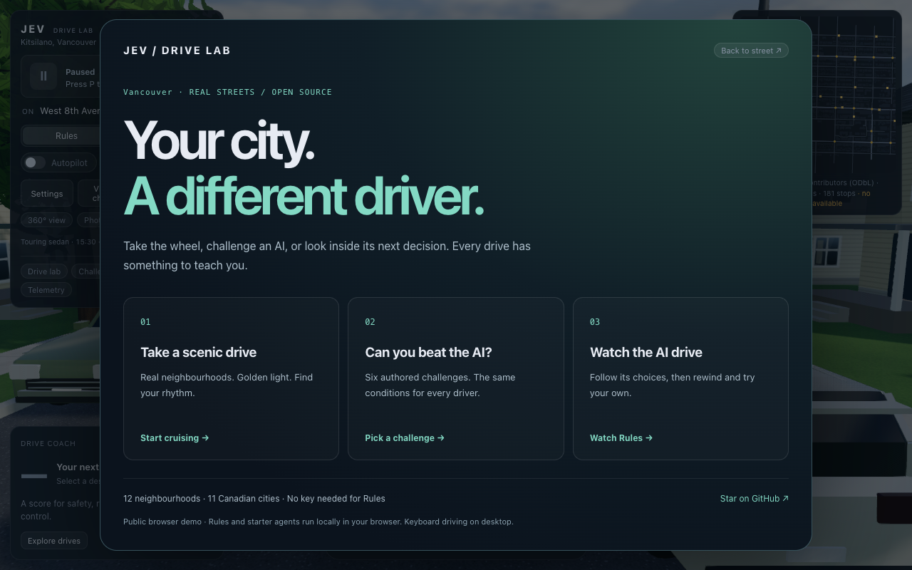
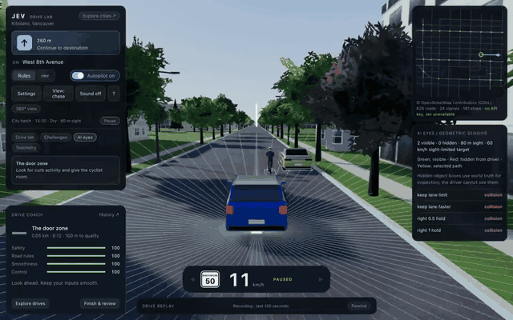
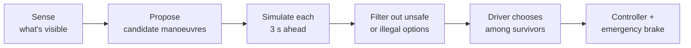

# Jev Drive Lab

**A driving simulator on real Canadian streets. Take on the same challenge as an AI driver, then
rewind and see why it made every choice.**

[**▶ Play it in your browser**](https://brendanh18.github.io/jev_fsd/) — no install, no account, no API key.



---

## Why this exists

Most self-driving demos ask you to trust a video. This one hands you the wheel.

Jev Drive Lab builds real neighbourhoods from OpenStreetMap: the roads, lanes, stop signs, traffic
lights and buildings. It lines the kerbs with parked cars and fills the streets with traffic,
cyclists and people on foot. Then
it lets you drive them yourself, or watch an AI driver do it. Every decision the AI makes is
recorded. You can pause the drive, scrub back to the moment a car door swung open, and see what the
driver could see, what it considered, and why it rejected each alternative.

It's part game, part teaching tool and part test bench for driving agents. The public demo runs
entirely in your browser.

> This is a research simulator. It is not, and is not meant to become, software for controlling a
> real vehicle.

## What you can do

### 🚗 Drive real neighbourhoods

Twelve neighbourhoods across eleven Canadian cities ship with the project, so the app works offline
once its dependencies are installed:

| Neighbourhood | City | | Neighbourhood | City |
|---|---|---|---|---|
| Kitsilano | Vancouver | | The Annex | Toronto |
| Mount Pleasant | Vancouver | | Le Plateau | Montréal |
| Old Town | Victoria | | Centretown | Ottawa |
| Beltline | Calgary | | Saint-Roch | Québec City |
| Downtown | Halifax | | Exchange District | Winnipeg |
| Old Strathcona | Edmonton | | Downtown & Nutana | Saskatoon |

Each city has its own house colours and a stylized backdrop on the horizon: Citadel Hill in
Halifax, a needle tower in Toronto, a river-valley truss bridge in Edmonton, the North Shore
mountains behind Vancouver.

Pick from six vehicles, including a city hatch, a sport coupe and a utility pickup. Each one has
its own dimensions, mass, power and handling. Then choose a paint colour, the weather (dry, rain,
fog or snow) and any time of day. The sun follows each city's real latitude, and street lights come
on at dusk.

### 🏁 Take on the challenges

Six hand-built scenarios test the situations real drivers get wrong:

| Challenge | Where | What it tests |
|---|---|---|
| **The door zone** | Kitsilano, afternoon | A parked car's door opens beside a cyclist |
| **Into the unknown** | Victoria, fog | A junction you can't see across |
| **Rain check** | Montréal, rainy night | A pedestrian crossing in poor light |
| **Winter composure** | Toronto, snow | A full stop on slippery roads |
| **Joining the flow** | Kitsilano | A car pulling out of a parking spot |
| **Around the corner** | Kitsilano | Someone stepping out from behind a building |

Drive them yourself, or set Rules, a decision model, an LLM or your own agent loose on the same
seed and compare results. A pass means you arrived with no collision, no red light or stop sign
run, no failure to yield, and less than a second off the road. A good coaching score on its own doesn't count.

### 🧠 See through the AI's eyes

Turn on **AI eyes** to see what the driver actually perceives. It shows which hazards are
visible, which ones buildings are hiding, how far it can see in the fog, the trajectories it
predicts for other road users, and the reason each candidate manoeuvre was rejected.



### ⏪ Rewind and try a different decision

The last two minutes of every drive are recorded. Scrub back, jump to the moment before an
incident, take over manually, switch to a different driver, or force one of the other manoeuvres
the AI considered. Then see how it plays out.

### 📸 Photo mode and the cinematic camera

Press **O** to freeze the world and step out of the car. The HUD disappears. You can orbit freely,
or let the cinematic director frame the shot, then adjust exposure, contrast, saturation, vignette
and even the time of day. **Save photo** downloads a clean PNG.

The **cinematic** camera (press **C** to cycle to it) works like a car film director. It cuts
between a roadside camera the car sweeps past, a low bumper chase, a slow helicopter orbit, a
tracking shot from ahead and a wheel-height side profile.

### 🤖 Three kinds of AI driver

The HUD has one button for each kind of driver, and keys `1`, `2` and `3` select them:

| Button | Key | What drives | Needs |
|---|---|---|---|
| **Rules** | `2` | Deterministic code that scores each safe manoeuvre | Nothing; free and offline |
| **Decision ▾** | `1` | A decision model: Jev, or another model that answers typed questions with probabilities | A key for a hosted model, or a local server |
| **LLM ▾** | `3` | Any chat model behind an OpenAI-compatible API | A key for a hosted model, or a local server |

The public browser demo runs Rules and your own browser agents. Decision models and LLMs need the
local app, whose server holds the keys.

**Decision models** answer typed questions with probabilities instead of writing text. Jev is the
built-in one. OpenRouter's Decisions API adds Perplexity Decider, Liquid d1, Microsoft Decision 1
and others, and llama.cpp runs open ones such as Kev 4B on your own computer. Click **Decision ▾ →
Connect a decision model…** and pick a provider:

- **TypeSafe**: paste a key and Jev turns on at once. Other Jev versions, such as `jev-preview`,
  can be added beside it for comparison.
- **OpenRouter**: the list of decision models and their prices loads without a key; paste a key
  to drive.
- **llama.cpp**: a server on this computer, no key.
- **Other**: any server that speaks the same protocol.

Every model other than the built-in Jev becomes a driver called `decision:<name>`, and each one
gets exactly the state and questions Jev gets, so comparisons are fair.

**LLMs** work through the OpenAI Chat Completions protocol, so OpenAI, OpenRouter, Groq, vLLM,
LM Studio, Ollama on your laptop and similar servers should all work. Click **LLM ▾ → Connect a
model**, pick a provider, paste a key and choose a model. Each one becomes a driver called
`llm:<name>`. The prompt is built from the same state Jev sees and lives in one file you can tweak.

Either way, the key is saved to `.env` on the local server and never reaches the browser, the
model drives straight away without a restart, and one OpenRouter key serves both kinds. The ▾
menus switch between your models, and each button drives with the last one you chose. You can
also list endpoints by hand in `data/decision-endpoints.json` and `data/llm-endpoints.json`
(templates are in `data/`). Every model picks among the same safety-checked manoeuvres; when an
answer is unusable, late or fails, Rules drives that step and the HUD says why. Both kinds of
endpoint have been tested only against local mock servers so far, not against a real provider.
The [agent guide](docs/agents.md#decision-models-jev-and-others) has the details and copy-paste
examples.

### 🧪 Bring your own agent and compare

Write a small JavaScript module with a `decide()` function, load it in **Settings**, and it drives
under the same physics, sensing and safety checks as the built-in drivers. The
[arena](http://127.0.0.1:8322/arena) runs the fixed challenge suite for any mix of Rules, decision
models, LLMs and your own agents, and compares safety, comfort, latency and cost. It saves
evaluations and lets you diff a run against a previous baseline. [`/bench`](http://127.0.0.1:8322/bench)
runs a seeded suite of routes for one driver. See the [agent guide](docs/agents.md) for a starter
template.

## Quick start

The fastest way to try it is the [browser demo](https://brendanh18.github.io/jev_fsd/). To run it
locally with the full feature set, install [uv](https://docs.astral.sh/uv/) and run:

```sh
git clone https://github.com/BrendanH18/jev_fsd
cd jev_fsd
uv run server.py
```

Open **<http://127.0.0.1:8322>** in a desktop browser with WebGL. There is no frontend build step.
Python 3.10+ is all you need, and uv fetches a suitable version if you don't have one.

### Controls

| Key | Action | | Key | Action |
|---|---|---|---|---|
| `W A S D` / arrows | Drive (and take over from autopilot) | | `C` | Cycle cameras |
| `Space` | Brake hard | | `O` | Photo mode |
| `J` | Toggle autopilot | | Drag / scroll | Orbit and zoom the 360° camera |
| `Q` / `E` | Left / right indicator | | `P` | Pause |
| `H` | Horn (with sound on) | | `R` | Reset to the lane |
| `1` / `2` / `3` | Decision / Rules / LLM driver | | `?` | Show every shortcut |

Click the minimap to set a destination, or open **Explore cities** for suggested drives. If keys
stop responding after you use a menu, click the road view to give it focus again.

### Enabling the Jev model (optional)

The free **Rules** driver and the cautious starter agent work out of the box. **Jev** is a
decision model served by [TypeSafe](https://console.typesafe.ai). To try it, click **Decision**
(or press `1`): the **Connect a model** dialog opens on TypeSafe. Paste your key and choose
**Save and drive**; Jev is available at once, without a restart. Or set it by hand:

```sh
cp .env.example .env
# then set TYPESAFE_API_KEY=... in .env and restart the server
```

Your key stays on the local server and is never sent to the browser. A spend cap
(`JEV_FSD_BUDGET_USD`, $1 per run by default) and a request-rate cap (`JEV_FSD_RPM`) limit live
model calls. The spend cap counts the cost a provider reports for each call (`usage.cost`, which
OpenRouter sends), else the configured prices; a call with neither counts as $0, and an endpoint
with `rpm: 0` also skips the rate cap. This project is independent and not affiliated with TypeSafe AI.

## How the AI drives

Every driver, whether it's Rules, a decision model, an LLM or yours, goes through the same loop for every decision:



Sensing is honest. Buildings block line of sight, fog and darkness shorten it, and traffic lights
you can't see are treated as unknown. Every driver shares the physics, the controller and the
emergency brake, so differences in results come from decision-making alone.

## Graphics

The renderer uses [Three.js](https://threejs.org) with no build step and a vendored runtime. In
**Settings → Graphics** you can choose:

- **Low**: direct rendering without post-processing, for older laptops.
- **High** (default): 4× multisampling with smooth leaf edges, SMAA, bloom, wet-road reflections
  and a cinematic colour grade.
- **Ultra**: adds ground-truth ambient occlusion, 4K shadow maps, sharper reflections and up to 2×
  pixel ratio (which supersamples in place of multisampling).

The sky is fully procedural. It has a physically placed sun and moon, stars, and a drifting cloud
deck lit from the sun's side. The clouds follow the weather, glow orange at dusk, pick up the
city's light at night, and show up in reflections on wet roads and car paint. Snow settles on
upward-facing surfaces, and rain darkens and polishes the asphalt. Tree shadows sway with the
leaves without crawling noise, and distant trees keep their colour and density.

## Development

```sh
uv run python -m unittest discover tests        # server, routing, maps, OSM pipeline, model endpoints
node scripts/test_drive_lab.mjs                 # drive lab and replay features
node scripts/test_arena_history.mjs             # saved evaluations and comparisons
node scripts/test_cinematic_photo.mjs           # cinematic camera and photo mode
node scripts/test_drive_score.mjs               # coaching score
node scripts/test_decision_agent.mjs            # decision-model drivers (registry, answers, fallback)
node scripts/test_llm_agent.mjs                 # LLM endpoint drivers (prompt, parsing, fallback)
node scripts/test_lane_change.mjs               # lane changes (gaps, lane ends, a pass, turn lanes)
node scripts/test_pull_out.mjs                  # pull-outs and a destination blocked by a parked car
python3 scripts/build_demo.py                   # build the static GitHub Pages demo
```

Every `scripts/test_*.mjs` file is a standalone Node check. Node 22 or newer runs them directly; CI passes `--experimental-default-type=module` too.
The [full reference](docs/project-reference.md#development) lists them all, along with the
Playwright browser checks. CI runs every check on every pull request: the Python tests, all Node
checks, the Jev fixture and offline request checks, and the browser, renderer and arena suites in
headless Chromium. It then builds the Pages demo and deploys it from `main`.

```
server.py          local HTTP server and API (stdlib only)
jev/               map fetching, OSM processing, routing, Jev client, decision-model and LLM proxies
static/js/sim/     physics, traffic, pedestrians, signals, scoring
static/js/brain/   sensing, candidate generation, safety filter, drivers
static/js/render/  Three.js scene, sky, weather, cars, buildings, cameras
static/js/ui/      HUD, Connect a model dialog, drive lab, photo mode
static/js/lab/     challenges, recorder, replay, arena
data/maps/         bundled neighbourhood map packs
data/*-endpoints.example.json   templates for your own decision-model and LLM endpoints
```

If you change physics, sensing or planning, run a seeded comparison on `/bench` before and after;
the committed Rules baseline is described in [docs/rules-baseline.md](docs/rules-baseline.md).
Contributions are welcome. Agents, new scenarios, accessibility fixes and neighbourhood details
are especially appreciated.

## Further reading

- [Drive lab, perception and replay](docs/drive-lab.md)
- [Decision models, LLMs and your own agent](docs/agents.md)
- [Scoring formula and driving details](docs/drive-experience.md)
- [Maps, attribution and custom extracts](docs/maps.md)
- [Rules benchmark baseline](docs/rules-baseline.md)
- [Rendering measurements](docs/render-performance.md)
- [Browser demo build and deployment](docs/browser-demo.md)
- [Full project reference](docs/project-reference.md)
- [Changelog](CHANGELOG.md)

## Credits

Map data © [OpenStreetMap contributors](https://www.openstreetmap.org/copyright), available under
the [ODbL](https://opendatacommons.org/licenses/odbl/1-0/). Rendering by
[Three.js](https://threejs.org) (MIT). Inspired by
[JevPilot](https://github.com/standardagents/jevpilot).

Released under the [MIT License](LICENSE).
