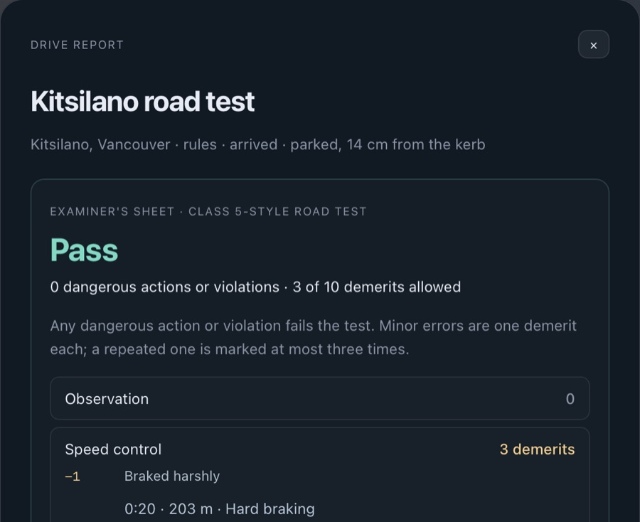
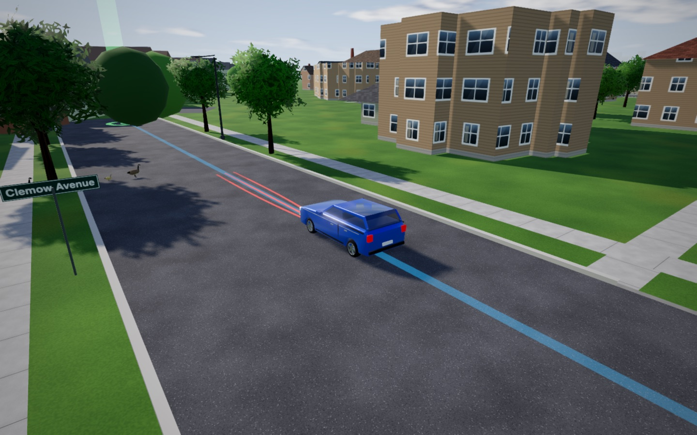
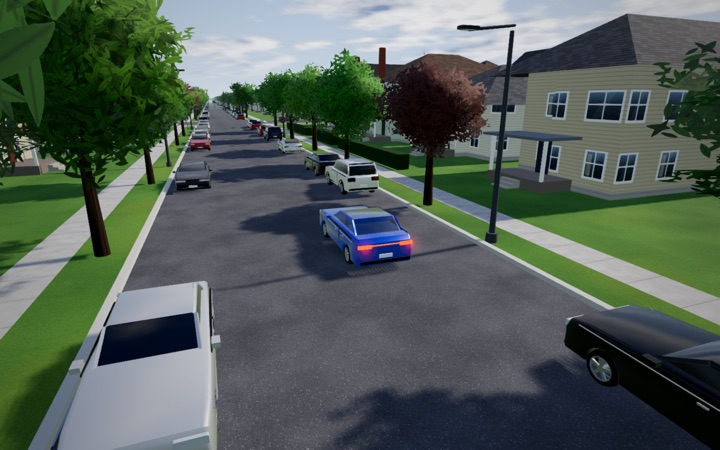
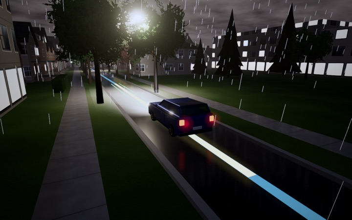
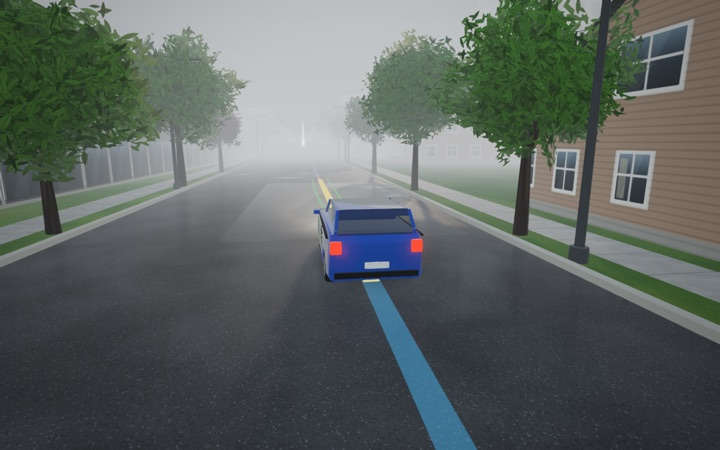
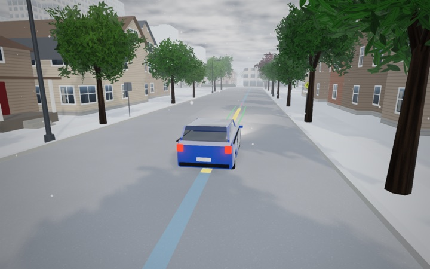
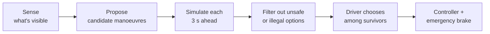

<div align="center">

# Jev Drive Lab

**A driving test for AI models, on real Canadian streets, that you can also take yourself.**

[**▶ Play it in your browser**](https://brendanh18.github.io/jev_fsd/) &nbsp;·&nbsp;
[**See how each AI drove**](https://brendanh18.github.io/jev_fsd/results.html) &nbsp;·&nbsp;
[**Run it locally**](#run-it-yourself)

No install, no account and no API key for the browser version.<br>
Try this first: open **Challenges**, choose **Flashing reds** and drive it yourself. Then let **Rules** take the same test.

</div>


<p align="center"><sub><b>Flashing reds</b>, Kitsilano: a school bus on the other side of the road has stopped, and a child is
crossing in front of it. Your lane is clear. Do you stop? (In BC you must.) The lines are what the driver can see.</sub></p>

---

Driving is mostly easy, and the rest of it happens in a couple of seconds. A ball rolls out from
between two parked cars. A van is double-parked and you can't see what's coming round it. The power's
out and the lights at Barrington and Morris are dark. Geese are crossing, and one of them has stopped
in your lane.

Jev Drive Lab puts those moments on real streets in twelve Canadian neighbourhoods, built from
OpenStreetMap, and gives the wheel to whoever you like: a hand-written rule set, a decision model, a
chat LLM, a JavaScript agent you wrote this afternoon, or you. The AI drivers share the same sensors,
the same candidate manoeuvres, the same controller and the same safety checks, so when two of them end
up with different results, it's because they made different decisions. You drive the same car on the
same streets and are marked by the same rules, with your own hands on the wheel.

Then you can rewind to the second before it went wrong, see what the driver saw and which options it
turned down, and take the wheel yourself.

> **Research simulator.** This is not, and won't become, software for controlling a real vehicle.

## What happened when we handed AI the wheel

The first full comparison ran in November 2026: two models and two hand-written drivers, each through
all 60 challenges and both road tests.

- **DeepSeek V4.1 Flash got stuck behind a van.** On Brunswick Avenue in Toronto, a delivery van is
  double-parked in your lane. DeepSeek stopped behind it and stayed there. It answered "stop" to 577
  of its 674 calls, though a safe way round was on offer at least 55 times, and after three minutes it
  ran out of time. Rules got round in 33 seconds. That was DeepSeek's only failure: **61 of 62**.
- **Jev passed all 62.** It made 12,096 of its 12,102 decisions itself, and the whole set cost
  $1.26 in model calls.
- **Rules passed its Class 5-style road test** with no violations and three demerits for braking
  harshly, the most a repeated fault can cost. Like a lot of new drivers.
- **Passing every challenge isn't the whole test.** The cautious starter agent passes all 62, then
  fails 6 of its 12 snowy city drives in Kitsilano. That's what the seeded city suite is for: ordinary
  routes with the city's hazards switched on.

Every published model drive is committed as a recording of each answer the model gave, so anyone can replay it
with one command, with no key and no model call ([how, and its limits](docs/model-results.md)). The
full table is [below](#results).

**One honest caveat.** An AI driver chooses among manoeuvres a shared safety filter has already
screened, with a controller and an emergency brake underneath. We measured how much that leaves to
the driver: in 55 of the 60 challenges, no option the filter let through led to a failure at any decision we
sampled. So for
now the challenges mostly test the filter, and the clearest way left to fail is DeepSeek's: by not
making progress. Making them tell drivers apart is the next phase of the [roadmap](ROADMAP.md)
([the measurement](docs/validation/driver-latitude-2026-11-14.md)).

## Take the test yourself

Everything an AI can drive, you can drive too, with the keyboard, a gamepad or a touch screen. You
don't get the safety filter or the emergency brake.

- **Practise the challenges.** Work through the library by city, skill or weather. Your clean,
  unaided runs are saved in your browser, and each drive ends with a debrief: what went wrong, the
  lesson behind the challenge, and links to rewind to each moment.
- **Book a road test.** There's a Class 5-style test in Kitsilano and a G2-style test in Toronto's
  Annex: a longer drive on a fixed route, an examiner giving directions, and an examiner's sheet at
  the end. Any dangerous action fails you, and minor errors cost demerits. Run an AI through the same
  test and see whether it passes the examiner. (They're styled on the provincial tests, not
  affiliated with any licensing authority.)
- **Or just drive.** Pick a city, a car, the weather and the time of day, and go. The sun follows
  each city's real latitude, street lights come on at dusk, and photo mode (`O`) and a cinematic
  camera (`C`) are there for the golden hour.

<p align="center"></p>

## Things that happen on these streets



Sixty hand-built challenges, each on a real street with its own weather, time of day and traffic.
Each one is a situation real drivers get wrong. A few of them:

| Challenge | What happens |
|---|---|
| 🪿 **Goose crossing**, Ottawa | A family of geese crosses Clemow Avenue between two parks, and one stops in your lane. Wait for the last one. |
| ⚽ **Chasing the ball**, Vancouver | A ball rolls out from between parked cars. Slow right down, because a child is about to run out after it. |
| 🚑 **Lights and sirens**, Edmonton | An ambulance comes up behind you just before a junction. Pull over and stop, but not in the junction. |
| 🔌 **Lights out**, Halifax | A storm has knocked out the signals. Treat the junction as an all-way stop and take your turn. |
| 🚋 **Behind the doors**, Toronto | A 511 streetcar stops beside you with its doors open. Its riders are about to cross your lane. |
| 🧊 **Bridges freeze first**, Saskatoon | Black ice on the Traffic Bridge, nearly invisible on a dry road. Ease off before you reach it. |
| 🚶 **All walk**, Victoria | A scramble crossing by the Empress. No right on red here, so wait through the all-walk. |
| 👮 **Follow the officer**, Toronto | An officer at Spadina and Bloor holds you on a green and waves you through a red. |

[See all sixty →](docs/challenges.md)

The rules are local. You can't turn right on red in Montréal, BC traffic stops both ways for a school
bus's flashing reds, and Ontario has pedestrian crossovers. A challenge **passes** only if the driver
arrives with no collision, no red light or stop sign run, no failure to yield and less than a second
off the road (and, in Squeeze in, parks within 30 cm of the kerb). A good style score doesn't save a
drive that broke a rule.

## See what the AI saw


Turn on **AI eyes** to see the world the way the driver sees it: which hazards it can see, which ones
a building is hiding, how far it can see in fog, where it thinks everyone else is going, and why it
turned down each manoeuvre it considered.

The last two minutes of every drive are recorded. Scrub back to the moment before a car door opened,
then take over, swap in a different driver, or make it try another manoeuvre that passed the safety
checks, and watch what happens.

## Bring any driver

| Driver | What it is | What you need |
|---|---|---|
| **Rules** | Plain code that scores each safe manoeuvre | Nothing. Free and offline. |
| **Decision models** | Jev, or another model that answers typed questions with probabilities, through TypeSafe or OpenRouter's Decisions API | A key, or a local server |
| **LLMs** | Any chat model behind an OpenAI-compatible API: OpenAI, OpenRouter, Groq, vLLM, LM Studio, Ollama… | A key, or a local server |
| **Your own agent** | A JavaScript module with one `decide()` function | A local clone and a text editor |

Your own agent can be this small. Save it as `static/js/agents/my-driver.js`:

```js
export default {
  id: "my-driver",
  label: "My driver",
  create: () => ({
    async decide(snap, eligible) {
      // eligible: the manoeuvres that passed the shared safety checks
      const best = eligible.reduce((a, b) => (b.sim.progress_m > a.sim.progress_m ? b : a));
      return { motion: "drive", candidateId: best.id,
        meta: { source: "my-driver", model: "my-driver",
                latency_ms: 0, input_tokens: 0, cost_usd: 0 } };
    },
  }),
};
```

Load it from **Settings → Local agent module**, then put it up against Rules, Jev and your favourite
LLM in the arena, which runs every challenge and compares safety, comfort, latency and cost. The
[agent guide](docs/agents.md) has the starter template and step-by-step setup for every provider.

## Results

<!-- results:start -->
| Driver | Model | 60 challenges + 2 road tests | City suite, Kitsilano: dry · fog · rain · snow | City suite, 11 other maps (dry) | Own decisions | Cost of the challenges |
|---|---|---|---|---|---|---|
| Rules | none | 62/62 | 12/12 · 12/12 · 12/12 · 12/12 | 20/22 | n/a | $0 |
| Cautious agent | none | 62/62 | 10/12 · 10/12 · 12/12 · 6/12 | 17/22 | 99.98% | $0 |
| Jev | `jev-1.14.0` | 62/62 | not run | not run | 99.95% | $1.26 |
| DeepSeek V4.1 Flash | `deepseek/deepseek-v4.1-flash-1017` | **61/62** (failed `double-parked`) | not run | not run | 99.01% | $2.55 |

Built from the committed records (2026-11-11 to 2026-11-14) by `scripts/build_results.py`, which also writes [`data/results.json`](data/results.json) with each row's source files; the [leaderboard](https://brendanh18.github.io/jev_fsd/results.html) shows every run and drive. Each city cell is the newest committed run (suite seed 1, lockstep clock, 40 traffic cars); a driver's runs may come from different dates. "Own decisions" are the share of the challenge decisions the driver made itself, not answered locally or by a Rules fallback. Model drives are recorded under `data/recordings/` and replay without a key. Details, failures and costs: [model results](docs/model-results.md) and [Rules baseline](docs/rules-baseline.md).

One-challenge pilots: GPT-6 Luna (`openai/gpt-6-luna`) 1/1 (door-zone); Liquid d1 (`liquid/d1-20260930`) 1/1 (door-zone); Granite 4.2 3B (`granite4.2:3b`) 2/2 (dont-splash, left-on-red).
<!-- results:end -->

## Twelve neighbourhoods, four kinds of weather, any hour

<table>
<tr>
<td width="50%"></td>
<td width="50%"></td>
</tr>
<tr>
<td width="50%"></td>
<td width="50%"></td>
</tr>
</table>

| Neighbourhood | City | | Neighbourhood | City |
|---|---|---|---|---|
| Kitsilano | Vancouver | | The Annex | Toronto |
| Mount Pleasant | Vancouver | | Le Plateau | Montréal |
| Old Town | Victoria | | Centretown | Ottawa |
| Beltline | Calgary | | Saint-Roch | Québec City |
| Downtown | Halifax | | Exchange District | Winnipeg |
| Old Strathcona | Edmonton | | Downtown & Nutana | Saskatoon |

The streets, lanes, signals, stop signs, marked crosswalks, bus lanes, speed humps and turn
restrictions come from OpenStreetMap, with sensible defaults where a tag is missing. The city around
them is full of traffic, cyclists and people on foot, plus buses, streetcars, snow plows, garbage
trucks, road crews and police officers directing traffic. Each city has its own house colours and
something on the horizon: Citadel Hill in Halifax, a river-valley truss bridge in Edmonton, the North
Shore mountains behind Vancouver. All twelve ship with the project, so it works offline.

## How a decision is made

Every AI driver goes through the same loop, every 650 ms on a clear road and every 250 ms near a
hazard:



- **Sensing is honest.** Buildings block the view, fog and darkness shorten it, and a light you can't
  see counts as unknown.
- **Only the choice differs.** Physics, the controller and the emergency brake are shared, so
  results come down to the decisions.
- **Runs repeat.** Seeded routes and a lockstep clock give the same numbers every time on the same
  simulation version and JavaScript engine. A recorded model run replays without the model; the
  [model results](docs/model-results.md) say which revision replays each published run exactly.
- **A wrong answer is never silent.** If a model's answer is late, malformed or fails, Rules drives
  that step, the HUD says so, and the fallback counts against the model.

## Run it yourself

The [browser demo](https://brendanh18.github.io/jev_fsd/) has Rules, the cautious starter agent, the
challenges and the road tests. To load your own agent or connect a model, run it locally. You need
[uv](https://docs.astral.sh/uv/), and uv fetches Python 3.10+ if you don't have it:

```sh
git clone https://github.com/BrendanH18/jev_fsd
cd jev_fsd
uv run server.py
```

Open **<http://127.0.0.1:8322>** in a desktop browser with WebGL. That's it: one Python dependency, no
frontend build, and every map included.

### Controls

| Key | Action | | Key | Action |
|---|---|---|---|---|
| `W A S D` / arrows | Drive (and take over from autopilot) | | `C` | Cycle cameras |
| `Space` | Brake hard | | `O` | Photo mode |
| `J` | Toggle autopilot | | Drag / scroll | Orbit and zoom the 360° camera |
| `Q` / `E` | Left / right indicator | | `P` | Pause |
| `H` | Horn (with sound on) | | `R` | Reset to the lane |
| `1` / `2` / `3` | Decision / Rules / LLM driver | | `?` | Show every shortcut |

A gamepad works too, and on touch screens the controls appear on screen
([details](docs/drive-experience.md#gamepad-and-touch)). Click the minimap to set a destination, or open
**Explore cities** for suggested drives.

### Connecting a model

Click **Decision ▾** or **LLM ▾**, choose **Connect a model…**, pick a provider (TypeSafe for Jev,
OpenRouter, Ollama, or any OpenAI-compatible server), paste a key and choose **Save and drive**. It
starts driving straight away, without a restart, and one OpenRouter key covers both kinds.

Keys are saved to `.env` by your local server and are never sent back to the browser. A spend cap
(`JEV_FSD_BUDGET_USD`, $1 per server run by default) and a rate cap (`JEV_FSD_RPM`) keep live runs
from surprising you. To set Jev up by hand instead:

```sh
cp .env.example .env    # then set TYPESAFE_API_KEY=... and restart the server
```

This project is independent and not affiliated with TypeSafe AI. Every provider, and how the spend
cap counts, is covered in the [agent guide](docs/agents.md#decision-models-jev-and-others).

## Contributing

This project gets better with local knowledge more than with anything else. If you drive one of these
streets and the simulator gets something wrong (a turn that's actually banned, a crosswalk in the wrong
place, a rule your province does differently), please
[open an issue](https://github.com/BrendanH18/jev_fsd/issues). Other especially welcome contributions:

- **A driver.** Write an agent, or connect a model you're curious about, and share how it did.
- **A challenge.** Something you've seen go wrong on a real road. See
  [adding a challenge](docs/adding-a-challenge.md).
- **A city.** New maps are Canadian, ideally one that brings a rule or a road layout the others
  don't have ([custom maps](docs/reference/custom-maps.md)).
- **Accessibility fixes** of any size.

What's planned next is in the [roadmap](ROADMAP.md).

### Development

```sh
uv run python -m unittest discover -s tests                  # Python: server, routing, maps, OSM pipeline, endpoints
node --experimental-default-type=module scripts/test_drive_lab.mjs   # one of the standalone Node checks
python3 scripts/build_demo.py                                # build the static GitHub Pages demo
```

Each `scripts/test_*.mjs` file is a standalone Node 22 check. The
[development reference](docs/reference/development.md) lists them all, along with the browser suites.
CI runs every check on every pull request and deploys the demo from `main`. If you change physics,
sensing or planning, run a seeded `/bench` comparison before and after against the
[Rules baseline](docs/rules-baseline.md).

```
server.py          local HTTP server and API (stdlib only)
jev/               map fetching, OSM processing, routing, Jev client, decision-model and LLM proxies
static/js/sim/     physics, traffic, pedestrians, signals, scoring
static/js/brain/   sensing, candidate generation, safety filter, drivers
static/js/render/  Three.js scene, sky, weather, cars, buildings, cameras
static/js/ui/      HUD, Connect a model dialog, drive lab, photo mode
static/js/lab/     challenges, road tests, recorder, replay, arena
data/maps/         bundled neighbourhood map packs
```

## Further reading

- [The sixty challenges](docs/challenges.md) and the [drive lab, AI eyes and replay](docs/drive-lab.md)
- [Model results](docs/model-results.md) and the [Rules baseline](docs/rules-baseline.md)
- [Decision models, LLMs and your own agent](docs/agents.md)
- [Drive coach, scoring and driving details](docs/drive-experience.md)
- [Maps, attribution and custom extracts](docs/maps.md)
- [Rendering measurements](docs/render-performance.md) and the [browser demo build](docs/browser-demo.md)
- [Full project reference](docs/reference/README.md), [changelog](CHANGELOG.md) and [roadmap](ROADMAP.md)

## Credits

Map data © [OpenStreetMap contributors](https://www.openstreetmap.org/copyright), available under the
[ODbL](https://opendatacommons.org/licenses/odbl/1-0/). Every street here exists because someone mapped
it. Rendering by [Three.js](https://threejs.org) (MIT). Inspired by
[JevPilot](https://github.com/standardagents/jevpilot).

Released under the [MIT License](LICENSE).
