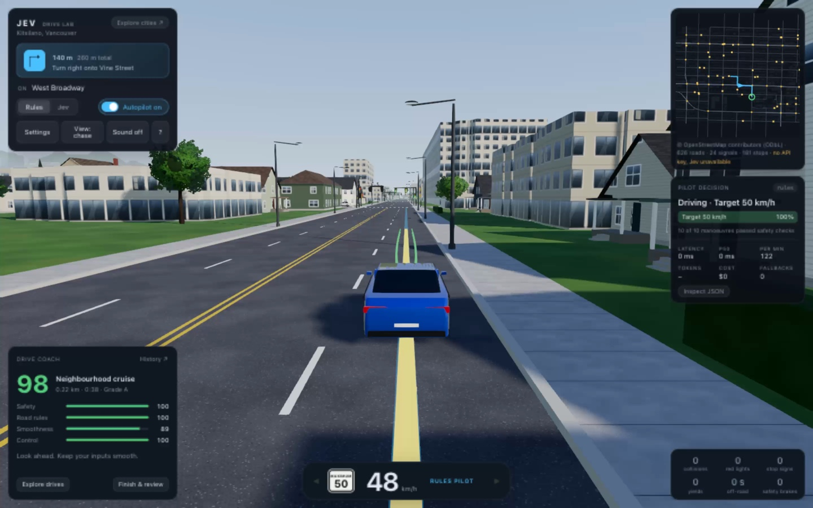
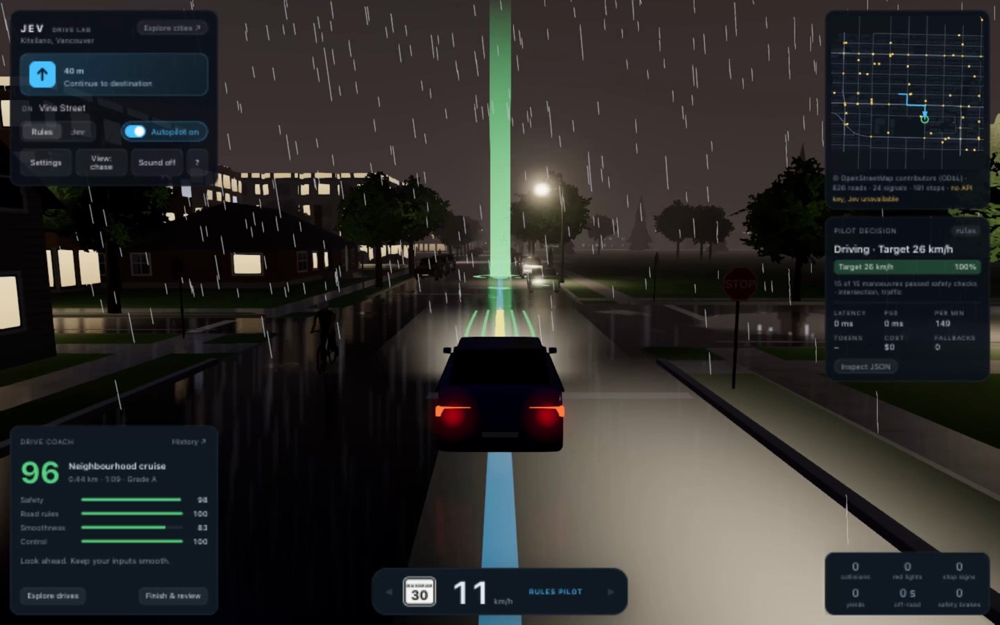
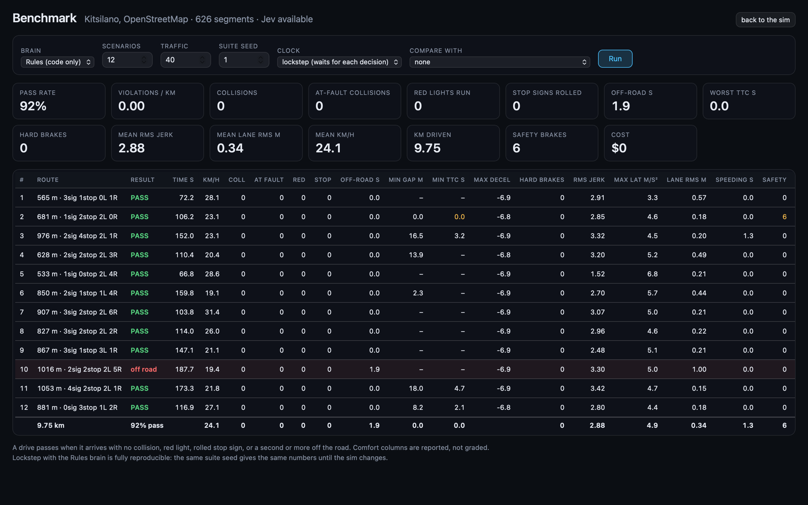

# Jev FSD

**Drive real Canadian streets, watch an AI choose its next move, and improve your driving score.**

Jev FSD is a local driving simulator built from [OpenStreetMap](https://www.openstreetmap.org/)
roads and buildings. Explore twelve neighbourhoods across eleven Canadian cities by hand, with the free
Rules driver, or with [TypeSafe AI's Jev](https://typesafe.ai/). The decision panel shows the
situation, available manoeuvres, model probabilities, latency and API cost.

Choose a suggested route, take the wheel, and review your drive for safety, road rules,
smoothness and control. Traffic parks and pulls out, car doors open, pedestrians cross, and
weather changes both visibility and grip. The driving HUD keeps turn guidance, speed, live
coaching and the pilot's latest decision visible while you drive.



> This is a research and demo simulator, not a system for controlling a real vehicle. The project
> is independent and is not affiliated with or endorsed by TypeSafe AI.

## Quick start

Install [uv](https://docs.astral.sh/uv/) and use a desktop browser with WebGL. The app needs
Python 3.10 or newer; `uv` manages Python and the project dependency.

```sh
git clone https://github.com/BrendanH18/jev_fsd
cd jev_fsd
uv run server.py
```

Open [127.0.0.1:8322](http://127.0.0.1:8322). Without an API key, the app selects the free Rules
driver. There is no frontend build step; the simulation and renderer use JavaScript and Three.js,
and the local server uses Python. The pinned Three.js runtime and all twelve map packs are bundled,
so driving with Rules needs no external network after installing the Python dependencies.

Try **Explore cities → Victoria → Neighbourhood cruise**. A suggested drive starts the selected
autopilot; `W A S D` takes over manually. You can also click a destination on the minimap or
start a free drive with the keyboard. Cycle **View** to hood view and enable **Sound** for driving
ambience. Open **Settings** to change weather, time and graphics, or press `?` for keyboard help.

To enable Jev, obtain a key from the [TypeSafe console](https://console.typesafe.ai), click
**Decision** (or press `1`), paste the key under **TypeSafe** and choose **Save and drive**. The
server saves it to `.env` as `TYPESAFE_API_KEY` and Jev is available at once. Or create the file
by hand:

```sh
cp .env.example .env
# Set TYPESAFE_API_KEY in .env, then restart the server.
```

The key stays on the server. Jev sends decision requests to TypeSafe; Rules driving, drive
scoring and the bundled maps need no API key.

## Explore twelve Canadian neighbourhoods

The city picker includes neighbourhood-sized extracts of real roads, one-way streets, lane
and speed-limit tags, traffic controls and buildings. All twelve processed map packs are bundled.
Search by city or neighbourhood, and filter by region and road character. The explorer keeps
your search and keyboard focus while loading maps or finding routes, and offers retries on errors.

| City | Neighbourhood | Direct simulator URL |
|---|---|---|
| Vancouver | Kitsilano | [/?map=kitsilano](http://127.0.0.1:8322/?map=kitsilano) |
| Vancouver | Mount Pleasant | [/?map=mount_pleasant](http://127.0.0.1:8322/?map=mount_pleasant) |
| Victoria | Old Town | [/?map=victoria](http://127.0.0.1:8322/?map=victoria) |
| Toronto | The Annex | [/?map=toronto](http://127.0.0.1:8322/?map=toronto) |
| Montréal | Le Plateau | [/?map=montreal](http://127.0.0.1:8322/?map=montreal) |
| Calgary | Beltline | [/?map=calgary](http://127.0.0.1:8322/?map=calgary) |
| Ottawa | Centretown | [/?map=ottawa](http://127.0.0.1:8322/?map=ottawa) |
| Québec City | Saint-Roch | [/?map=quebec_city](http://127.0.0.1:8322/?map=quebec_city) |
| Halifax | Downtown | [/?map=halifax](http://127.0.0.1:8322/?map=halifax) |
| Winnipeg | Exchange District | [/?map=winnipeg](http://127.0.0.1:8322/?map=winnipeg) |
| Edmonton | Old Strathcona | [/?map=edmonton](http://127.0.0.1:8322/?map=edmonton) |
| Saskatoon | Downtown & Nutana | [/?map=saskatoon](http://127.0.0.1:8322/?map=saskatoon) |

**Explore cities** offers three reachable drives from your current position: **Neighbourhood
cruise**, **City precision** and **The long way home**. The world pauses while choosing a route
or reading a drive report. Changing cities keeps your weather, time and graphics settings.
Routing, rerouting, benchmarks and 3D benchmark replays use the selected city's map.

The sun uses each city's latitude, longitude and late-September daylight-time offset.
Vancouver's mountains, water and landmark backdrop appear only on Vancouver maps. These packs
have no elevation data; building heights come from tags or procedural estimates.
See [map coverage, attribution and refresh instructions](maps.md).

**Settings** includes a six-car garage, six paint colours, traffic-car density, a repeatable world
seed and **Start new world**. Choose a city hatch, touring sedan, sport coupe, estate wagon,
trail SUV or utility pickup; start a new world to apply your selection. Each driven model has
its own dimensions, mass, wheel power, drive layout and centre of gravity. Collision checks,
stopping distances, candidate predictions and cameras use the selected vehicle. Vehicle names
and specifications describe generic simulated cars.
Changing density or seed restarts the world and saves a non-empty active drive. A quiet world
still has cyclists, pedestrians and curb activity. URL options include `?traffic=16&seed=42`.
The daylight clock can remain fixed, run in real time or advance one minute per simulated second
(`?clock=0`, `1` or `60`). Pausing also pauses daylight. The conditions strip shows local time,
weather and forward sight range, with a visible Pause/Resume button.

## Drive coach and reports

A live card scores each drive out of 100 and offers coaching as you go. Manual driving, Rules
and Jev use the same deterministic scoring model; scoring makes no model calls.

| Category | Weight | What it measures |
|---|---:|---|
| Safety | 40% | collisions, time to collision and following gaps |
| Road rules | 30% | red lights, missed stops, failed yields and speeding |
| Smoothness | 20% | harsh braking, hard cornering and high jerk |
| Control | 10% | time off-road, wrong-way driving and lane resets |

Arrival opens a report automatically. **Finish & review** ends a drive manually; **History**
shows the last 20 reports stored in this browser, and **Export JSON** saves a report with its
event timeline and scoring-model version. Starting a replacement route or changing cities
saves a non-empty drive without claiming arrival.

Grades require at least **100 m and 10 seconds**. Short sessions remain practice drives. A
collision caps the total at 59; a red light or failed yield caps it at 69. Waiting at lights,
pausing and driving slowly carry no penalty. Emergency braking can reduce smoothness even when
it is the safer choice. Scores use the full simulated world, including hazards the driver
could not see; use the seeded benchmark for controlled driver comparisons.

See [the scoring formula, thresholds and report behaviour](drive-experience.md).

## Driving HUD

The redesigned HUD groups route guidance, driving instruments and pilot feedback:

| Area | What it shows |
|---|---|
| Left column | City and current street, next turn and distance, Rules / Decision ▾ / LLM ▾ buttons, autopilot switch, Settings and live drive coach |
| Instrument cluster | Speed in km/h, mapped speed limit, indicators and manual, pilot or paused mode |
| Right column | Minimap, latest pilot decision, candidate probabilities, latency, tokens, cost, fallbacks and incident counts |

The trip card gives turn-by-turn guidance during both manual and autopilot driving. Speed and
limit highlights use the same 5 km/h speeding grace as the drive coach.

The **Pilot decision** card displays candidate speeds in km/h and up to five probability rows,
keeping the executed candidate visible when it has a probability. Rules probabilities describe
a deterministic choice, not model confidence. Jev responses have a green label; Rules fallbacks
have an amber label and no model probabilities. Locally resolved choices may also have no
probabilities. Turning autopilot off clears the latest latency and token fields; cost and p50
remain session statistics.

At widths of 900 px or less, the decision and incident cards are hidden and **Inspect JSON**
is available under **Settings**. Short screens hide category bars and secondary telemetry;
the HUD columns scroll to keep settings and drive actions reachable. At very narrow widths,
the minimap and compact instruments sit below the left column. Driving still requires a
keyboard; there are no touch driving controls. HUD animations and transitions respect the
system's reduced-motion preference.

## Controls and driving feel

| Key or control | Action |
|---|---|
| Click the minimap | Set a destination and start autopilot |
| `W A S D` or arrows | Drive manually and take over from autopilot |
| `Space` | Brake hard |
| `J` | Toggle autopilot |
| `1` / `2` / `3` | Select the decision model / Rules / the LLM (also available as buttons; ▾ picks the model) |
| `Q` / `E` | Toggle left / right indicators |
| `H` | Horn when sound is enabled |
| `C` or **View** | Cycle chase, 360°, hood, overhead, high chase and cinematic cameras |
| `O` or **Photo mode** | Freeze the world, hide the HUD, adjust the look and save a PNG |
| **360° view** or drag the driving view | Orbit freely around the car; follows it as you drive |
| Wheel / pinch / camera + − | Zoom the 360° view |
| Shift + arrow keys (view focused) | Rotate the 360° view without steering |
| **Recenter** | Return the 360° camera behind the car |
| `R` / `P` | Reset to the lane / pause |
| `?` or `/` | Toggle keyboard shortcuts |
| `Escape` | Leave photo mode, or close keyboard shortcuts or the decision inspector |
| **Explore cities** / **Explore drives** | Pick a city or suggested route |
| **Finish & review** / **History** | Review the current drive / saved drives |
| **Inspect JSON** | Open the decision inspector; on narrow screens, find it under **Settings** |
| **Settings** | Weather, time, graphics quality, wipers and camera motion |
| **Sound** | Toggle driving audio |

Use `Tab` to reach controls. The Rules / Decision / LLM group has one tab stop; arrow keys,
`Home` and `End` select a driver. Decision remains visible when no decision model is usable;
arrow keys skip it, and clicking it opens **Connect a model** on TypeSafe. Focused controls retain their normal keyboard behaviour; click the road view
to use WASD, Space or arrows for driving. Driving shortcuts are ignored in form fields and
open dialogs, and shortcuts with Ctrl, Cmd or Alt keep their normal browser behaviour.

Keyboard steering ramps gently and limits cornering demand at speed while retaining full lock
for low-speed manoeuvres. Vehicles, cyclists, pedestrians and the camera interpolate between
physics steps for smoother motion. Physics, sensing and scoring still use fixed-step state.

Hood view adds windshield trim, rain beads and two sweeping wipers, with optional acceleration
and cornering motion. Procedural audio provides motor, tire, road and rain sounds, indicator
clicks and a horn; it starts after enabling sound and fades while paused or hidden.
Manual indicators cancel after a completed turn or 12 seconds, and a speed warning highlights
speeding.

## Graphics and recent rendering fixes



The sky draws a drifting procedural cloud deck. Each cloud is lit from the sun's side, with a
silver rim near the sun. Coverage follows the weather: scattered fair-weather cumulus when dry and
a continuous low deck in rain or snow; fog hides it. At dusk the clouds take the sun's colour, and
at night they reflect the city's glow. Wet roads and car paint reflect the same clouds through the
environment map.

On High and Ultra, a grade pass after tone mapping sets contrast, saturation, a time-of-day tint
(warm at golden hour, cool at night) and a soft vignette. It also adds a ±½-step dither that removes
8-bit banding in smooth sky gradients.

The **cinematic** camera cuts automatically between five shots: a roadside camera the car sweeps
past, a low bumper chase, a slow helicopter orbit, a tracking shot from ahead and a wheel-height
side profile. **Photo mode** (`O`) pauses the world and hides the HUD. You can frame the car with
the free, cinematic, chase or hood camera. Sliders set exposure (±2 EV), contrast, saturation,
vignette and time of day. **Save photo** downloads the rendered frame as a PNG at the canvas
resolution; the controls are never included. Leaving photo mode restores the previous camera,
the default look and the previous pause state.

Parked cars and trees use distance-based detail to reduce distant geometry. Nearby scenery
retains detailed meshes and shadows, while hysteresis prevents repeated detail switches around
the distance threshold. Static scenery transforms are computed once.

Road layers share a stable ground depth. Wet reflections no longer sample their own render
target, and reflection and main passes share the same shadow maps and scenery detail within
each frame. These changes address road flicker, inconsistent shadows and wet-rendering errors.

Street-name and speed-limit signs use correctly proportioned printed rectangles, bolder street
lettering, padded atlas cells and up to 8× anisotropic filtering. Text reads correctly from
both sides. The signs keep their shared 2048² atlas and batched meshes. Driving instruments,
the drive coach, incident panel and windshield trim are opaque, and persistent HUD panels
avoid backdrop blur, so green scenery cannot bleed through the opaque surfaces.

HUD text and statistics refresh at most 10 times per second and skip unchanged DOM writes.
The decision card rebuilds only when a decision or autopilot state changes. These changes
reduce DOM work while physics and pilot decisions keep their existing cadence.

| Preset | Rendering |
|---|---|
| Low | Direct rendering at 1× pixel ratio, 2048 shadows, no post-processing or wet reflections |
| High | 1× pixel ratio, 2048 shadows, bloom, SMAA and quarter-size wet reflections |
| Ultra | Up to 2× pixel ratio, 4096 shadows, ambient occlusion and half-size wet reflections |

High is the default. URL options also work, for example
[Victoria in rain at night](http://127.0.0.1:8322/?map=victoria&weather=rain&time=night&quality=high).
Time accepts presets or a clock value such as `?time=17:45`.

Measured GPU work fell in the recorded rendering comparisons, but the high preset also uses
fewer pixels and effects than the earlier version. Those measurements do not establish a
frame-rate guarantee or an equal-quality speedup. See [rendering measurements, tradeoffs and
profiling instructions](render-performance.md).

## Simulation and decision making

The car uses a dynamic bicycle model with saturating tire forces, weight transfer, power-limited
acceleration, actuator lag, drag and stability assistance. The same physical model runs traffic
cars and candidate predictions. Rain and snow reduce grip.

Traffic follows lanes, obeys signals, yields at junctions and crossings, changes lanes, reserves
curb parking, pulls in and waits for gaps before pulling out, looking again until it is moving. Parked cars can open a street-side
door for six seconds; the animated door has matching sensing, prediction and collision geometry.
Cyclists ride bike routes, keeping right: where a street's parking lane is empty to the end of the
block they ride in it, past cars queued at the corner, and move back into the traffic lane before
the next parked car once nothing is beside them. A car turning right, the driven car included,
waits for a cyclist coming up on its right (a right hook). Pedestrians cross at signals, at the
marked crosswalks between junctions (half of those walking past one cross there, stepping off once
nothing coming is too close to stop for them, BC MVA s. 179) or sometimes mid-block, and carry
umbrellas in rain. A vehicle in traffic hides a person behind it from the driver. Nobody may pass a
vehicle stopped at a crosswalk (BC MVA s. 179(3)): the driven car coming up beside one in another
lane stops 3.5 m short of the crosswalk's centre, if it could do that braking at up to 3.5 m/s^2
when it first saw it, and goes on once it has stood still there for 2 s (see
`static/js/sim/crosswalk.js` and [maps.md](maps.md#crosswalks)). In a free drive an ambulance or a fire truck
answers a call now and then, lights flashing and siren wailing (with **Sound** on), coming up
behind the car, toward it or across the junction ahead; everyone pulls over to the right, clear of
any junction, and stops until it has gone by (`?emergency=0` turns them off). Buses run their
real routes (up to four at a time, `?buses=0` takes them off) and stop at the routes' real stops:
they signal, pull in to the curb, wait 10 to 25 s with their doors open, signal left and pull out.
Where the limit is 60 km/h or less, traffic and the driven car coming up behind a bus at a stop
that is signalling to pull out let it go first (BC Motor Vehicle Act s. 169.1) when they can stop
2 m behind it braking at up to 3 m/s^2; nobody parks in a bus zone, and traffic eases left in its
lane to get past a bus standing at its stop. See `static/js/sim/bus.js` and
[maps.md](maps.md#bus-routes) for where the routes come from. On the school run (7:00 to 17:00)
two school buses drive the streets (`?schoolbuses=0` takes them off) and every 150 to 400 m stop in
their lane, mid-block on a two-way street with one lane each way and a limit of 50 km/h or less, to
let one to three children off: ambers flashing as they slow, then reds and the stop arm. Some of
the children cross the street in front of the bus. Traffic both ways and the driven car stop for a
school bus with its reds flashing (BC Motor Vehicle Act s. 149), 5 m behind it or 10 m short of its
front, when they can stop there braking at up to 3.5 m/s^2, and wait until the reds go off; the bus
keeps them on until its children are across. See `static/js/sim/school-bus.js`.

School and playground zones (BC Motor Vehicle Act s. 147) come from each map's schools and
playgrounds in OpenStreetMap ([maps.md](maps.md#school-and-playground-zones)). Where one is in
effect the limit is 30 km/h, never more than the street's own: a school zone's from 8:00 to 17:00 (the
sim has no calendar, so every day is a school day), a playground zone's from dawn to dusk (while the
sun, as the sky draws it, is above -6 deg). The world's road info reports the zone's limit and the
zone, so the HUD's limit sign turns yellow-green and says SCHOOL or PLAYGROUND, the coaching score
counts speeding against it (and says so once a visit), and Rules keeps to it. Rules also slows on
the way in, to be at the zone's limit as its front reaches the sign, and traffic keeps to it from
15 m before. Signs stand where each stretch of zone starts and, short of the end of its street, where
it ends. AI eyes outlines the zones in effect nearby in yellow-green. The seeded benchmark drives no
zones (its world has no clock); a benchmark replayed in the app likewise. See
`static/js/sim/speed-zones.js`.

Slow down, move over (BC Motor Vehicle Act Regulations s. 47.02): in a free drive two vehicles stand
at the roadside with their lights flashing at any time (`?roadside=0` takes them off), each in two
bays of a street's right-hand parking lane, 150 to 450 m from the car and out of its sight, for 2.5
to 6 minutes, leaving once the car is well away: a tow truck (amber lights) in front of the car it is
about to tow, or a police car (red and blue) behind the car it has pulled over. They are parked cars
that never pull out or open a door, so traffic, cyclists and collisions treat them as such. Passing
one going its way, from 30 m short of its rear until past it, the limit is 40 km/h (70 where the
street's is 80 or more): traffic keeps to it in every lane from 40 m before that, and Rules keeps to
it from the way in, as the snapshot's `limit`. In the lane next to it, where another lane goes the
car's way, the car is offered a `move_over` lane change to the left (not within 5 m of it, and only
into a lane that runs on past it), and Rules takes it and stays out of that lane until past it, if
it safely can. The coaching score counts passing too fast and passing it in the lane next to it,
each once a vehicle, with a tip; the HUD says "TOW TRUCK · LIGHTS FLASHING · SLOW TO 40 · MOVE OVER",
and AI eyes outlines it in amber. The seeded benchmark and the other challenges have none. See
`static/js/sim/roadside.js`.

Buildings, tree trunks, signposts, signal poles, street lamps, porches and hedges physically block
the driven car and candidate predictions. Rendering and collisions share deterministic scenery
placements. Swept checks stop the car before penetration and count contact once until it separates;
collision scoring applies. Trunk radii follow the model, while overhead crowns remain passable.
Stop-line auditing and the planner share route controls while the car follows its route, so a
completed stop is remembered even when the rear axle remains on an adjacent road segment.

Buildings block the driver's view of traffic, pedestrians and signals. Daylight detection range is
**80 m dry, 55 m rain, 40 m snow and 28 m fog**. Darkness reduces forward low-beam sight to
45 m and unlit peripheral sight to 22 m, with a smooth twilight transition; weather caps both.
These sight limits feed actual sensing and speed planning. Unseen signal phases are treated as unknown,
and planning limits speed to stopping within visible road. Predictions and the emergency brake
use observed hazards; collisions and violations are audited against the full world.

Every 250 ms of simulated time near hazards, or 650 ms on open road, the shared driving pipeline:

1. **Senses** the visible world and projects the car onto its route.
2. **Proposes** up to 16 manoeuvres, including speed changes, small lateral shifts, lane changes and stops.
3. **Simulates** each manoeuvre three seconds ahead and rejects unsafe or illegal options.
4. **Chooses** among the survivors using Rules, a decision model (Jev or another) or an LLM.
5. **Executes** the chosen manoeuvre while the next decision is pending.

Jev answers typed multiple-choice questions with probabilities; other decision models
([agent guide](agents.md#decision-models-jev-and-others)) receive the same questions and answer
the same way. Rules scores the same candidate set locally. Both share sensing, safety filtering, physics and the controller. Jev reads
`driving_style`; Rules uses a fixed score. If Jev exceeds 1.5 seconds, returns an invalid choice
or errors, Rules handles that step and the fallback counter increases. Settled questions can
be answered locally without an API call.

On streets with more than one lane in its direction, the car can change lanes. A change into
the next lane is offered to pass a vehicle ahead that is stopped, is a cyclist, door or parking
car, or is at least 2.5 m/s slower than the car would drive. A pass needs at least 80 m of lane
beside the route, no stop line within 25 m and no queue at a junction just ahead. While the car is
outside its route's lane, a return is offered except in the 8 m before a stop line. A change needs
a gap in the target lane: 6 m plus 2 s of closing speed to the vehicle ahead and 6 m plus 2.5 s to
the one behind, and nothing alongside. The car signals and eases across over about 3.5 s of travel
(18–50 m), or more sharply (down to 12 m) to finish before the lane it is leaving ends; with less
room than that it waits. Any manoeuvre that would keep the car outside its route's lane too close to where that
lane ends is rejected. That point can be a turn, a junction where the lanes change, or the
destination. Without a gap the car slows in its lane and waits. Rules weighs a lane change and
time outside the route's lane as small costs, so it passes only for a clear gain and returns once
there is room. Abandoning a change already under way is offered but costs more, so Rules finishes
a change unless finishing it is no longer safe. Decision models and LLMs see the lanes and the gaps beside the car, and the
situation tells them when a change is on offer.

Before a turn the router takes the turn lane on the last block, so its route line slides across
the lanes at the junction before that block. The car does not follow that slide. From 150 m before
it, the turn lane counts as the route's lane, so the car signals and changes into it with the same
gap checks, then holds it while the route line moves across. It has to be in the lane before the
turn. A slow or stopped car in the turn lane within 150 m of the turn is treated as a queue: the car
doesn't pass it, and Rules doesn't drive past it in the next lane, because that lane's extra speed
gains nothing. This applies where the block before the turn continues the street straight on with
the same lanes; where the lane count or layout changes at that junction, the route line still
slides across inside it.

At an all-way stop, vehicles go in the order they stopped at their lines (`static/js/sim/all-way.js`),
for traffic and the driven car alike. A vehicle joins the order when it stops within 6 m of its
line. Two that stop within a second of each other go right before left: the one on the right goes
first, and from opposite sides a left turn waits for the other. From opposite sides, two vehicles
that are not turning left go together, and so do two opposing left turns. A vehicle that has set
off on its turn keeps the right of way until it is 6 m past the junction's centre. If everyone waits
for someone (four cars stopping together), the first to stop goes. The driven car senses only the
vehicles it can see, so it may go before a hidden one; the audit counts going out of turn as a
failure to yield whether or not the car could see who stopped first. Decision models and LLMs get
`intersection.priority` and a situation line. Turning left at a stop sign, once its stop is made and
it is its turn, the car yields to oncoming traffic as at a signal. The stop-sign oncoming audit
applies to left turns and U-turns; a straight or right departure is not an oncoming yield
violation. Without a route, the audit judges the actual turn rather than the indicator.

The decision inspector exposes requests, answers, confidence, timing and spend; decisions can
be saved or copied as `curl` commands. The emergency brake responds to imminent observed
collisions, not traffic-rule violations, so driving mistakes remain visible. It brakes at 8 m/s²
while still steering along the manoeuvre the car was following.

## Benchmarks and validation



Open [/bench](http://127.0.0.1:8322/bench), or use **Benchmark this city** in the explorer.
The benchmark runs seeded drives through the same simulation and autopilot without graphics.
**Lockstep** pauses while decisions are pending; **realtime** keeps the world moving so model
latency affects the drive. Runs save under `data/runs/`, support side-by-side comparison and
open as 3D replays on their recorded map.

A benchmark drive passes only if it arrives with no collision, red light, rolled stop or failed
yield, and less than one second off-road. A car arrives within 3.5 m of its destination, or
within 10 m, stopped on its route and in the route's lane, when every manoeuvre along that lane
that would get it closer hits a parked car or static scenery. It also reports comfort, lane keeping (measured from
the centre of the lane the car is in or moving into), lane changes, fault, safety
brakes, gaps, tokens, cost and latency. This pass criterion is separate from the live coach's
weighted score.

Recorded validation includes a 500 m Rules drive through Victoria in rain with no audited
collision, red-light, stop or yield violations and a score of 97. The
[2026-10-20 Rules baseline](rules-baseline.md) is the current seeded record. In WebKit, the
12-route Kitsilano suite passed 12/12 dry, 11/12 fog, 12/12 rain and 12/12 snow, and every route
arrived; all eleven two-route city smoke suites passed. In V8 every Kitsilano route passed and
Edmonton's smoke suite failed one route.
Results vary between JavaScript engines, so compare runs from the same browser. These are
individual recorded checks, not guarantees for every city or seed. Live Jev behaviour with the revised prompt has
not been validated; offline fixtures establish request consistency, not model judgment.

Detailed results: [Rules benchmark baseline](rules-baseline.md), [drive experience](drive-experience.md),
[realism validation](realism-validation.md) and [rendering validation](render-performance.md). Release history is in [CHANGELOG.md](../CHANGELOG.md).
The [world expansion validation](world-validation.md) records the new maps, physical building
collisions, darkness, startup reliability and final seeded comparisons.

## Custom maps and configuration

Keep custom extracts neighbourhood-sized: roughly 1–2 km across and under 0.25 square degrees.
Use `?bbox=W,S,E,N`, a preset name, or a server default:

```sh
JEV_FSD_BBOX="-123.1120,49.2570,-123.0940,49.2680" uv run server.py
uv run scripts/fetch_map.py mount_pleasant
```

Custom maps download and cache under `data/maps/`. If fetching fails, the app displays a
synthetic practice grid and labels it. Refresh a bundled preset with
`uv run scripts/fetch_map.py victoria --force`; see [map documentation](maps.md) for raw-cache handling.

| Environment setting | Default | Purpose |
|---|---|---|
| `TYPESAFE_API_KEY` | None | Enable Jev |
| `JEV_FSD_BUDGET_USD` | `1.00` | Cap live Jev, decision-model and LLM spend per server run; an endpoint without a price or reported cost counts as $0 |
| `JEV_FSD_RPM` | `240` | Cap live model calls per minute; an endpoint's own `rpm` replaces it (`0` = none) |
| `JEV_FSD_DECISION_ENDPOINTS` | `data/decision-endpoints.json` | Decision-model drivers ([agent guide](agents.md#decision-models-jev-and-others)) |
| `JEV_FSD_LLM_ENDPOINTS` | `data/llm-endpoints.json` | LLM endpoint drivers ([agent guide](agents.md#llm-endpoints-test-your-own-model)) |
| `JEV_FSD_LLM_BASE_URL`, `_MODEL`, `_API_KEY`, `_NAME` | None | One OpenAI-compatible endpoint without a config file (`llm:default`) |
| `JEV_FSD_LLM_PRICE_INPUT_PER_MTOK`, `_OUTPUT_PER_MTOK`, `_TIMEOUT_S` | None, None, `10` | Prices (USD per million tokens) and total per-decision deadline for that endpoint |
| `JEV_FSD_NPCS` | `40` | Set traffic-car count |
| `JEV_FSD_BBOX` | Kitsilano | Select a default area by bounding box or preset |
| `PORT` | `8322` | Set the server port |
| `TYPESAFE_DEFAULT_MODEL` | `jev-latest` | Set the model |
| `TYPESAFE_BASE_URL` | `https://api.typesafe.ai` | Set the API endpoint |

## Privacy and limitations

The server binds to `127.0.0.1`, keeps the API key out of the browser and checks hosts, origins,
fetch metadata and session tokens. A per-run budget and rate limit guard live API spending; the budget counts an endpoint without prices or a reported cost as $0.
TypeSafe receives the decision state and questions shown in the inspector: distances, speeds,
street names and manoeuvre descriptions, without map coordinates. Other decision models receive
the same request, and LLM endpoint drivers the same information as a chat prompt, from whichever
provider you configure. Drive reports stay in this
browser's local storage unless you export them.

Map tags and procedural geometry limit realism. There is no road elevation or camber, and
visual body pitch and roll do not add a physical suspension model. Buildings, weather and darkness
determine sensing; trees and vehicles do not occlude it, and individual street lamps do not extend
detection range. Scenery collision checks use polygon exteriors and circular trunk/post cross-sections; courtyard holes and crash damage are not modeled. The driven car changes lanes only to pass and
then returns, and to get into the lane for a turn; two or more lanes from its route's lane, it keeps room for one lane change per lane. Where its route makes a U-turn at a dead end, it stops and turns round with a three-point turn (more legs where it is tight), letting its bumpers reach no more than 0.2 m over the kerb and keeping clear of parked cars and scenery; it does not turn round anywhere else, and the router uses U-turns only at dead ends. Where a street's lanes change at the junction
before a turn (a turn bay, say), the car still moves into the turn lane inside that junction. Turning left or making a U-turn at a signal, a stop sign or a junction without either, the car yields to the oncoming traffic it can see, waiting at the line or inside the junction, and it takes an oncoming car's left indicator at its word when that car is in its leftmost lane within 40 m of the junction (anywhere else, it may be a lane change; a car pulling out from the curb is waited for whatever it signals). It turns right on red after a full stop (except on the island of Montréal, judged from the map's centre against a coarse outline of the island), but only where it can see along the street to its left from the line: at a red light it does not creep forward to look, so at a corner a building hides it waits for the green, as it does in fog, rain, snow and after dark. Signs banning a right on red at a particular junction are not read from the map, and left turns on red from one one-way street onto another are not made. At a two-way stop, once its stop is made, the car gives way to traffic on the through road from both sides; at a junction without a sign or signal it gives way to traffic from the right, or to the larger road where a smaller one meets it (road classes from OpenStreetMap: primary and secondary, then tertiary, then the rest). OpenStreetMap misses some stop signs, so a few junctions that have one on the street are treated as having none, and a T-junction follows the same rules as a crossroads. Where a building hides a street it gives way to, the car slows, creeps forward to look and goes once stopped at the point it looks from (0.3 m short of the crossing road's asphalt) if nothing it can see is coming, even if a building still hides part of the street; in fog and after dark it looks only as far as it can see. Traffic gives way by the same rules but does not look: it knows where everyone is. The audit counts pulling out in front of a vehicle with the right of way that is due at the junction within 2 s as a failure to yield, seen or not, if it was already on its way when the car crossed its line. Traffic does not overtake cyclists, parking uses forward pull-ins, and pedestrians do not cross
against signals. Street-name and speed-limit posts block the car; their labels do not add sensing information. No post or trunk stands in a lane or on the asphalt: where map topology would put one there (a slip road leaving a main road at a shallow angle, or a street continuing wider past a junction), it moves outward, a signal pole to the stop line's curb if the far side has no room, and otherwise is left out (across the twelve maps: 4 of 1,127 signal poles, 27 of 13,358 lamp posts, 11 street-sign and 2 stop-sign posts, and 4 trees).
Low curbs remain traversable, and scenery beyond the playable map is decorative with simplified geography.

## Development

```sh
uv run python -m unittest discover tests
node --experimental-default-type=module scripts/test_drive_score.mjs
node --experimental-default-type=module scripts/test_drive_controls.mjs
node --experimental-default-type=module scripts/test_replay.mjs
node --experimental-default-type=module scripts/test_interpolate.mjs
node --experimental-default-type=module scripts/test_orbit_camera.mjs
node --experimental-default-type=module scripts/test_cinematic_photo.mjs
node --experimental-default-type=module scripts/test_static_collision.mjs
node --experimental-default-type=module scripts/test_scenery_collision.mjs
node --experimental-default-type=module scripts/test_route_controls.mjs
node --experimental-default-type=module scripts/test_world_conditions.mjs
node --experimental-default-type=module scripts/test_vehicle_models.mjs
node --experimental-default-type=module scripts/test_llm_agent.mjs
node --experimental-default-type=module scripts/test_decision_agent.mjs
node --experimental-default-type=module scripts/test_lane_change.mjs
node --experimental-default-type=module scripts/test_pull_out.mjs
node --experimental-default-type=module scripts/test_left_turn.mjs
node --experimental-default-type=module scripts/test_right_on_red.mjs
node --experimental-default-type=module scripts/test_all_way_stop.mjs
node --experimental-default-type=module scripts/test_give_way.mjs
node --experimental-default-type=module scripts/test_right_hook.mjs
node --experimental-default-type=module scripts/test_speed_zones.mjs
node --experimental-default-type=module scripts/test_roadside.mjs
node --experimental-default-type=module scripts/build_jev_fixtures.mjs --check
uv run scripts/verify_jev.py --offline
```

With a running app, `uv run --with playwright python scripts/test_browser_pages.py` runs the `/tests`
page, the renderer assertions and a check that the pilot controls fit the HUD panel in headless Chromium, and `scripts/test_arena_browser.py` runs the
arena workflow (install the browser once with `uv run --with playwright python -m playwright install chromium`).
CI runs all of the above on every pull request.

Open [/tests](http://127.0.0.1:8322/tests) for simulation and HUD checks. From the simulator's browser
console, run the WebGL renderer checks:

```js
const { runRenderTests } = await import('/tests/render-tests.js');
runRenderTests(); // Every result should have ok: true.
```

The documented validation covers 160 Python tests (68 for LLM endpoints and their setup against a local mock
OpenAI-compatible server, and 25 for decision-model endpoints and their setup against a local mock System One
server, both with temporary files; no real provider is tested), 146 browser assertions (99 simulation, 27 HUD and 20 explorer),
106 renderer assertions, one HUD layout check, 19 scoring tests, 13 building collision regressions, 17 scenery collision regressions,
22 vehicle model regressions, 15 LLM agent checks, 14 decision agent checks, six route-control regressions,
world-condition and interpolation checks, and 20 offline Jev requests.
Renderer checks include actual front/rear sign rasterization and wet frames across quality
transitions. HUD checks cover fallback and stop labels, the three pillar buttons and an unavailable
Decision button, keyboard driver selection, probability rows, telemetry reset and the 10 Hz update bound. See
[HUD validation and viewport-review limits](drive-experience.md#validation) and
[rendering performance](render-performance.md) for DOM measurements and GPU profiling.

Run a seeded Rules benchmark after changing physics, traffic, planning or routing. Rebuild
committed Jev cases with `scripts/build_jev_fixtures.mjs` after changing sensing or question
wording. Live verification (`uv run scripts/verify_jev.py`) requires an API key and spends
credits. The fixtures are generated by the real production pipeline.

| Path | Contents |
|---|---|
| `server.py`, `jev/` | Local server, TypeSafe client, decision-model and LLM endpoint proxies, spend guard, OSM processing and routing |
| `static/js/sim/` | Physics, traffic, collisions, signals, parking, pedestrians and sensing |
| `static/js/brain/` | Candidates, Jev questions, drivers (Rules, decision models, LLMs) and safety brake |
| `static/js/ui/` | City explorer, drive reports, cockpit and driving audio |
| `static/js/render/` | Three.js scene, scenery, lighting, signs, reflections and post-processing |
| `static/js/bench/` | Seeded suites, headless runs and metrics |
| `scripts/` | Map fetching, fixture generation, verification and headless tools |
| `data/`, `docs/` | Map packs, decisions, runs, screenshots and validation reports |

To add a driver, follow the [agent adapter guide](agents.md): implement
`decide(snap, eligible, request, signal)`, returning `{ motion, candidateId, meta }`, and
register its factory with `registerAgent` in `static/js/brain/registry.js` or load its module
through the simulator and arena. Before contributing, run the applicable tests and include
a baseline comparison when a change affects driving.

## Credits and license

- Map data © [OpenStreetMap contributors](https://www.openstreetmap.org/copyright), under the
  [Open Database License](https://opendatacommons.org/licenses/odbl/1-0/).
- Rendering by [Three.js](https://threejs.org/) (MIT).
- Jev and TypeSafe are products of TypeSafe AI; this project is independent.
- Inspired by [JevPilot](https://github.com/standardagents/jevpilot).

Released under the [MIT License](../LICENSE).
