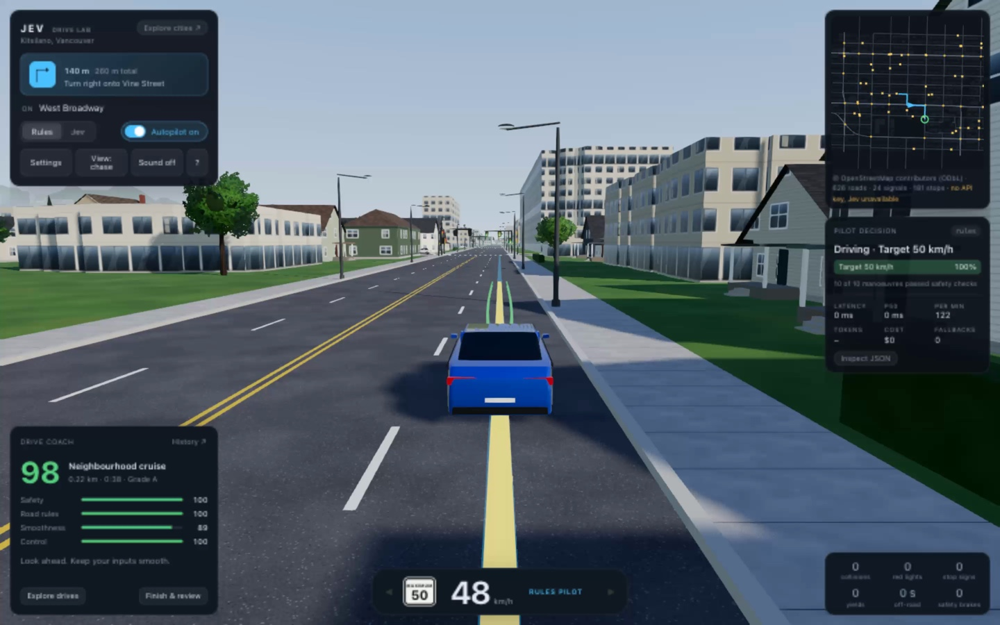
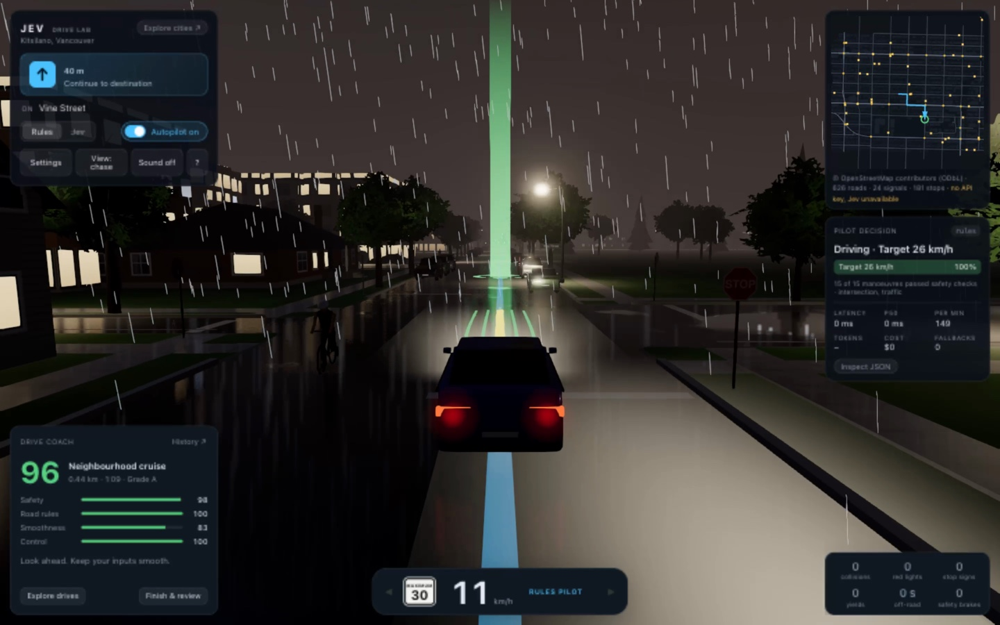
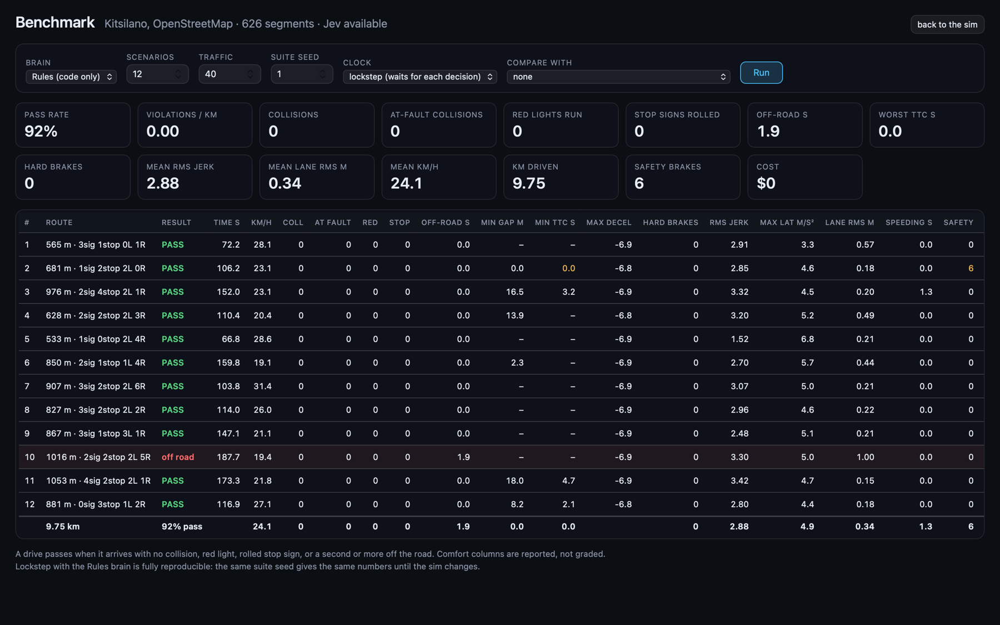

# Jev FSD

**Drive real Canadian streets, watch an AI choose its next move, and improve your driving score.**

Jev FSD is a local driving simulator built from [OpenStreetMap](https://www.openstreetmap.org/)
roads and buildings. Explore twelve neighbourhoods across eleven Canadian cities by hand, with the free
Rules driver, or with [TypeSafe AI's Jev](https://typesafe.ai/). The decision panel shows the
situation, available manoeuvres, model probabilities, latency and API cost.

Choose a suggested route, take the wheel, and review your drive for safety, road rules,
smoothness and control. Traffic parks and pulls out, car doors open, pedestrians cross, and
weather changes both visibility and grip. The driving HUD keeps turn guidance, speed, live
coaching and the pilot's latest decision visible while you drive.



> This is a research and demo simulator, not a system for controlling a real vehicle. The project
> is independent and is not affiliated with or endorsed by TypeSafe AI.

## Quick start

Install [uv](https://docs.astral.sh/uv/) and use a desktop browser with WebGL. The app needs
Python 3.10 or newer; `uv` manages Python and the project dependency.

```sh
git clone https://github.com/BrendanH18/jev_fsd
cd jev_fsd
uv run server.py
```

Open [127.0.0.1:8322](http://127.0.0.1:8322). Without an API key, the app selects the free Rules
driver. There is no frontend build step; the simulation and renderer use JavaScript and Three.js,
and the local server uses Python. The pinned Three.js runtime and all twelve map packs are bundled,
so driving with Rules needs no external network after installing the Python dependencies.

Try **Explore cities → Victoria → Neighbourhood cruise**. A suggested drive starts the selected
autopilot; `W A S D` takes over manually. You can also click a destination on the minimap or
start a free drive with the keyboard. Cycle **View** to hood view and enable **Sound** for driving
ambience. Open **Settings** to change weather, time and graphics, or press `?` for keyboard help.

To enable Jev, obtain a key from the [TypeSafe console](https://console.typesafe.ai), click
**Decision** (or press `1`), paste the key under **TypeSafe** and choose **Save and drive**. The
server saves it to `.env` as `TYPESAFE_API_KEY` and Jev is available at once. Or create the file
by hand:

```sh
cp .env.example .env
# Set TYPESAFE_API_KEY in .env, then restart the server.
```

The key stays on the server. Jev sends decision requests to TypeSafe; Rules driving, drive
scoring and the bundled maps need no API key.

## Explore twelve Canadian neighbourhoods

The city picker includes neighbourhood-sized extracts of real roads, one-way streets, lane
and speed-limit tags, traffic controls and buildings. All twelve processed map packs are bundled.
Search by city or neighbourhood, and filter by region and road character. The explorer keeps
your search and keyboard focus while loading maps or finding routes, and offers retries on errors.

| City | Neighbourhood | Direct simulator URL |
|---|---|---|
| Vancouver | Kitsilano | [/?map=kitsilano](http://127.0.0.1:8322/?map=kitsilano) |
| Vancouver | Mount Pleasant | [/?map=mount_pleasant](http://127.0.0.1:8322/?map=mount_pleasant) |
| Victoria | Old Town | [/?map=victoria](http://127.0.0.1:8322/?map=victoria) |
| Toronto | The Annex | [/?map=toronto](http://127.0.0.1:8322/?map=toronto) |
| Montréal | Le Plateau | [/?map=montreal](http://127.0.0.1:8322/?map=montreal) |
| Calgary | Beltline | [/?map=calgary](http://127.0.0.1:8322/?map=calgary) |
| Ottawa | Centretown | [/?map=ottawa](http://127.0.0.1:8322/?map=ottawa) |
| Québec City | Saint-Roch | [/?map=quebec_city](http://127.0.0.1:8322/?map=quebec_city) |
| Halifax | Downtown | [/?map=halifax](http://127.0.0.1:8322/?map=halifax) |
| Winnipeg | Exchange District | [/?map=winnipeg](http://127.0.0.1:8322/?map=winnipeg) |
| Edmonton | Old Strathcona | [/?map=edmonton](http://127.0.0.1:8322/?map=edmonton) |
| Saskatoon | Downtown & Nutana | [/?map=saskatoon](http://127.0.0.1:8322/?map=saskatoon) |

**Explore cities** offers three reachable drives from your current position: **Neighbourhood
cruise**, **City precision** and **The long way home**. The world pauses while choosing a route
or reading a drive report. Changing cities keeps your weather, time and graphics settings.
Routing, rerouting, benchmarks and 3D benchmark replays use the selected city's map.

The sun uses each city's latitude, longitude and late-September daylight-time offset.
Vancouver's mountains, water and landmark backdrop appear only on Vancouver maps. These packs
have no elevation data; building heights come from tags or procedural estimates.
See [map coverage, attribution and refresh instructions](maps.md).

**Settings** includes a six-car garage, six paint colours, traffic-car density, a repeatable world
seed and **Start new world**. Choose a city hatch, touring sedan, sport coupe, estate wagon,
trail SUV or utility pickup; start a new world to apply your selection. Each driven model has
its own dimensions, mass, wheel power, drive layout and centre of gravity. Collision checks,
stopping distances, candidate predictions and cameras use the selected vehicle. Vehicle names
and specifications describe generic simulated cars.
Changing density or seed restarts the world and saves a non-empty active drive. A quiet world
still has cyclists, pedestrians and curb activity. URL options include `?traffic=16&seed=42`.
The daylight clock can remain fixed, run in real time or advance one minute per simulated second
(`?clock=0`, `1` or `60`). Pausing also pauses daylight. The conditions strip shows local time,
weather and forward sight range, with a visible Pause/Resume button.

## Drive coach and reports

A live card scores each drive out of 100 and offers coaching as you go. Manual driving, Rules
and Jev use the same deterministic scoring model; scoring makes no model calls.

| Category | Weight | What it measures |
|---|---:|---|
| Safety | 40% | collisions, time to collision and following gaps |
| Road rules | 30% | red lights, missed stops, failed yields and speeding |
| Smoothness | 20% | harsh braking, hard cornering and high jerk |
| Control | 10% | time off-road, wrong-way driving and lane resets |

Arrival opens a report automatically. **Finish & review** ends a drive manually; **History**
shows the last 20 reports stored in this browser, and **Export JSON** saves a report with its
event timeline and scoring-model version. Starting a replacement route or changing cities
saves a non-empty drive without claiming arrival.

Grades require at least **100 m and 10 seconds**. Short sessions remain practice drives. A
collision caps the total at 59; a red light or failed yield caps it at 69. Waiting at lights,
pausing and driving slowly carry no penalty. Emergency braking can reduce smoothness even when
it is the safer choice. Scores use the full simulated world, including hazards the driver
could not see; use the seeded benchmark for controlled driver comparisons.

See [the scoring formula, thresholds and report behaviour](drive-experience.md).

## Driving HUD

The redesigned HUD groups route guidance, driving instruments and pilot feedback:

| Area | What it shows |
|---|---|
| Left column | City and current street, next turn and distance, Rules / Decision ▾ / LLM ▾ buttons, autopilot switch, Settings and live drive coach |
| Instrument cluster | Speed in km/h, mapped speed limit, indicators and manual, pilot or paused mode |
| Right column | Minimap, latest pilot decision, candidate probabilities, latency, tokens, cost, fallbacks and incident counts |

The trip card gives turn-by-turn guidance during both manual and autopilot driving. Speed and
limit highlights use the same 5 km/h speeding grace as the drive coach.

The **Pilot decision** card displays candidate speeds in km/h and up to five probability rows,
keeping the executed candidate visible when it has a probability. Rules probabilities describe
a deterministic choice, not model confidence. Jev responses have a green label; Rules fallbacks
have an amber label and no model probabilities. Locally resolved choices may also have no
probabilities. Turning autopilot off clears the latest latency and token fields; cost and p50
remain session statistics.

At widths of 900 px or less, the decision and incident cards are hidden and **Inspect JSON**
is available under **Settings**. Short screens hide category bars and secondary telemetry;
the HUD columns scroll to keep settings and drive actions reachable. At very narrow widths,
the minimap and compact instruments sit below the left column. Driving still requires a
keyboard; there are no touch driving controls. HUD animations and transitions respect the
system's reduced-motion preference.

## Controls and driving feel

| Key or control | Action |
|---|---|
| Click the minimap | Set a destination and start autopilot |
| `W A S D` or arrows | Drive manually and take over from autopilot |
| `Space` | Brake hard |
| `J` | Toggle autopilot |
| `1` / `2` / `3` | Select the decision model / Rules / the LLM (also available as buttons; ▾ picks the model) |
| `Q` / `E` | Toggle left / right indicators |
| `H` | Horn when sound is enabled |
| `C` or **View** | Cycle chase, 360°, hood, overhead, high chase and cinematic cameras |
| `O` or **Photo mode** | Freeze the world, hide the HUD, adjust the look and save a PNG |
| **360° view** or drag the driving view | Orbit freely around the car; follows it as you drive |
| Wheel / pinch / camera + − | Zoom the 360° view |
| Shift + arrow keys (view focused) | Rotate the 360° view without steering |
| **Recenter** | Return the 360° camera behind the car |
| `R` / `P` | Reset to the lane / pause |
| `?` or `/` | Toggle keyboard shortcuts |
| `Escape` | Leave photo mode, or close keyboard shortcuts or the decision inspector |
| **Explore cities** / **Explore drives** | Pick a city or suggested route |
| **Finish & review** / **History** | Review the current drive / saved drives |
| **Inspect JSON** | Open the decision inspector; on narrow screens, find it under **Settings** |
| **Settings** | Weather, time, graphics quality, wipers and camera motion |
| **Sound** | Toggle driving audio |

Use `Tab` to reach controls. The Rules / Decision / LLM group has one tab stop; arrow keys,
`Home` and `End` select a driver. Decision remains visible when no decision model is usable;
arrow keys skip it, and clicking it opens **Connect a model** on TypeSafe. Focused controls retain their normal keyboard behaviour; click the road view
to use WASD, Space or arrows for driving. Driving shortcuts are ignored in form fields and
open dialogs, and shortcuts with Ctrl, Cmd or Alt keep their normal browser behaviour.

Keyboard steering ramps gently and limits cornering demand at speed while retaining full lock
for low-speed manoeuvres. Vehicles, cyclists, pedestrians and the camera interpolate between
physics steps for smoother motion. Physics, sensing and scoring still use fixed-step state.

Hood view adds windshield trim, rain beads and two sweeping wipers, with optional acceleration
and cornering motion. Procedural audio provides motor, tire, road and rain sounds, indicator
clicks and a horn; it starts after enabling sound and fades while paused or hidden.
Manual indicators cancel after a completed turn or 12 seconds, and a speed warning highlights
speeding.

## Graphics and recent rendering fixes



The sky draws a drifting procedural cloud deck. Each cloud is lit from the sun's side, with a
silver rim near the sun. Coverage follows the weather: scattered fair-weather cumulus when dry and
a continuous low deck in rain or snow; fog hides it. At dusk the clouds take the sun's colour, and
at night they reflect the city's glow. Wet roads and car paint reflect the same clouds through the
environment map.

On High and Ultra, a grade pass after tone mapping sets contrast, saturation, a time-of-day tint
(warm at golden hour, cool at night) and a soft vignette. It also adds a ±½-step dither that removes
8-bit banding in smooth sky gradients.

The **cinematic** camera cuts automatically between five shots: a roadside camera the car sweeps
past, a low bumper chase, a slow helicopter orbit, a tracking shot from ahead and a wheel-height
side profile. **Photo mode** (`O`) pauses the world and hides the HUD. You can frame the car with
the free, cinematic, chase or hood camera. Sliders set exposure (±2 EV), contrast, saturation,
vignette and time of day. **Save photo** downloads the rendered frame as a PNG at the canvas
resolution; the controls are never included. Leaving photo mode restores the previous camera,
the default look and the previous pause state.

Parked cars and trees use distance-based detail to reduce distant geometry. Nearby scenery
retains detailed meshes and shadows, while hysteresis prevents repeated detail switches around
the distance threshold. Static scenery transforms are computed once.

Road layers share a stable ground depth. Wet reflections no longer sample their own render
target, and reflection and main passes share the same shadow maps and scenery detail within
each frame. These changes address road flicker, inconsistent shadows and wet-rendering errors.

Street-name and speed-limit signs use correctly proportioned printed rectangles, bolder street
lettering, padded atlas cells and up to 8× anisotropic filtering. Text reads correctly from
both sides. The signs keep their shared 2048² atlas and batched meshes. Driving instruments,
the drive coach, incident panel and windshield trim are opaque, and persistent HUD panels
avoid backdrop blur, so green scenery cannot bleed through the opaque surfaces.

HUD text and statistics refresh at most 10 times per second and skip unchanged DOM writes.
The decision card rebuilds only when a decision or autopilot state changes. These changes
reduce DOM work while physics and pilot decisions keep their existing cadence.

| Preset | Rendering |
|---|---|
| Low | Direct rendering at 1× pixel ratio, 2048 shadows, no post-processing or wet reflections |
| High | 1× pixel ratio, 2048 shadows, bloom, SMAA and quarter-size wet reflections |
| Ultra | Up to 2× pixel ratio, 4096 shadows, ambient occlusion and half-size wet reflections |

High is the default. URL options also work, for example
[Victoria in rain at night](http://127.0.0.1:8322/?map=victoria&weather=rain&time=night&quality=high).
Time accepts presets or a clock value such as `?time=17:45`.

Measured GPU work fell in the recorded rendering comparisons, but the high preset also uses
fewer pixels and effects than the earlier version. Those measurements do not establish a
frame-rate guarantee or an equal-quality speedup. See [rendering measurements, tradeoffs and
profiling instructions](render-performance.md).

## Simulation and decision making

The car uses a dynamic bicycle model with saturating tire forces, weight transfer, power-limited
acceleration, actuator lag, drag and stability assistance. The same physical model runs traffic
cars and candidate predictions. Rain and snow reduce grip.

Traffic follows lanes, obeys signals, yields at junctions and crossings, changes lanes, reserves
curb parking, pulls in and waits for gaps before pulling out, looking again until it is moving. Parked cars can open a street-side
door for six seconds; the animated door has matching sensing, prediction and collision geometry.
Cyclists ride bike routes, keeping right: where a street's parking lane is empty to the end of the
block they ride in it, past cars queued at the corner, and move back into the traffic lane before
the next parked car once nothing is beside them. A car turning right, the driven car included,
waits for a cyclist coming up on its right (a right hook). Pedestrians cross at signals, at the
marked crosswalks between junctions (half of those walking past one cross there, stepping off once
nothing coming is too close to stop for them, BC MVA s. 179) or sometimes mid-block, and carry
umbrellas in rain. A vehicle in traffic hides a person behind it from the driver. Nobody may pass a
vehicle stopped at a crosswalk (BC MVA s. 179(3)): the driven car coming up beside one in another
lane stops 3.5 m short of the crosswalk's centre, if it could do that braking at up to 3.5 m/s^2
when it first saw it, and goes on once it has stood still there for 2 s (see
`static/js/sim/crosswalk.js` and [maps.md](maps.md#crosswalks)). In a free drive an ambulance or a fire truck
answers a call now and then, lights flashing and siren wailing (with **Sound** on), coming up
behind the car, toward it or across the junction ahead; everyone pulls over to the right, clear of
any junction, and stops until it has gone by (`?emergency=0` turns them off). Buses run their
real routes (up to four at a time, `?buses=0` takes them off) and stop at the routes' real stops:
they signal, pull in to the curb, wait 10 to 25 s with their doors open, signal left and pull out.
Where the limit is 60 km/h or less, traffic and the driven car coming up behind a bus at a stop
that is signalling to pull out let it go first (BC Motor Vehicle Act s. 169.1) when they can stop
2 m behind it braking at up to 3 m/s^2; nobody parks in a bus zone, and traffic eases left in its
lane to get past a bus standing at its stop. See `static/js/sim/bus.js` and
[maps.md](maps.md#bus-and-streetcar-routes) for where the routes come from. On the school run (7:00 to 17:00)
two school buses drive the streets (`?schoolbuses=0` takes them off) and every 150 to 400 m stop in
their lane, mid-block on a two-way street with one lane each way and a limit of 50 km/h or less, to
let one to three children off: ambers flashing as they slow, then reds and the stop arm. Some of
the children cross the street in front of the bus. Traffic both ways and the driven car stop for a
school bus with its reds flashing (BC Motor Vehicle Act s. 149), 5 m behind it or 10 m short of its
front, when they can stop there braking at up to 3.5 m/s^2, and wait until the reds go off; the bus
keeps them on until its children are across. See `static/js/sim/school-bus.js`.

School and playground zones (BC Motor Vehicle Act s. 147) come from each map's schools and
playgrounds in OpenStreetMap ([maps.md](maps.md#school-and-playground-zones)). Where one is in
effect the limit is 30 km/h, never more than the street's own: a school zone's from 8:00 to 17:00 (the
sim has no calendar, so every day is a school day), a playground zone's from dawn to dusk (while the
sun, as the sky draws it, is above -6 deg). The world's road info reports the zone's limit and the
zone, so the HUD's limit sign turns yellow-green and says SCHOOL or PLAYGROUND, the coaching score
counts speeding against it (and says so once a visit), and Rules keeps to it. Rules also slows on
the way in, to be at the zone's limit as its front reaches the sign, and traffic keeps to it from
15 m before. Signs stand where each stretch of zone starts and, short of the end of its street, where
it ends. AI eyes outlines the zones in effect nearby in yellow-green. The seeded benchmark drives no
zones (its world has no clock); a benchmark replayed in the app likewise. See
`static/js/sim/speed-zones.js`.

School crossing guards (`static/js/sim/crossing-guard.js`, `World` option `guards`: on in free drives
unless `?guards=0`, and in "Stop for the guard"). Posts stand at marked crosswalks between junctions
(`map.crosswalks`, `crowd.marked`) within a school-zone span on either direction's edge, while the zone
is in effect by `inEffect("school", world.clock)`. The current packs have sites on Rue Berri in Montréal
and Trollope Street in Halifax. Guards wait at the curb in hi-vis vests with round red STOP paddles.
Groups of one to four children arrive along the sidewalk every 25 to 70 s, from a separate seeded stream.
Once everyone is at the curb and approaching traffic can stop comfortably (1 s reaction plus braking
at the weather-dependent `comfort().decel`), the guard raises the paddle and walks to the middle at 1.2 m/s. The children cross;
only once every child is on the far sidewalk does the guard return and lower the paddle at the curb.
School hours ending never cuts short a crossing. Guards and children are pedestrians (`ped.guard`,
`ped.child`); the manager moves them until children finish crossing, when the crowd walks them home.
Collisions, visibility and rendering treat them as people; the vest and paddle are render-only.

The stop rule models Ontario HTA s.176 and the corresponding BC and Québec rule: traffic both ways,
including cyclists, stops before the crosswalk until the guard and every child are off the entire
roadway. The sim's front stop point is 5 m short of the crosswalk centre. A driver owes the stop if it
could brake at up to 3.5 m/s² when the sign rose (or on first approach for later arrivals); that decision
is retained for the whole crossing. Sensing reports `crossing_guard` within 80 m once the guard is in
view: paddle, phase, children waiting, people in the road, stop point and whether the car must wait.
A raised sign already seen remains binding when traffic temporarily hides the guard.
Rules and the cautious agent choose `stop_for_crossing_guard`; candidates passing the stop point by
more than 1.5 m are rejected (`passes_crossing_guard`), and deadlock recovery leaves a lawful wait alone.
State, motion criteria, situation text and the LLM prompt explain waiting for the whole roadway.
The audit counts proceeding more than 2 m past the stop point at over 1 m/s once owed, once per raising,
as `guard_violations` (`passed_crossing_guard` event). Metrics and coaching report it only after a guard
has stood out in the drive (`World.guardsSeen`); it fails the drive and costs legality points.
The HUD announces children waiting or "CROSSING GUARD · STOP · WAIT UNTIL EVERYONE IS ACROSS".
Replay checkpoints preserve the post, crowd identities, random stream and obligations, and reconnect
the manager to the restored world. With guards off no posts, arrivals, random draws, traffic checks or
audit computations run; metrics and coaching have no guard field. The focused check is
`node --experimental-default-type=module scripts/test_crossing_guards.mjs`.

Slow down, move over (BC Motor Vehicle Act Regulations s. 47.02): in a free drive two vehicles stand
at the roadside with their lights flashing at any time (`?roadside=0` takes them off), each in two
bays of a street's right-hand parking lane, 150 to 450 m from the car and out of its sight, for 2.5
to 6 minutes, leaving once the car is well away: a tow truck (amber lights) in front of the car it is
about to tow, or a police car (red and blue) behind the car it has pulled over. They are parked cars
that never pull out or open a door, so traffic, cyclists and collisions treat them as such. Passing
one going its way, from 30 m short of its rear until past it, the limit is 40 km/h (70 where the
street's is 80 or more): traffic keeps to it in every lane from 40 m before that, and Rules keeps to
it from the way in, as the snapshot's `limit`. In the lane next to it, where another lane goes the
car's way, the car is offered a `move_over` lane change to the left (not within 5 m of it, and only
into a lane that runs on past it), and Rules takes it and stays out of that lane until past it, if
it safely can. The coaching score counts passing too fast and passing it in the lane next to it,
each once a vehicle, with a tip; the HUD says "TOW TRUCK · LIGHTS FLASHING · SLOW TO 40 · MOVE OVER",
and AI eyes outlines it in amber. The seeded benchmark and the other challenges have none. See
`static/js/sim/roadside.js`.

Streetcars (Ontario Highway Traffic Act s. 166): in a free drive two streetcars run the map's
streetcar runs (`?streetcars=0` takes them off; only The Annex has any, the 511 on Bathurst Street),
placed and replaced as buses are. A streetcar keeps to the lane its track is laid in, never changing
lanes or pulling over, stops in it at each of its stops, and opens its doors while up to three
riders get off across the lane beside it to the curb and up to three walk out to it from the curb;
its doors never close on a rider in the street. At the end of its run it waits until the car is well
away or out of sight, and leaves. A driver going its way, behind it in its lane or in the lane beside
it on the curb side, stops 4 m behind its rear doors (the law's line is 2 m behind them; 4 m behind
it in its own lane) while they are open, if it could stop there braking at up to 3.5 m/s^2 when it first saw them open: traffic,
cyclists and the driven car alike. Rules gets a `stop_for_streetcar` candidate and rejects going past
that point (`passes_streetcar_doors`), and slows for a streetcar slowing for its stop. Decision models
and LLMs get `streetcar`. The audit counts a failure to yield once a stop if the car, owing it,
comes within 2 m of the rear doors at more than 1 m/s while they are open. The HUD says "STREETCAR · DOORS OPEN ·
STOP BEHIND THE DOORS", and AI eyes outline it in amber. The seeded benchmark and the other
challenges have none. See `static/js/sim/streetcar.js`.

Level crossings (Alberta Use of Highway and Rules of the Road Regulation, AR 304/2002, s. 42): in a
free drive one heritage streetcar runs each map's track (`?trains=0` takes it off; only Old Strathcona,
Edmonton, has one, the High Level Bridge line). It runs at up to 25 km/h, stops 15 to 30 s at each
stop, waits 40 to 80 s at its terminus and turns back, and comes back 60 to 150 s after running off the
map's edge. It rings its gong on the way to each crossing, from 150 m out, and brakes (at up to
2.5 m/s^2) for anything in its way that its motorman can see. While it is coming, or on the
crossing, a driver crossing the track stops with its front 7 m back from the nearest rail (the law's
line is 5 m) and waits until it has passed, if it could stop there braking at up to 3.5 m/s^2 when it
first heard (within 250 m) or saw it. And whatever is coming, nobody stops on the tracks: a driver waits
at the same place while a vehicle past them, stopped or slower than 3 m/s, leaves less than its own
length and 1 m clear of the train's envelope (2.5 m either side of the track's centre). Traffic,
cyclists and the driven car alike; an emergency vehicle waits only for the train. Rules gets a
`stop_before_tracks` candidate and rejects going past that point (`crosses_in_front_of_train`,
`no_room_past_tracks`). Decision models and LLMs get `level_crossing`. The audit counts a failure to
yield to the train once per train at each crossing if the car, owing the stop, comes within 5 m of the nearest
rail at more than 1 m/s while it is approaching, or stands on the tracks slower than 1 m/s while it is;
the coaching score counts standing on the tracks for a second, once a visit ("Stopped on the tracks"),
with a tip. The HUD says "LEVEL CROSSING · STREETCAR COMING · STOP 5 M BACK" or "LEVEL CROSSING · NO
ROOM PAST THE TRACKS · WAIT SHORT OF THEM", and AI eyes outline the streetcar in amber. The seeded
benchmark has no trains; the room rule applies there as everywhere. See `static/js/sim/rail.js`.

Keeping the junction clear (Québec's Highway Safety Code; Québec.ca, "Savoir manœuvrer aux
intersections"): even on a green, a driver must not enter a junction without room past it to clear it
completely. At a signal the box runs from the stop line to the far side of the widest street across
it. A driver short of the line, or up to 1 m over it, waits there while a vehicle ahead on its way past
the junction, going its way, stopped or slower than 3 m/s, leaves less than its own length, the 2.5 m
it would stop behind that vehicle and 1 m clear of the box; so does one further over, slower than 2 m/s and still short of the street across.
Into the junction it is committed. Traffic, buses and streetcars wait (at the line, 2 m back, as at any
line); cyclists, who keep right of the queue, and emergency vehicles with their sirens on do not.
Junctions without a signal, and roundabouts, are left out. The car's sensing reports `junction_box`
(it aims to stop 1 m short of the line, and a slow stop runs on to about the line); Rules gets a
`wait_short_of_junction` candidate and rejects going on past it (`blocks_junction`). Decision models
and LLMs get `junction_box`, a situation line, a motion criterion and a prompt line. The audit counts a
failure to yield (`to: "cross traffic"`, `blocking: true`) once a visit if the car, following its route,
entered the junction (its front past the near side of the street across) while traffic past it left no
room, and then stands in it slower than 1 m/s while its light is red; the coaching score counts standing
in a junction for a second with traffic past it leaving no room ("Stopped in the junction"), with a tip.
The HUD says "JUNCTION · NO ROOM PAST IT · WAIT AT THE LINE" while the light is not red, and AI eyes
outline the vehicle that leaves no room in amber. At an all-way stop, traffic also waits for a car
coming in on a street without a sign there (the short link between two junctions close together),
which does not stop, and that car gives way to one pulling away from an all-way stop's line. Both
reach the seeded benchmark (see [the Rules baseline](rules-baseline.md)). See
`static/js/sim/junction-box.js`.

Advance greens and left-turn arrows (`static/js/sim/signals.js`): where two multi-lane major streets
(primary or secondary, two lanes or more in a direction) cross at a signal, one approach on one of them,
with an approach opposite it in its group and a left turn out of it, leads its group with a protected
left turn: the busiest (lanes × limit), then the first by edge id. The cycle grows by 12 s to fit it:
for the first 8 s of the group's green only that approach goes, and the approach opposite it (and any
other in its group) waits on red; then 4 s of clearance (a yellow arrow for 3 s and 1 s of red for the
turn), and the whole group has its usual green, left turns yielding to oncoming traffic as ever. In
Ontario and Québec it shows as a flashing green ball, under which the approach may go left, straight or
right (the MTO Driver's Handbook, "Traffic lights"; the SAAQ's "feu vert clignotant"), steady green
through the clearance; everywhere else as a green left arrow beside a red ball, under which only the
left turn goes (BC's Motor Vehicle Act s. 130), so in BC a flashing green never means an advance (it
means a pedestrian-controlled signal there). The province comes from a coarse outline of Ontario and
Québec judged at the map's centre. The people walking alongside that group start their walk once the
clearance is over. The bundled maps have 50 such junctions, none in Saint-Roch and 12 in Victoria's Old
Town. Each approach's light is now worked out for the way a vehicle goes (`approachPhase`,
`movementSignal`): traffic, buses, streetcars and the driven car turn left on the arrow and wait for
their green going any other way; a right turn on red from an approach held while the approach opposite
has its advance waits for it to end, as the protected turns come into the same street. The car's
sensing reports `intersection.signal` for its own movement and `intersection.advance` (`flashing_green`,
`left_arrow`, `left_arrow_yellow`, or `held` on the approach opposite, and whether its left turn is
`protected`); a protected left turn does not wait for oncoming traffic, held on red. Decision models
and LLMs get `intersection.advance`, a situation line and a prompt line. The audit counts a red light
run crossing the line on a red for the car's movement; crossing it on a left arrow it judges once the
car is 15 m from the junction's centre, counting anything but a left turn (or a right turn on red after
a full stop) as a red light run. Signal heads light each approach on its own at such a junction: a
left arrow's approach has two more sections, a yellow arrow and a green arrow, under the head over its
left lane, and a flashing green blinks. The HUD says "LEFT ARROW · NOT YOUR LIGHT · WAIT FOR GREEN",
"LEFT ARROW · TURN PROTECTED", "YELLOW ARROW · TURN ENDING · STOP IF YOU CAN", "ADVANCE GREEN · LEFT
TURN PROTECTED" or "ADVANCE GREEN · ONCOMING TRAFFIC HELD". This reaches the seeded benchmark (see
[the Rules baseline](rules-baseline.md)).

Where the car, centred in its lane, would touch static scenery within 40 m along its route (a building's
corner mapped over the curb lane, as on Belleville Street in Victoria), Rules is offered lateral nudges of
a full metre either way as well as half a metre, and `stop_at_line` and `hard_brake` keep the car's
current nudge (to the nearest half metre, at most a metre) instead of steering back to the lane's centre.

Work zones with a flagger (Ontario Highway Traffic Act s. 146.1; the Ontario Traffic Manual, Book 7;
`static/js/sim/work-zone.js`, `render/work-zone.js`): a road crew closes one lane of a straight block of a
two-way street with one lane each way, and two traffic control persons, one on the sidewalk at each end,
take turns letting each direction through the lane that is left with STOP/SLOW paddles. Along the closed
lane's street a zone runs 100 m: the closed side's stop line, 6 m to where its traffic starts moving
across, 30 m over which it does, 2 m, the closed stretch itself (24 m of the closed lane and its parking
lane, a parked obstacle, with the crew's truck, its arrow board, two workers and cones angled across the
lane for 12 m before it), 2 m, 30 m back, and 6 m on to the other side's stop line. The flaggers keep one
side on SLOW for at least 10 s, then turn both paddles to STOP once someone is waiting at the other end and
nobody more is coming within 40 m on this one, or after 25 s; both stay on STOP for at least 2 s and until
nothing is left in the one-lane section, then the other side gets SLOW. Everyone keeps to 30 km/h (never
above the street's limit) from their stop line to the end of the one-lane section. A driver short of its
line when its paddle turns to STOP stops there if it could, braking at up to 3.5 m/s^2; one too close goes
on through, and the flaggers wait for it. Traffic, buses and cyclists all do, and the closed side goes
round the closed stretch through the other lane; emergency vehicles are not routed round it. In a free
drive one zone stands at a time, 150 to 450 m from the car where it cannot see it, for 4 to 8 minutes, and
packs up once the car is 150 m away, out of sight, and nothing is in its one-lane section
(`?workzones=0` takes them off). Zones go only where there is no marked crosswalk, bus or streetcar route
or level crossing on the block, 20 m or more from a junction or its stop line; whoever is parked along the
zone leaves, and nobody parks there. The car's sensing reports `work_zone` once it can see the flagger at
its end: which side it is on, what the paddle shows it, its stop line, whether it must wait there, and, on
the closed side, the detour round the closed stretch in route arc lengths, which every lane and hard-brake
candidate then follows (`detour` in a lane law, `sim/controller.js` `detourAt`). Rules gets a
`stop_for_flagger` candidate and rejects going past the line while it must wait (`runs_flagger_stop`).
Decision models and LLMs get `work_zone`, a situation line, a motion criterion and a prompt line. The
audit counts a missed stop once each time a paddle turns to STOP if the car, owing it, goes more than 2 m
past the line at more than 1 m/s while it still shows STOP; the coaching score counts going through
faster than the zone's limit, with tips for both. The HUD says "WORK ZONE · FLAGGER SHOWS STOP · WAIT AT
THE LINE" or "WORK ZONE · SLOW · 30 · ONE LANE" (with "· GO ROUND IT" where the car's lane is closed), and
AI eyes outline the closed stretch in amber. The seeded benchmark and the other challenges have none.

Power cuts (`static/js/sim/outage.js`): where a signal's lights are out, every driver treats the
junction as an all-way stop (the MTO Driver's Handbook, ICBC's Learn to Drive Smart, and the other
provinces' handbooks). Each of its approaches then obeys an all-way stop in place of its signal
(`controlAt`): its own stop for that approach, as a stop sign's, on the signal's line, all of them in one
queue for the junction (`sim/all-way.js`, keyed on the signal's id), where a vehicle that went has cleared
the junction once it is 2 m past the far side of its widest street. Its signal heads and walk signals are
dark, and people on foot cross there on a gap, as where there is no signal. A traffic driver too close to
its line to stop there when the lights go out goes on through; traffic, buses and streetcars all obey it,
and emergency vehicles slow through it as through any junction they have no right of way at. In a free
drive one signal at a time is dark, 150 to 450 m from the car where it cannot see it, with nobody within
40 m, for 4 to 8 minutes; its lights come back on once the car is 150 m away, out of sight, and nobody is
within 40 m, and the next goes dark 60 to 180 s later (`?outages=0` turns them off). The car's sensing is
honest: until it can see the junction it reports an unseen signal, and once it can, an all-way stop
(`intersection.control` is `stop`, `all_way` true, with `dark` and its place in the order). Rules needs
nothing new. Decision models and LLMs get `intersection.lights_out`, a situation line and a prompt line.
The audit counts going through without a full stop as a missed stop, and going out of turn as a failure
to yield (both events with `dark`), with a coaching tip. The HUD says "LIGHTS OUT · ALL-WAY STOP · STOP AT
THE LINE", "· WAIT YOUR TURN" or "· YOUR TURN". The seeded benchmark and the other challenges have none.

Double-parked delivery vans (`static/js/sim/double-parked.js`, `render/delivery-van.js`): a high-roof
cargo van stops in the travel lane of a straight block of a two-way street with one lane each way, beside
the cars parked at the curb, its hazards flashing. The only way past is round it through the oncoming
lane, where oncoming traffic has the right of way (every province's driver's handbook). Along the van's
street the way round (a lane law's `detour`, as at a work zone) eases across from 18 m short of its rear
to 1 m short of it, all the way into the oncoming lane, stays there to 2 m past its front, and eases back
by 16 m past it. A driver waits with its front 7 m short of the van (traffic, which keeps its standstill
gap, about 2 m further back), and keeps to 20 km/h from there until it is back in its lane, slowing to
that at 1.5 m/s^2. It goes round once its front is within 30 m of the van, nobody waiting behind the van
is ahead of it, and the way is clear (`wayRound`): nobody coming the other way, along the street or coming
up to the junction ahead with its indicator (or none, going straight on) pointing into the oncoming lane,
would reach the end of the way round sooner than 2 s after the driver, going round at 20 km/h and pulling
away at 1.5 m/s^2, has its front there; one standing still beyond it, or already past, is no matter. Once
it has started across it carries on round. A traffic driver closer to the van than 1.5 m past where it
would wait is too close to pull out round it, and waits for the van to leave. The cars parked along the way round,
at either curb, stay put (no door opens, nobody pulls out) while the van is there. Traffic and cyclists all
do; a cyclist riding the empty parking lane goes by on the right; emergency vehicles are not routed round
it. In a free drive one van stands at a time, by day and out of fog, 150 to 450 m from the car where it
cannot see it, for 1 to 3 minutes; then, once nobody is beside it or going round it, it goes if the car
cannot see it and is 150 m away, or, in sight, switches its hazards off and drives away as traffic
(`?vans=0` takes them off). Vans stop only where there is no marked crosswalk, transit route or level
crossing on the block, with the way round and 15 m for a queue behind it at least 12 m from the junction
lines at each end, never on the block of a work zone or within 40 m of a vehicle stopped at the roadside.
The car's sensing reports `double_parked` once it can see the van, 80 m short of it or nearer: where it
waits, the way round as far as it can tell (it must see along the oncoming lane as far as anyone at the
street's limit would come in the time it needs, or as far as it ever sees, 80 m less 10, so by night or
in fog it waits), who waits ahead of it, whether it has started round (it is executing a law that goes
round and has moved across or past where it waits), and, once it goes, the detour, which every lane and
hard-brake candidate then follows. Short of where it waits the van is a stop, not a car to follow. Rules
gets a `wait_behind_van` candidate and rejects pulling up more than 1.5 m past where it waits while it
must (`no_room_to_go_round`). Decision models and LLMs get `double_parked`, a situation line, a motion
criterion and a prompt line. The audit counts going round into the way of an oncoming vehicle as a failure
to yield (`double_parked`): the car, going its street's way with its front alongside the way round and its
centre left of the centre line, meets one coming the other way on its side of the street, ahead of it,
less than 8 m front to front or 2 s away at the speed they close at; once a pass. The coaching score counts
it (`van_cutoffs`) with a tip, and going round is not driving the wrong way. The HUD says "DOUBLE-PARKED
VAN · ONCOMING TRAFFIC · WAIT BEHIND IT", "· CAN'T SEE PAST · WAIT BEHIND IT", "· WAIT YOUR TURN BEHIND
IT", "· WAY CLEAR · GO ROUND IT" or "· GOING ROUND · BACK INTO YOUR LANE PAST IT", and AI eyes outline the
van in amber. The seeded benchmark and the other challenges have none.

Snow plows (`static/js/sim/snow-plow.js`, `render/snow-plow.js`): while it snows, a city plow (a
single-axle dump truck, 9.8 m with its blade, 2.6 m wide, a salt spreader on its box, the wing blade
folded up on its right) clears the main streets at 18 km/h whatever the weather, its blue and amber lamps
flashing in turn. Manitoba's Highway Traffic Act (in force in 2026) says to stay 30 m back from a plow
with its blue warning lamps on where the limit is 80 km/h or less, 100 m above that, and not to pass one
where blowing snow hides the view ahead or passing would get in the way of its work; the City of Winnipeg
adds never to pass one on the right, the side snow and debris are plowed to, and Ontario that a plow may
be passed only in a lane clear of every part of it (a wing can reach 3 m to its right). So the driven car
stays that far behind a plow going its way in its lane, and behind one in the lane to its left too: it
never draws level with one on its right. It passes one only on the left, through a lane going its way
(never across the centre line), and only seeing as far as it ever does (80 m: in falling snow, fog, rain
or after dark it stays behind, even one in the lane to its right) with nothing hiding its route ahead
within 60 m, and it moves back in front of it only
once its rear is the stay-back distance ahead of the plow's front. A plow signalling a left turn may be
passed on the right, as any vehicle turning left. The 100 m is further than the car ever sees, so there
it keeps back as far as it can see (about 75 m). Traffic keeps to the same rules (following the
stay-back distance behind one, never passing one on the right, holding back behind one in the lane to
its left, and in poor sight behind one in the lane to its right, passing on the left only with a clear
view, never changing lanes in front of one closer than the stay-back distance). The car's sensing reports
`snow_plow` for the nearest one it can see going its way in its lane or one beside it, from 60 m ahead
(or the stay-back distance, where further) until the car is the stay-back distance past it: its lane from the car, gap, speed, whether the car must
stay back of it (`holds`), may pass it on the left now (`may_pass`) or is passing it (`passing`). The
target speed keeps the car back: no faster than the plow at the stay-back distance, down to standing
still at a third of it, and beside one on its right it drops back behind it. The car's lane options
offer a pass round a plow only on the left and only when it may, the left lane's speed not held to the
plow's, and any lane change into the plow's lane in front of it needs the stay-back distance behind the
car. Candidates are rejected that take the car's front past the plow's rear while the car is right of
its lane (`passes_plow_on_right`), or that end closer to it than the stay-back distance and closer than
now, in its lane or one to its right (`follows_plow_too_close`). Decision models and LLMs get
`snow_plow`, a situation line and a prompt line. The audit counts passing one on the right (the car's
centre drawing level with the plow's in the lane to its right, the plow not turning left) as
`plow_right_passes`, once a pass, which the metrics report and fail a drive on once a plow has worked in
it (`passed plow on the right`), and notes moving back in front of one passed on the left less than the
stay-back distance (less 3 m) ahead of it. Coaching counts time moving closer than 20 m behind one it
must stay back of (`plow_close_s`), passes on the right and cut-ins, with tips, only for a drive a plow
worked in. The HUD says "SNOW PLOW AHEAD · STAY 30 M BACK", "SNOW PLOW · NEVER PASS ON THE RIGHT · STAY
30 M BACK", "SNOW PLOW · CAN'T SEE TO PASS · STAY 30 M BACK" or "PASSING THE SNOW PLOW · BACK IN ONLY 30 M
AHEAD OF IT", and AI eyes outline the plow in
amber. In a free drive one plow at a time works the primary, secondary and tertiary streets while it
snows, put down out of the car's sight 150 to 450 m away and taken off once out of sight 500 m away,
another coming 30 to 90 s later; when the snow stops no more come (`?plows=0` takes them off). The wing
blade is drawn but is not part of the plow's body in the sim, and an oncoming plow asks nothing of the
car. The seeded benchmark and the other challenges have none.

Lane closures and the zipper merge (`static/js/sim/lane-closure.js`, `render/lane-closure.js`): a road
crew closes the curb lane of a straight block with two lanes going its way (one-way, or two each way),
with no flagger: orange cones angle across the closed lane over the 30 m taper from the merge point, line
it past the work and angle back after it, the crew's truck stands at the start of the work with its amber
light bar and an arrow board flashing left, two workers stand past it, a "right lane closed ahead" sign
stands 80 m before the merge point and a "take turns at merge" sign at it. The closed stretch (24 m, the
closed lane and any parking lane beside it) is a parked obstacle. Manitoba's driver's handbook (Manitoba
Public Insurance) teaches the zipper merge and the City of Winnipeg signs it at lane closures; Ontario
cities (Windsor, Brantford, Greater Sudbury) and police ask for it too, and the Alberta Motor Association
says merging late is right: use both lanes up to the merge point, then take turns, one vehicle from each
lane. So nobody changes lanes into or out of the closed lane from 80 m short of the merge point, and
everyone keeps to 30 km/h (never above the street's limit) from 5 m short of it to the end. Within 25 m
of the merge point, the vehicle in the closed lane nearest it is at the merge (further back a driver
drives on up its lane). It is the closed lane's turn when the last vehicle through the merge point came
from the open lane, or nobody in the open lane is coming within 40 m of it, and the open lane's otherwise.
On the closed lane's turn the one at the merge is let in once nobody in the open lane is beside it or just
ahead of where it joins, and whoever comes up behind it in the open lane can drop back to its speed short
of it braking at 2.5 m/s^2 with a 1.5 m plus 0.6 s headway (the driven car, closing on it at more than
2 m/s, 2 s more back: it has to be seen to let it in); until then it waits at the merge point if it can
stop there braking at 3.5 m/s^2. The first in the open lane lets it in, stopping 7 m short of the merge
point and 1.5 m behind its rear, if it can braking at 2.5 m/s^2 (one too close goes on through first),
and keeps behind it until it is across. A vehicle at the merge that stands still 6 s on its turn, let in
or stuck short of the merge point, loses the turn to the open lane until the next vehicle goes through.
The closed lane's traffic, cyclists and the driven car included, moves across into the open lane over the
taper and back into its own past the work. The driven car's sensing reports `lane_closure`: its lane
(`side`, the lane it came from past the merge point), the merge point, whether it is at the merge, whose
turn it is, whether it has been let in (`let_in`), whether it waits (`wait`, with `wait_for` the open
lane's vehicle that goes first) and, in the open lane, whom it lets in (`let_in_for`, only for the first in
that lane). In the closed lane every lane candidate carries the way across (a `detour`, as at a work zone);
`wait_to_merge` stops a metre short of the merge point and `let_merge_in` half a metre short of where it
lets someone in, and candidates that go through the merge point while the car waits (`merges_out_of_turn`)
or past where it lets someone in (`takes_merge_turn`), change lanes out of the closed lane short of the
merge point (`merges_early`) or into it (`into_closed_lane`) are rejected. Decision models and LLMs get
`lane_closure`, a situation line, a motion criterion and a prompt line. The audit counts going through the
merge point from the closed lane without being let in, once the car owed its wait there (at the merge, it
could stop braking at 3.5 m/s^2), as `merge_cut_ins`, which the metrics report and fail a drive on once a
closure has stood in it (`merged out of turn`); merging into the open lane more than 5 m short of the merge
point, and, first in the open lane and owing it, going 2 m past where it would let someone in at more than
1 m/s, are events for coaching. Coaching counts cut-ins, turns taken (`merge_turns_taken`) and early merges
(`early_merges`), with tips, for drives a closure stood in, and the closure's 30 km/h as a work zone's. The
HUD says "RIGHT LANE CLOSED AHEAD · STAY IN LANE TO THE MERGE · TAKE TURNS", "WAIT YOUR TURN · LET THE NEXT
CAR GO FIRST", "YOUR TURN · MERGE NOW", "LANE ENDS BESIDE YOU · LET ONE CAR IN · TAKE TURNS" or "RIGHT LANE
CLOSED AHEAD · TAKE TURNS AT THE MERGE", and AI eyes outline the closure, and the car it waits for or lets
in, in amber. In a free drive one closure at a time stands 150 to 450 m from the car, out of its sight,
for 4 to 8 minutes, on blocks with no marked crosswalk, bus or streetcar route or level crossing, its merge
point at least 40 m along the block and its end 20 m short of the junction (`?closures=0` takes them off).
Brantford allows an early merge in light traffic where it slows nobody; here everyone keeps its lane to
the merge point. Emergency vehicles are not routed round closures. The seeded benchmark and the other
challenges have none.

Passing cyclists with room (`static/js/sim/cyclist-pass.js`, `World` option `passCyclists`: on in free
drives unless `?cyclistpass=0`, and in the "Give them room" challenge). On a two-way street with one lane
each way, a cyclist riding in the travel lane leaves no room to pass within it, so going by means moving
into the oncoming lane. BC's minimum passing distance regulation (Motor Vehicle Act, 2024) asks for 1 m
where the limit is 50 km/h or less and 1.5 m above, as Québec's Highway Safety Code (s. 341) does, and
Ontario's Highway Traffic Act (s. 148(6.1)) asks for 1 m; every province's handbook adds that a driver
crosses the centre line to pass only when the oncoming lane is clear for long enough, and not approaching
a junction, a crosswalk or a level crossing. The pass (`planPass`, along the cyclist's street, the
driver's front) aims the driver's side the minimum passing distance plus 0.25 m from the cyclist's, which
on a 3.2 m lane puts the car's centre about on the centre line (never past the far side of the oncoming
lane: `no_room`). It eases over across 2.5 s of travel at the pass speed (at least 12 m) to be across by
`full`, where the driver's front is 2 m short of the cyclist's rear wheel, stays across until `back`, where
its rear is 5 m past the cyclist's front, and eases back in by `to`, passing at the cyclist's speed plus
20 km/h, up to the street's limit, pulling away at 1.5 m/s^2. Because the cyclist moves, the marks are
where the driver gets to them at that speed; the driven car works them out again at every decision from
where the cyclist is then, keeping only where it started over (and, once past the cyclist, all of them),
so they hold however fast it actually goes. A pass is not on when it would gain less than 2.5 m/s on the
cyclist (`too_fast`), would not be over 5 m short of the junction ahead (its stop line, or the near side
of the crossing street), 10 m short of a marked crosswalk or 30 m short of a level crossing, would go past
a work zone, a lane closure, a double-parked van, a school bus with its reds on or a streetcar standing on
the street, or would leave no room (6 m) to move back in behind whoever rides or drives ahead of the
cyclist. The way is clear (`wayClear`) when nobody coming the other way, along the street or coming up to
the junction ahead with its indicator (or none) pointing into the oncoming lane (as round a
double-parked van), would reach the end of the pass sooner than 2 s after the driver's front is there;
the driven car must also see along the oncoming lane as far as anyone at the street's limit would come in
that time, or to the end of the street. Looking along the street for this, by clear daylight, it sees
oncoming traffic out to 250 m (`PASS_SIGHT_M`, sim/visibility.js; buildings and, with hidden hazards on,
other vehicles still block the view), past the 80 m it sees everything else in; when what it must see
is further than it can see now, less 10 m, it cannot tell, and stays behind, so it always does by night
and in rain, snow or fog. Only the first
driver behind a cyclist passes it: one ahead of it, between it and the cyclist or passing it and not yet
5 m past the cyclist's front, makes it wait (`queuedBehind`). Once across a driver carries on; still
behind the cyclist, it falls back in behind it if the way stops being clear (traffic looks again 2 s
later). Traffic (sim/npc.js) decides once its front is within 25 m of the cyclist and it is where the
pass would start easing over, moves across at 0.2 m/s for every m/s it drives (0.6 to 1.4 m/s), and
keeps the cyclist as the one it follows until it is within 0.15 m of the minimum passing distance clear of
it; buses, school buses, streetcars, plows and cyclists do not pass. A cyclist riding the empty parking lane
leaves room in the lane, and is passed there as before. The driven car's sensing reports `cyclist_pass`
for the nearest cyclist it can see riding in its lane ahead within 50 m, or the one it is passing, until
it is past the end of the way round: the gap, the cyclist's speed, the minimum passing distance, whether a
pass is on and why not, the way, who is ahead of it, whether it is too close behind to pull out (less than
8 m to where it would be across: it drops back), whether it has started round (it is executing a law that
goes round and has moved across, or drawn level), whether it goes (`go`), the detour, and the speed to
stay 8 m behind at. While it cannot go, the cyclist is followed and the target speed stays 8 m behind it;
once it goes the cyclist is not followed, the car keeps to the pass speed, and only `pass_cyclist`
carries the detour (and `hard_brake`, once it has started round). Once it has started round, the only
candidates are carrying on round (`pass_cyclist`), dropping back in behind while still behind the cyclist
(`follow_cyclist`) and braking hard, so it never sits in the oncoming lane slower than the pass was worked
out for. Rules gets `pass_cyclist` (at the pass speed) and `follow_cyclist` (8 m
behind, in the lane): starting a pass costs 1.5, so the car passes only for a clear gain, and staying
behind one it cannot pass gains 1. The cautious agent takes `pass_cyclist` when it is offered. Candidates
are rejected that would pass a cyclist closer than the minimum passing distance
(`passes_cyclist_without_room`, in place of the metre of `passes_cyclist_too_close` that holds with the
option off), or that, going round a cyclist with the car's far side across the centre line, would meet a
vehicle coming the other way less than 8 m front to front or 2 s away (`crosses_into_oncoming_traffic`).
Decision models and LLMs get `cyclist_pass`, a situation line (in place of the plain "cyclist ahead"
one), a motion criterion and a prompt line. The audit counts passing a cyclist closer than the minimum
passing distance (the car's body going from wholly behind a cyclist going its way to wholly ahead of it,
less than the distance, less 0.1 m, from it while alongside) as `close_passes`, which the metrics report
and fail a drive on (`passed a cyclist too close`), and, passing one with its centre left of the centre
line, meeting an oncoming vehicle as round a double-parked van as a failure to yield (`cyclist_pass`),
both only with the option on. Coaching counts them (`close_passes`, `cyclist_cutoffs`) with tips, and
passing is not driving the wrong way. The HUD says "CYCLIST AHEAD · ONCOMING TRAFFIC · STAY BEHIND",
"CYCLIST AHEAD · CAN'T SEE FAR ENOUGH · STAY BEHIND", "CYCLIST AHEAD · WAIT YOUR TURN BEHIND", "CYCLIST
AHEAD · WAY CLEAR · PASS WITH 1 M" (or 1.5 M), "PASSING A CYCLIST · 1 M CLEAR · BACK IN WELL AHEAD OF
THEM" or, where a pass is not on, why ("CYCLIST AHEAD · JUNCTION AHEAD · STAY BEHIND", say), and AI eyes
outline the cyclist in amber. The seeded benchmark and the other challenges have it off.

Collection day (`static/js/sim/collection-truck.js`, `NpcFleet` option `collection`: on in free drives
unless `?collection=0`, from its own random stream; the "Collection day" challenge places a truck itself).
By day and out of fog, one garbage truck (a rear-loader, 9.6 m long and 2.5 m wide) works the quiet streets:
it is put down on a collection street 150 to 450 m from the car where the car cannot see it, and goes once
it has worked 4 to 8 minutes, or is 450 m away, out of the car's sight. A collection street is a quiet
(residential, unclassified or living) two-way street with one lane each way where a van could double-park
(`vanSites`: straight, no crosswalk, bus or streetcar route or level crossing, clear of the junctions at
each end), shortened for the truck's length. On one it drives at 15 km/h (30 km/h elsewhere), and every 24
to 42 m it slows to a stop in its lane (never by a van, a work zone, a lane closure or a vehicle at the
roadside), its hazards on and its beacons turning all the while. For the 8 to 14 s it stands there it is a
record in `world.doubleParked` (`placeTruck`, `truck: true`, named "garbage truck"), so everyone treats it
as a double-parked van (above): drivers wait with their front 10 m (`TRUCK_WAIT_M`) back of its rear, clear
of the crew, and go round through the oncoming lane at 20 km/h once that is clear; and also only once no
worker is out in the street (`crewInRoad`, in `wayRound`): left of the truck's left side short of the far
kerb, more than 1.2 m behind its rear in its lane, or across the street with the crossing back still to
make. The driven car counts only workers it can see. A worker (a pedestrian with `crew` set, in a hi-vis
vest) gets down from the rear step to the bins at the right kerb and back; at 45% of stops another crosses
behind the truck to the far kerb's bins and back, stepping into the street only once nothing moving would
reach them within 4 s. Each pauses 3 to 5 s at the bins and climbs back on. Once the crew is back and nobody
is beside the truck or going round it, it drives on. On a street with one lane each way nobody passes a
truck on the move: it is traffic, followed as any other. The driven car's sensing reports it as
`double_parked` with `truck` and `crew_in_road`; Rules waits behind it with `wait_behind_van`, and
decision models and LLMs get the truck's own situation line and a prompt line. The audit counts the car's
body, moving at more than 7 km/h, coming within 1.5 m of a worker as `crew_close_passes`, once a worker,
which the metrics report and fail a drive on (`passed a garbage crew worker too close`), only once a truck
has stopped to collect in the drive (`World.collectionSeen`); going round into the way of oncoming traffic
is a failure to yield, as for a van. Coaching counts close passes (`crew_close_passes`) with a tip. The HUD
says "GARBAGE TRUCK · CREW IN THE ROAD · WAIT BEHIND IT", "GARBAGE TRUCK · ONCOMING TRAFFIC · WAIT BEHIND
IT", "GARBAGE TRUCK · WAY CLEAR · GO ROUND IT" and "GARBAGE TRUCK · GOING ROUND · SLOWLY, BACK INTO YOUR
LANE PAST IT". Side-loading trucks with an arm and no crew in the street, trucks reversing into lanes,
and bins standing in the street are not modelled. The seeded benchmark and the other challenges have none.

Speed humps, tables, cushions and bumps (`static/js/sim/traffic-calming.js`, `World` option `calming`: on in
free drives unless `?calming=0`, and in the "Over the humps" challenge). A layer beside each pack,
`<key>.calming.v1.json` (`jev/osm/calming.py`), places every node tagged `traffic_calming` with `hump`,
`table`, `cushion` or `bump` on the pack street whose centreline passes within 4 m of it, on both edges of a
two-way street, merging two within 6 m on one street (a hump mapped once a lane); a table at a crossing is
a raised crosswalk. Devices tagged on a whole way (as Kitsilano's bikeways' `traffic_calming=yes`) and
islands, chokers and chicanes are left out. Each kind has the shape the Transportation Association of
Canada's traffic calming guide gives it: a hump a cosine rise 3.7 m long and 80 mm high, crossed at
30 km/h; a cushion the same, which a vehicle 2.3 m wide or more straddles; a table 6.7 m long with a flat
top of 3 m, crossed at 40 km/h; and a bump 0.9 m long, at 15 km/h. Routes keep them in route arc length
(`calmingMarks`, map/route.js). The driven car's sensing reports the next one along its route within 80 m
whose far side is ahead of its rear (`traffic_calming`); `snap.limit` and the target speed come down to its
speed (no faster than the weather allows anywhere else) by 8 m short of it, braking at 0.6 of the comfortable
rate, and stay there until its rear is over, so no manoeuvre goes faster. Traffic slows to 10% over each
device's speed by 6 m short of it, braking at 1 m/s^2, and keeps to that over it; cyclists ride over, and
wide vehicles straddle cushions. The audit counts the car's front axle crossing a device more than 10 km/h
over its speed as a hard hit (`hump_hits`), once a device a crossing; the metrics report it, and fail a
drive on it (`took a speed hump too fast`), only once the car has crossed a device (`World.calmingSeen`).
Coaching takes 8 points of smoothness a hit, with an incident and a tip. Decision models and LLMs get
`traffic_calming`, a situation line and a prompt line; the HUD says "SPEED HUMP AHEAD · SLOW TO 30 KM/H"
(or "TAKE IT AT", already slow enough) and then "SPEED HUMP · 30 KM/H" while over it. The devices are
drawn rising across the street with their white triangles, depth-tested after the ground's markings, and
the bodies of the car and of traffic rise and pitch over them, as the height under each axle has it
(render only: the sim's cars stay on the road). Traffic circles were there already: OSM maps them as
roundabouts. The seeded benchmark and the other challenges have it off.

Scramble crossings (`static/js/sim/signals.js`, `World` option `scrambles`: on in free drives unless
`?scramble=0`, and in the "All walk" challenge). A layer beside each pack, `<key>.scrambles.v1.json`
(`jev/osm/scrambles.py`), marks a signal as a scramble crossing where a crossing node or footway within
30 m of it says so (`crossing:scramble=yes`, `crossing=scramble`, or a note or description naming a scramble,
an all-way walk or a Barnes dance), or where a footway tagged as a crossing runs diagonally across the
junction (within 6 m of its centre, at least 25 degrees off every approach). Of the bundled maps only
Victoria's has one, at Government Street, Wharf Street and Humboldt Street, by the Empress. `MapData` keeps a
second plan for it, `scramblePlan`: the usual one with an all-walk added after the last group's clearance, a
10 s walk and then a flashing hand long enough to cross the junction corner to corner at 1.2 m/s (at least
7 s), then 2 s of all-red, every approach red throughout. `planOf` uses it only while scrambles are on
(`setScrambles`, module state set by `new World()`, as the weather's grip is). The walk is exclusive: at a
scramble `pedPhase` gives every group the all-walk, so nobody walks alongside a green and turning traffic
has the crosswalks to itself; and, as Toronto signs its scrambles, there is no right turn on red there
(`isScramble`): not for the driven car (`intersection.right_on_red` is not offered; `intersection.scramble`
says whether the all-walk is on and for how long, or when it comes, and that there is no right on red), not
for traffic (`NpcFleet.rightOnRed`), and the audit counts one as running the red light (its event has
`scramble: true`), with a coaching tip. At a scramble a third of the people at a corner cross diagonally,
straight to the farthest corner, on the all-walk; drivers yield to them in the junction as to anyone
crossing. Decision models and LLMs get `intersection.scramble`, a situation line and a prompt line. The
diagonal crosswalks are painted, the walk signals all show the walk together, and the HUD says "SCRAMBLE
CROSSING · ALL WALK · EVERY LIGHT RED" and, at its red turning right, "SCRAMBLE CROSSING · NO RIGHT TURN ON
RED". With scrambles off every signal runs and every pedestrian walks exactly as before; the seeded
benchmark and the other challenges have it off.

Parallel parking at the destination (`static/js/sim/parallel-park.js`, BC Motor Vehicle Act s. 189(1) and
s. 190(1)): in a free drive (`World` option `park`; `?park=0` turns it off) the autopilot looks for a space
in the parking lane on its right once the destination is within 150 m. A space is a stretch of the right
kerb that is legal (not in a junction or on its crosswalk, which sits 1.6 m past the widest street's
asphalt; not within 6 m of the approach side of a crosswalk, including a junction's, or of a stop line;
not in a bus stop zone; no parking on a street a level crossing is on; fire hydrants are not on the map),
straight, empty of anything standing still that reaches 0.2 m into the parking lane and of bays another
driver has reserved, on a route edge whose route lane is the curb lane, ending before the destination
and starting within 60 m of it, and long enough to reverse into in one go (`planSpace`): the car starts
alongside the car in front, its rear bumper level with that car's, 0.6 m out from the parking lane's line
(at most 0.6 m right of its lane's centre); its last arc swings its outer front corner round a point a
turning radius left of its rear axle, which must keep 0.4 m from the car in front's inner rear corner, and
its rear bumper must end 0.4 m clear of whatever is behind the space. For the compact that is 6.6 m bumper
to bumper, the sedan 7.0 m and the pickup 8.2 m. The car must see the middle and both ends of the space,
and be within 70 m of where it would park in it; it takes the one nearest the destination it can
still stop for at 2 m/s^2, reserves its bays, and gives it up if it could no longer stop there even at
3.5 m/s^2, if anything stands in it, or after 30 s standing where it starts without starting back. With
no space left that it could still stop for, it stops in its lane at the destination as before (the
`arrived` event says `parked: false`). It signals right from 40 m short of where it stops, slows at no more
than 1.2 m/s^2, and stops there (`wait_to_park`). Traffic and cyclists coming up behind it on its path,
from 30 m short of there until it is parked, treat the car as a leader that is the S's length plus 1.5 m
longer, so they stop back from the room it reverses into; a driver that has stopped inside that room and
is what the car waits for backs up out of it after 2 s (up to 7 m). The car waits there while anything
(not parked) is inside that room behind it, in the lane or the space, or is moving toward it from up to
15 m behind or 4 s away. Then it parks (`park`, a law of `kind: "park"`, World.parking): straight to
where the S starts if it stopped short of it or past it, full lock toward the kerb up to the angle
`solveS` gives (`in1`), straight back (`back`) until full lock the other way will bring it parallel at
the kerb (`in2`), then straight forward or back to its spot (`settle`): 0.9 m behind the car in front
where the space allows, its body 15 cm off the kerb. Legs go at 0.15 to 0.8 m/s, slowing for their end
at 0.6 m/s^2, and the car stops and turns the wheel to within 3 deg of its target before each one. A leg
ends early 0.4 m short of anything standing still, before a tyre would touch the kerb (a bumper may reach
0.25 m over it), or after 9 m; then the next leg squares the car up, gaining on the kerb where it can, or
moves it toward the kerb in another S, and after 12 legs it gives up (`stuck`, arriving with `parked:
false`, `stuck: true`). Parked within 2.5 deg of parallel and 8 cm of its lateral goal, it arrives
(`parked: true`, `kerb_m`, the right tyres' distance from the kerb, `angle_deg` and `within_kerb`, wheels
within 30 cm and within 4 deg of parallel). The space then stays the car's (World.parkedIn) until it has
moved 10 m away, and the next drive starts by pulling out of it (`pull_out`, the same law in `mode:
"out"`): straight back to where the S ended (`out_back`), signal left and wait (`out_wait`) until nothing
is coming up the lane beside it within 25 m or 6 s, or standing beside it, then full lock out (`out1`),
straight (`out2`) and full lock back (`out3`) until parallel in the lane, when the lane law takes over
(`done`). The safety brake lets the car come within 0.3 m of what it parks beside, ignores traffic going
the other way in its own lane while the car stands at an angle (the prediction still checks it), and
looks behind it on reversing legs. The car's sensing reports `parking` (the space and its length, where it
stops to reverse in and how far right it pulls up there, `wait_for`, and once under way the leg). Rules
gets `wait_to_park`, `park` and `pull_out` candidates, and rejects lane manoeuvres that would drive on more
than 1 m past where it stops while still moving (`passes_parking_space`); `stop_at_destination` is not
offered while there is a space, and arriving at the route's end does not stop the car before it parks.
Decision models and LLMs get `parking`, a situation line, a motion criterion (parking is driving, and the
destination is reached only once parked) and a prompt line. The audit counts a tyre more than 2 cm past the
asphalt's edge while the car parks or pulls out as a kerb strike (`kerb_strike`, once a contact), and the
coaching score reports `parking` (`parked`, with how far from the kerb and how square, `stopped in lane`
or `stuck partway in`) with the kerb strikes and tips, only for drives that park. The HUD says "PARKING
SPACE AHEAD · SIGNAL RIGHT · PULL UP ALONGSIDE THE CAR IN FRONT", "PARKING · CHECKING BEHIND · WAIT", "·
CLEAR BEHIND · REVERSE IN", "· REVERSING IN", "PULLING OUT · TRAFFIC COMING · WAIT", "· SIGNAL LEFT ·
CLEAR", "PULLING OUT", then "PARKED", "ARRIVED · STOPPED IN LANE" or "ARRIVED · STUCK PARTWAY IN". The seeded benchmark and the other
challenges never park.

Hidden hazards (`static/js/sim/hidden-hazards.js`, with the blind spot and its speed in `sim/blind-spot.js`,
which coaching imports without the DOM): with the `World` option `hazards` (free drives, unless
`?hazards=0`; challenges with `hidden: true`), a vehicle standing at the kerb (anything in `world.parked`: a
parked car, a van double-parked or stopped at the roadside) hides a pedestrian from the driven car when
every line from it to them, to their middle and 0.3 m either side, passes through it or a vehicle in
traffic (`World.sees`, sim/crosswalk.js `hiddenByTraffic` with `standing`). Sensing is in plan view: a body
hides whatever is behind it, whatever its height. A blind spot (`blindSpot`) is a vehicle standing at the
kerb ahead of the car's front (up to 60 m), within 30 deg of parallel to it, whose traffic side is no more
than 2 m from the car's side, on a quiet street (residential, unclassified or living street, by the edge it
is parked along) or anywhere in a school or playground zone in effect, that the car can see. Beside one the
car keeps to the blind-spot speed (`blindSpeed`): the speed from which, 0.6 s after someone steps out 15 m
ahead of its front and braking at 0.75 of `comfort().hardDecel`, it stops 2 m short of their line (32 km/h
dry, 27 in rain, 19 in snow), never above the limit. Nobody steps out further ahead than 15 m, so it slows
to it at 0.6 of the comfortable deceleration by the time its front is 20 m short of the first such vehicle
(`blindApproach`) and keeps to it until none is left within that distance. In a free drive (`StepOuts`,
`stepOuts: 1`) someone waits at a time, now and then (first after 20 to 60 s, then 60 to 150 s after each,
retrying every 3 s), hidden between two cars parked 0.9 to 3.5 m apart along the car's side of the quiet
street it is on, 35 to 70 m ahead of its front, 0.6 m in from their traffic side: a child 6 times in 10,
walking at 1.4 to 1.9 m/s (an adult at 1.3 to 1.8). Once the car, heading along the street, has its front
within 15 m of their line (and no nearer than 9 m), they step out across the street to just past the far
kerb without looking (`dart`), then walk on along the far sidewalk with the crowd, if no vehicle in traffic
or cyclist is on the street ahead of the car up to 45 m past their line; otherwise, or after 40 s, they
stay put and are taken off once out of sight. The car's sensing reports `blind_spot` (`side`, `from_m` and
`to_m` from its front, `gap_m`, `cars`, the `first` and its `edge`, `why` and `limit_mps`), caps the limit at
`blindApproach`, adds it to the target speed ("parked cars hide the sidewalk"), and flags "blind spot" for
250 ms decisions from 25 m short of it. Decision models and LLMs get `blind_spot`, a situation line and a
prompt line. The coaching score counts time within 15 m of a blind spot more than 5 km/h over the
blind-spot speed (`blind_spot_speeding_s`, deducted from safety; once a street side as an incident) with a
coaching line and a tip, reported only with hidden hazards on. The HUD says "PARKED CARS HIDE THE SIDEWALK
· 32 KM/H" once a street side, and "CHILD STEPPING OUT FROM THE PARKED CARS · STOP" (or "PERSON") when it
sees one. The seeded benchmark and the other challenges have none.

Hidden traffic (`static/js/sim/hidden-traffic.js`), with the same `hazards` option: a road vehicle or
cyclist moving in traffic (not a train, nothing standing) is out of the driven car's sight when every line
from the car to its middle, nose and tail passes through the body of another road vehicle, one in traffic
(not a cyclist) or one standing in the road (`standsInRoad`: a double-parked van, a vehicle stopped at the
roadside, a work zone's), within 90 m (`World.sees`, `hiddenVehicle`). Cars parked in a parking lane hide
people but not traffic: the car looks from its rear axle, and from there a street lined with parked cars
would hide all of its traffic. Everything that goes by `World.sees` (sensing, candidate predictions, the
emergency brake) follows. What the car can see along a lane it gives way to (`laneSight`): it looks back
along the lane from its end (the junction's centre), every 3 m from 6 m out, as far as it is asked to or
can see at all (`Visibility.rangeAt`), and the lane is in view up to the first point a vehicle's body hides;
a vehicle it can see standing in the lane (slower than 0.5 m/s, its front short of the lane's end) covers
the rest, one coming along it does not. Turning left (or round) at a signal, a stop sign or a junction
without either, while it may turn, the car checks every lane of each street into the junction heading
within 60 deg of straight at its approach, as far as traffic at that street's limit (slowed for the
weather) covers in the time it needs (`oncomingYield`, `oncomingView`). Where it cannot see that far it
yields as to a vehicle at the first hidden point (`intersection.oncoming` with `id` null and `view`:
`hidden_by`, `sight_m`, `lane`; with a vehicle it waits for too, that one's entry gets the `view`), waiting
short of that lane's path but no further in than the near edge of the street it crosses
(`sJunction - crossingHalfWidth`), or, already past that, where it can stop at the comfortable
deceleration; so a vehicle waiting to turn left opposite has room to turn in front of it. Inside the
junction once its light is no longer green it skips the check and clears the junction as before. Giving
way (`giveWayAt`), it also checks every lane of the streets with the right of way over it: one a vehicle
hides makes the view not clear (`hidden_by`), so it creeps up to look as past a building, and stopped
where it looks from it waits there up to 8 s (`waiting_to_see`, from `World.egoPeekAt`) before going once
nothing it can see is coming. Turning right on red (`rightOnRed`), a vehicle hiding a lane of a street from
its left is a `view` it waits for (`hidden_by`). Decision models and LLMs get
`intersection.oncoming.lane_hidden_by` and `sees_lane_m`, `give_way.view` naming the vehicle, situation
lines and a prompt line. The audit's failures to yield at a give-way junction or to oncoming or cross
traffic carry `unseen` when another vehicle's body hid it from the car as it pulled out (`World.hiddenByVehicle`); the coaching score counts
those (`hidden_cutoffs`, an incident each, and a tip), reported only with hidden hazards on. The HUD says
"THE VAN HIDES THE ONCOMING LANE · WAIT UNTIL YOU CAN SEE", "THE CAR HIDES THE CROSS STREET · CREEP UP AND
LOOK" (or "· WAIT UNTIL YOU CAN SEE" once it has looked) and "THE CAR HIDES TRAFFIC FROM THE LEFT · WAIT",
naming the vehicle's kind.

Buildings, tree trunks, signposts, signal poles, street lamps, porches and hedges physically block
the driven car and candidate predictions. Rendering and collisions share deterministic scenery
placements. Swept checks stop the car before penetration and count contact once until it separates;
collision scoring applies. Trunk radii follow the model, while overhead crowns remain passable.
Stop-line auditing and the planner share route controls while the car follows its route, so a
completed stop is remembered even when the rear axle remains on an adjacent road segment.

Buildings block the driver's view of traffic, pedestrians and signals. Daylight detection range is
**80 m dry, 55 m rain, 40 m snow and 28 m fog**. Darkness reduces forward low-beam sight to
45 m and unlit peripheral sight to 22 m, with a smooth twilight transition; weather caps both.
These sight limits feed actual sensing and speed planning. Unseen signal phases are treated as unknown,
and planning limits speed to stopping within visible road. Predictions and the emergency brake
use observed hazards; collisions and violations are audited against the full world.

Every 250 ms of simulated time near hazards, or 650 ms on open road, the shared driving pipeline:

1. **Senses** the visible world and projects the car onto its route.
2. **Proposes** up to 16 manoeuvres, including speed changes, small lateral shifts, lane changes and stops.
3. **Simulates** each manoeuvre three seconds ahead and rejects unsafe or illegal options.
4. **Chooses** among the survivors using Rules, a decision model (Jev or another) or an LLM.
5. **Executes** the chosen manoeuvre while the next decision is pending.

Jev answers typed multiple-choice questions with probabilities; other decision models
([agent guide](agents.md#decision-models-jev-and-others)) receive the same questions and answer
the same way. Rules scores the same candidate set locally. Both share sensing, safety filtering, physics and the controller. Jev reads
`driving_style`; Rules uses a fixed score. If Jev exceeds 1.5 seconds, returns an invalid choice
or errors, Rules handles that step and the fallback counter increases. Settled questions can
be answered locally without an API call.

On streets with more than one lane in its direction, the car can change lanes. A change into
the next lane is offered to pass a vehicle ahead that is stopped, is a cyclist, door or parking
car, or is at least 2.5 m/s slower than the car would drive. A pass needs at least 80 m of lane
beside the route, no stop line within 25 m and no queue at a junction just ahead. While the car is
outside its route's lane, a return is offered except in the 8 m before a stop line. A change needs
a gap in the target lane: 6 m plus 2 s of closing speed to the vehicle ahead and 6 m plus 2.5 s to
the one behind, and nothing alongside. The car signals and eases across over about 3.5 s of travel
(18–50 m), or more sharply (down to 12 m) to finish before the lane it is leaving ends; with less
room than that it waits. Any manoeuvre that would keep the car outside its route's lane too close to where that
lane ends is rejected. That point can be a turn, a junction where the lanes change, or the
destination. Without a gap the car slows in its lane and waits. Rules weighs a lane change and
time outside the route's lane as small costs, so it passes only for a clear gain and returns once
there is room. Abandoning a change already under way is offered but costs more, so Rules finishes
a change unless finishing it is no longer safe. Decision models and LLMs see the lanes and the gaps beside the car, and the
situation tells them when a change is on offer.

Before a turn the router takes the turn lane on the last block, so its route line slides across
the lanes at the junction before that block. The car does not follow that slide. From 150 m before
it, the turn lane counts as the route's lane, so the car signals and changes into it with the same
gap checks, then holds it while the route line moves across. It has to be in the lane before the
turn. A slow or stopped car in the turn lane within 150 m of the turn is treated as a queue: the car
doesn't pass it, and Rules doesn't drive past it in the next lane, because that lane's extra speed
gains nothing. This applies where the block before the turn continues the street straight on with
the same lanes; where the lane count or layout changes at that junction, the route line still
slides across inside it.

At an all-way stop, vehicles go in the order they stopped at their lines (`static/js/sim/all-way.js`),
for traffic and the driven car alike. A vehicle joins the order when it stops within 6 m of its
line. Two that stop within a second of each other go right before left: the one on the right goes
first, and from opposite sides a left turn waits for the other. From opposite sides, two vehicles
that are not turning left go together, and so do two opposing left turns. A vehicle that has set
off on its turn keeps the right of way until it is 6 m past the junction's centre. If everyone waits
for someone (four cars stopping together), the first to stop goes. The driven car senses only the
vehicles it can see, so it may go before a hidden one; the audit counts going out of turn as a
failure to yield whether or not the car could see who stopped first. Decision models and LLMs get
`intersection.priority` and a situation line. Turning left at a stop sign, once its stop is made and
it is its turn, the car yields to oncoming traffic as at a signal. The stop-sign oncoming audit
applies to left turns and U-turns; a straight or right departure is not an oncoming yield
violation. Without a route, the audit judges the actual turn rather than the indicator.

The decision inspector exposes requests, answers, confidence, timing and spend; decisions can
be saved or copied as `curl` commands. The emergency brake responds to imminent observed
collisions, not traffic-rule violations, so driving mistakes remain visible. It brakes at 8 m/s²
while still steering along the manoeuvre the car was following.

## Benchmarks and validation



Open [/bench](http://127.0.0.1:8322/bench), or use **Benchmark this city** in the explorer.
The benchmark runs seeded drives through the same simulation and autopilot without graphics.
**Lockstep** pauses while decisions are pending; **realtime** keeps the world moving so model
latency affects the drive. Runs save under `data/runs/`, support side-by-side comparison and
open as 3D replays on their recorded map.

A benchmark drive passes only if it arrives with no collision, red light, rolled stop or failed
yield, and less than one second off-road. A car arrives within 3.5 m of its destination, or
within 10 m, stopped on its route and in the route's lane, when every manoeuvre along that lane
that would get it closer hits a parked car or static scenery. It also reports comfort, lane keeping (measured from
the centre of the lane the car is in or moving into), lane changes, fault, safety
brakes, gaps, tokens, cost and latency. This pass criterion is separate from the live coach's
weighted score.

Recorded validation includes a 500 m Rules drive through Victoria in rain with no audited
collision, red-light, stop or yield violations and a score of 97. The
[2026-10-20 Rules baseline](rules-baseline.md) is the current seeded record. In WebKit, the
12-route Kitsilano suite passed 12/12 dry, 11/12 fog, 12/12 rain and 12/12 snow, and every route
arrived; all eleven two-route city smoke suites passed. In V8 every Kitsilano route passed and
Edmonton's smoke suite failed one route.
Results vary between JavaScript engines, so compare runs from the same browser. These are
individual recorded checks, not guarantees for every city or seed. Live Jev behaviour with the revised prompt has
not been validated; offline fixtures establish request consistency, not model judgment.

Detailed results: [Rules benchmark baseline](rules-baseline.md), [drive experience](drive-experience.md),
[realism validation](realism-validation.md) and [rendering validation](render-performance.md). Release history is in [CHANGELOG.md](../CHANGELOG.md).
The [world expansion validation](world-validation.md) records the new maps, physical building
collisions, darkness, startup reliability and final seeded comparisons.

## Custom maps and configuration

Keep custom extracts neighbourhood-sized: roughly 1–2 km across and under 0.25 square degrees.
Use `?bbox=W,S,E,N`, a preset name, or a server default:

```sh
JEV_FSD_BBOX="-123.1120,49.2570,-123.0940,49.2680" uv run server.py
uv run scripts/fetch_map.py mount_pleasant
```

Custom maps download and cache under `data/maps/`. If fetching fails, the app displays a
synthetic practice grid and labels it. Refresh a bundled preset with
`uv run scripts/fetch_map.py victoria --force`; see [map documentation](maps.md) for raw-cache handling.

| Environment setting | Default | Purpose |
|---|---|---|
| `TYPESAFE_API_KEY` | None | Enable Jev |
| `JEV_FSD_BUDGET_USD` | `1.00` | Cap live Jev, decision-model and LLM spend per server run; an endpoint without a price or reported cost counts as $0 |
| `JEV_FSD_RPM` | `240` | Cap live model calls per minute; an endpoint's own `rpm` replaces it (`0` = none) |
| `JEV_FSD_DECISION_ENDPOINTS` | `data/decision-endpoints.json` | Decision-model drivers ([agent guide](agents.md#decision-models-jev-and-others)) |
| `JEV_FSD_LLM_ENDPOINTS` | `data/llm-endpoints.json` | LLM endpoint drivers ([agent guide](agents.md#llm-endpoints-test-your-own-model)) |
| `JEV_FSD_LLM_BASE_URL`, `_MODEL`, `_API_KEY`, `_NAME` | None | One OpenAI-compatible endpoint without a config file (`llm:default`) |
| `JEV_FSD_LLM_PRICE_INPUT_PER_MTOK`, `_OUTPUT_PER_MTOK`, `_TIMEOUT_S` | None, None, `10` | Prices (USD per million tokens) and total per-decision deadline for that endpoint |
| `JEV_FSD_NPCS` | `40` | Set traffic-car count |
| `JEV_FSD_BBOX` | Kitsilano | Select a default area by bounding box or preset |
| `PORT` | `8322` | Set the server port |
| `TYPESAFE_DEFAULT_MODEL` | `jev-latest` | Set the model |
| `TYPESAFE_BASE_URL` | `https://api.typesafe.ai` | Set the API endpoint |

## Privacy and limitations

The server binds to `127.0.0.1`, keeps the API key out of the browser and checks hosts, origins,
fetch metadata and session tokens. A per-run budget and rate limit guard live API spending; the budget counts an endpoint without prices or a reported cost as $0.
TypeSafe receives the decision state and questions shown in the inspector: distances, speeds,
street names and manoeuvre descriptions, without map coordinates. Other decision models receive
the same request, and LLM endpoint drivers the same information as a chat prompt, from whichever
provider you configure. Drive reports stay in this
browser's local storage unless you export them.

Map tags and procedural geometry limit realism. There is no road elevation or camber, and
visual body pitch and roll do not add a physical suspension model. Buildings, weather and darkness
determine sensing; a vehicle in traffic hides a pedestrian behind it, and so, with hidden hazards on, does one
standing at the kerb; with them on, road vehicles also hide other vehicles and cyclists (cars parked in a parking lane do not). Trees occlude nothing, and individual street lamps do not extend
detection range. Scenery collision checks use polygon exteriors and circular trunk/post cross-sections; courtyard holes and crash damage are not modeled. The driven car changes lanes only to pass and
then returns, and to get into the lane for a turn; two or more lanes from its route's lane, it keeps room for one lane change per lane. Where its route makes a U-turn at a dead end, it stops and turns round with a three-point turn (more legs where it is tight), letting its bumpers reach no more than 0.2 m over the kerb and keeping clear of parked cars and scenery; it does not turn round anywhere else, and the router uses U-turns only at dead ends. Where a street's lanes change at the junction
before a turn (a turn bay, say), the car still moves into the turn lane inside that junction. Turning left or making a U-turn at a signal, a stop sign or a junction without either, the car yields to the oncoming traffic it can see, waiting at the line or inside the junction, and it takes an oncoming car's left indicator at its word when that car is in its leftmost lane within 40 m of the junction (anywhere else, it may be a lane change; a car pulling out from the curb is waited for whatever it signals). It turns right on red after a full stop (except on the island of Montréal, judged from the map's centre against a coarse outline of the island), but only where it can see along the street to its left from the line: at a red light it does not creep forward to look, so at a corner a building hides it waits for the green, as it does in fog, rain, snow and after dark. Mapped red-turn bans apply with `redTurnSigns` on (see below); only supported relation tags are read, so the map is not a complete roadside-sign inventory. With `leftOnRed` on, one-way-to-one-way lefts on red are supported in the reviewed map regions outside Québec (see below). At a two-way stop, once its stop is made, the car gives way to traffic on the through road from both sides; at a junction without a sign or signal it gives way to traffic from the right, or to the larger road where a smaller one meets it (road classes from OpenStreetMap: primary and secondary, then tertiary, then the rest). OpenStreetMap misses some stop signs, so a few junctions that have one on the street are treated as having none, and a T-junction follows the same rules as a crossroads. Where a building hides a street it gives way to, the car slows, creeps forward to look and goes once stopped at the point it looks from (0.3 m short of the crossing road's asphalt) if nothing it can see is coming, even if a building still hides part of the street; in fog and after dark it looks only as far as it can see. Traffic gives way by the same rules but does not look: it knows where everyone is. The audit counts pulling out in front of a vehicle with the right of way that is due at the junction within 2 s as a failure to yield, seen or not, if it was already on its way when the car crossed its line. Traffic does not overtake cyclists in the lane: on a street with one lane each way it stays behind one riding in the lane unless passing cyclists is on (`passCyclists`, free drives and the "Give them room" challenge), when it passes through the oncoming lane once that is clear (sim/cyclist-pass.js); parking uses forward pull-ins, and pedestrians do not cross
against signals. Street-name and speed-limit posts block the car; their labels do not add sensing information. No post or trunk stands in a lane or on the asphalt: where map topology would put one there (a slip road leaving a main road at a shallow angle, or a street continuing wider past a junction), it moves outward, a signal pole to the stop line's curb if the far side has no room, and otherwise is left out (across the twelve maps: 4 of 1,127 signal poles, 27 of 13,358 lamp posts, 11 street-sign and 2 stop-sign posts, and 4 trees).
Low curbs remain traversable, and scenery beyond the playable map is decorative with simplified geography.

## Development

```sh
uv run python -m unittest discover tests
node --experimental-default-type=module scripts/test_drive_score.mjs
node --experimental-default-type=module scripts/test_drive_controls.mjs
node --experimental-default-type=module scripts/test_replay.mjs
node --experimental-default-type=module scripts/test_interpolate.mjs
node --experimental-default-type=module scripts/test_orbit_camera.mjs
node --experimental-default-type=module scripts/test_cinematic_photo.mjs
node --experimental-default-type=module scripts/test_static_collision.mjs
node --experimental-default-type=module scripts/test_scenery_collision.mjs
node --experimental-default-type=module scripts/test_route_controls.mjs
node --experimental-default-type=module scripts/test_world_conditions.mjs
node --experimental-default-type=module scripts/test_vehicle_models.mjs
node --experimental-default-type=module scripts/test_llm_agent.mjs
node --experimental-default-type=module scripts/test_decision_agent.mjs
node --experimental-default-type=module scripts/test_lane_change.mjs
node --experimental-default-type=module scripts/test_pull_out.mjs
node --experimental-default-type=module scripts/test_left_turn.mjs
node --experimental-default-type=module scripts/test_right_on_red.mjs
node --experimental-default-type=module scripts/test_all_way_stop.mjs
node --experimental-default-type=module scripts/test_give_way.mjs
node --experimental-default-type=module scripts/test_right_hook.mjs
node --experimental-default-type=module scripts/test_speed_zones.mjs
node --experimental-default-type=module scripts/test_roadside.mjs
node --experimental-default-type=module scripts/test_streetcars.mjs
node --experimental-default-type=module scripts/test_level_crossings.mjs
node --experimental-default-type=module scripts/test_junction_box.mjs
node --experimental-default-type=module scripts/test_advance_green.mjs
node --experimental-default-type=module scripts/test_work_zones.mjs
node --experimental-default-type=module scripts/test_outages.mjs
node --experimental-default-type=module scripts/build_jev_fixtures.mjs --check
uv run scripts/verify_jev.py --offline
```

With a running app, `uv run --with playwright python scripts/test_browser_pages.py` runs the `/tests`
page, the renderer assertions and a check that the pilot controls fit the HUD panel in headless Chromium, and `scripts/test_arena_browser.py` runs the
arena workflow (install the browser once with `uv run --with playwright python -m playwright install chromium`).
CI runs all of the above on every pull request.

Open [/tests](http://127.0.0.1:8322/tests) for simulation and HUD checks. From the simulator's browser
console, run the WebGL renderer checks:

```js
const { runRenderTests } = await import('/tests/render-tests.js');
runRenderTests(); // Every result should have ok: true.
```

The documented validation covers 160 Python tests (68 for LLM endpoints and their setup against a local mock
OpenAI-compatible server, and 25 for decision-model endpoints and their setup against a local mock System One
server, both with temporary files; no real provider is tested), 146 browser assertions (99 simulation, 27 HUD and 20 explorer),
106 renderer assertions, one HUD layout check, 19 scoring tests, 13 building collision regressions, 17 scenery collision regressions,
22 vehicle model regressions, 15 LLM agent checks, 14 decision agent checks, six route-control regressions,
world-condition and interpolation checks, and 20 offline Jev requests.
Renderer checks include actual front/rear sign rasterization and wet frames across quality
transitions. HUD checks cover fallback and stop labels, the three pillar buttons and an unavailable
Decision button, keyboard driver selection, probability rows, telemetry reset and the 10 Hz update bound. See
[HUD validation and viewport-review limits](drive-experience.md#validation) and
[rendering performance](render-performance.md) for DOM measurements and GPU profiling.

Run a seeded Rules benchmark after changing physics, traffic, planning or routing. Rebuild
committed Jev cases with `scripts/build_jev_fixtures.mjs` after changing sensing or question
wording. Live verification (`uv run scripts/verify_jev.py`) requires an API key and spends
credits. The fixtures are generated by the real production pipeline.

| Path | Contents |
|---|---|
| `server.py`, `jev/` | Local server, TypeSafe client, decision-model and LLM endpoint proxies, spend guard, OSM processing and routing |
| `static/js/sim/` | Physics, traffic, collisions, signals, parking, pedestrians and sensing |
| `static/js/brain/` | Candidates, Jev questions, drivers (Rules, decision models, LLMs) and safety brake |
| `static/js/ui/` | City explorer, drive reports, cockpit and driving audio |
| `static/js/render/` | Three.js scene, scenery, lighting, signs, reflections and post-processing |
| `static/js/bench/` | Seeded suites, headless runs and metrics |
| `scripts/` | Map fetching, fixture generation, verification and headless tools |
| `data/`, `docs/` | Map packs, decisions, runs, screenshots and validation reports |

To add a driver, follow the [agent adapter guide](agents.md): implement
`decide(snap, eligible, request, signal)`, returning `{ motion, candidateId, meta }`, and
register its factory with `registerAgent` in `static/js/brain/registry.js` or load its module
through the simulator and arena. Before contributing, run the applicable tests and include
a baseline comparison when a change affects driving.

## Credits and license

- Map data © [OpenStreetMap contributors](https://www.openstreetmap.org/copyright), under the
  [Open Database License](https://opendatacommons.org/licenses/odbl/1-0/).
- Rendering by [Three.js](https://threejs.org/) (MIT).
- Jev and TypeSafe are products of TypeSafe AI; this project is independent.
- Inspired by [JevPilot](https://github.com/standardagents/jevpilot).

Released under the [MIT License](../LICENSE).

## Bus-only lanes

`jev/osm/bus_lanes.py` builds `<key>.buslanes.v1.json` from the raw ways;
`--buslanes` rebuilds only this layer without changing street packs. Lane lists,
counts, busway sides and conditional hours map onto existing directed edge/lane
indices. Weekday/time windows are minutes since midnight; unknown schedules are
retained and conservatively active. The day comes from the world clock's `weekday`
(Monday = 0, the default; `?weekday=` in free drives, and the app clock moves it on at
midnight), as for turn restrictions. No clock means inactive.

`World.busLanes` enables `sim/bus-lanes.js`, sensing `bus_lane`, route lane choice,
NPC lane choice and gap-checked lane changes, candidate filtering and both local
agents. Cars may enter a reserved lane in the final **50 m** before a right turn,
or during the actual curb parking/pull-out manoeuvre. Buses retain access;
explicit taxi/bicycle permissions are kept in the layer. The audit measures
`bus_lane_driving` in metres, in the lane the car is actually in, with or without a
route (the route only grants the right-turn approach); more than 1 m fails the drive (tolerance for lane
projection at joins). It is reported only after an active lane is encountered.
Red surfaces and BUS ONLY/diamond paint follow fixed ground render ordering.
No random stream is drawn with the option off. Focused check:
`node --experimental-default-type=module scripts/test_bus_lanes.mjs`.

## Ontario pedestrian crossovers

`sim/pxo.js` implements the whole-roadway clearance rule at Ontario PXOs. [Ontario’s guidance](https://www.ontario.ca/page/driving-near-pedestrian-crossovers-and-school-crossings)
requires drivers to stay stopped until pedestrians are safely on the sidewalk across the roadway.
A flashing amber beacon is a warning, not a traffic signal or permission to proceed.

`jev/osm/crossings.py` v2 adds `pxo` and `beacons` to the crossings sidecar, leaving the v6 street
pack alone. `load_crossings` and `build_crossings` accept cached v1 layers; only Toronto and Ottawa
need v2 files. Rebuild with `uv run scripts/fetch_map.py ottawa --crossings` (add `--force` to
refetch raw OSM). The Ontario gate uses map-centre bounds around the two bundled neighbourhoods,
like the geographic Montréal right-on-red gate; it is deliberately not a province-wide boundary.
Identification requires a marked, non-signalled crossing plus `crossing_ref=pxo` or `pxo:*`;
a fallback requires `crossing:signed=yes`, `crossing:signals=no` and `flashing_lights=button|yes|always`.
`crossing=uncontrolled` alone never qualifies. All three bundled cases have explicit references:
Toronto Harbord Street node 67344971 (`pxo:Type_A`), Ottawa Somerset Street West node 5606060531,
and Ottawa Metcalfe Street node 2317854682 (`pxo`, both attributed in OSM to City of Ottawa).
Their button-operated flashing-light tags are retained as `beacons`. PXOs are kept near junctions
and edge ends, where the old mid-block filter discarded them. No raw OSM or street pack is committed.

`MapData.pxos` is separate from `map.crosswalks`; only `World({pxo:true})` on these Ontario maps adds
them to the crowd’s marked crossings. Off means identical crossing geometry and random draws.
Nearby junction pedestrian legs align to the mapped PXO only while enabled, so free-drive walkers
use its real location and whole-roadway clearance rule too. NPCs use the shared `crosswalkConflict` whole-road occupancy branch; sensing reports `pxo` and
reuses pedestrian stop candidates. Rules and cautious hold at the line, and Jev/LLM wording explicitly
requires every pedestrian to reach the far curb. Occupancy uses the complete asphalt cross-section,
including parking lanes, with 0.3 m for the pedestrian’s body. The audit counts each forward crossing
of the hold line (2 m short of the centre) while occupied, in either travel direction, once per passage.
`pxo_early_goes` fails the drive and costs safety points; metrics/report fields appear only once a
nearby PXO is used (`pxoSeen`). Replay checkpoints retain the line history and occupancy mode.
Rendering places X/STOP FOR PEDESTRIANS signs and flashing amber roadside beacons; the visual is a
simplified assembly, not a reconstruction of each site’s overhead hardware. Buttons are implicit
when people enter; there is no separate button animation or beacon clearance timer.

The challenge **Wait for the far curb** (`pxo-far-curb`, Ottawa, Metcalfe Street) uses node 2317854682.
The car takes the inner lane of this one-way street. A slow pedestrian crosses from its far/left
sidewalk: that lane clears early while the rest of the roadway remains occupied. Both Rules and
cautious complete it without leaving early. `scripts/test_pxo.mjs` checks identification, off-mode
preservation, occupancy after lane clearance, sensing/prompt wording, the audit and both drivers;
`tests/test_pxo.py` checks tags and layer migration. Unlabelled crossings, two-stage refuges and
PXOs elsewhere in Ontario are not inferred from geography alone.

### OpenStreetMap turn restrictions

`jev/osm/restrictions.py` builds `<key>.restrictions.v1.json` beside unchanged packs.
`uv run scripts/fetch_map.py <preset> --restrictions` refetches raw OSM and rebuilds only
this layer. All twelve presets have layers; raw XML is cache data, excluded from this change.
The Overpass fallback includes `type=restriction` relations, and the XML parser retains them.
Because committed packs omit OSM way IDs, relation ways are matched through both endpoint
node IDs. Relations outside the retained street graph do not produce edge pairs.

Supported kinds: no left/right/U-turn/straight and only left/right/straight. Records contain
`from`, `to` successor IDs, `kind`, source relation ID, and optional `condition` with local
minute bounds and weekdays (Monday=0). Motorcar tags override motor_vehicle and generic tags;
`except=motorcar|motor_vehicle|vehicle` exempts the car, while bicycle/bus exemptions do not.
Supported conditions are an optional weekday or weekday range followed by HH:MM-HH:MM,
including overnight intervals; semicolon-separated conditional clauses are supported. Supported conditional clauses override the base restriction while active, including `none` exemptions.
Via-way relations and unsupported conditions (holidays, dates, sunrise, comma lists) are
explicitly recorded in `skipped`. Unsupported clauses are never treated as permanent bans.
Distinct parallel ways sharing both endpoint IDs cannot be distinguished by these packs.

`World.restrictions` is false by default. Free drives enable it unless `?restrictions=0`.
Route calls send `restrictions: true`, `hour`, `weekday`; Python and demo routing filter
successors only with that flag. Conditions are evaluated at request time, not predicted
arrival time. The app uses WorldClock weekdays (`?weekday=0` Monday, through 6 Sunday,
default Monday) and advances days at midnight. NPC random successor choices exclude banned
turns without drawing extra randomness; ordinary traffic also replaces preplanned turns
when a condition activates more than 12 m before the junction. Fixed transit routes remain
authored transit paths. Cyclists are exempt from these motorcar restrictions.

Sensing reports `turn_restriction` for the next restricted approach within 100 m, with
`kinds`, `in_effect`, `banned`, and distance. If the route becomes illegal, target speed
brakes short of the junction, Rules and cautious stop, and Autopilot requests a legal route.
Jev state and the LLM prompt expose the same rule. Signs are render-only white squares with
black arrows and a red slash for prohibitions (only-turn signs omit the slash). Conditional
schedule text is not drawn on these simple signs.

The audit follows actual lane transitions, independently of navigation, and records
`illegal_turns`; `World.restrictionsSeen` gates metrics and legality coaching. A prohibited
turn fails a drive and costs 25 legality points. Disabled worlds add no metrics or sensing
fields and consume no additional random numbers.

Challenge `no-left-turn`, “No left turn”, Toronto / Bathurst Street, uses OSM relation
124176 on approach e192. The direct shortest route makes its forbidden left; the challenge
routes around it on real streets. Focused checks: `scripts/test_turn_restrictions.mjs` and
`tests/test_restrictions.py`. Existing challenges and benchmark retain restrictions off.

## Overnight flashing signals

`sim/night-flash.js` implements opt-in `World.nightFlash`, enabled in free drives unless
`?nightflash=0` and in the `after-midnight` challenge (Halifax, Morris at Barrington, seed 39042).
It requires a clock: 23:00 <= hour or hour < 05:00. Selection draws no randomness and uses the
pack's existing `roadRank`: primary/secondary and links = 3, tertiary and links = 2, others = 1.
Every approach in one phase group must rank strictly above every approach in the other. Equal
or overlapping ranks retain normal timing. This is a documented simulator policy, not municipal
signal-program data. Disabled worlds do not select sites or consume random draws.

Main-street `flashing_amber` supplies a 20 km/h caution ceiling (a simulation target, not a
statutory speed limit): at 5.56 m/s it gives time to observe a junction and stop within a short
visible distance. Grip and the existing safe-speed controller can require slower travel. Vehicles
yield to pedestrians and vehicles already crossing. Side-street `flashing_red` becomes an
approach-specific two-way stop through `controlAt`, `StopMemory` and `priority.js`; a stop on
another approach does not count. The all-way arrival queue is not involved. Sensing reports the
flashing state, suppresses countdowns, and shares stops, priority and caution with Rules, cautious,
Jev and LLM drivers. An unseen signal remains unknown. The audit sets `World.nightFlashSeen` when
met, counts missed red stops in `stop_signs_run`, and priority violations in `failed_to_yield`.
No new metric keys appear in disabled benchmark results.

Outages override flashing. Flashing overrides advance greens and scramble timing; there is no
right-on-red question. Pedestrian heads are dark and pedestrians use gaps. Signal lamps blink
at 1 Hz with a 50% duty cycle. Like `setScrambles`, `setNightFlash` selects module state for the
current world; constructor and checkpoint restore reconnect it. `scripts/test_night_flash.mjs`
is included by the CI Node-check glob.

Legal basis: [BC Motor Vehicle Act s. 131(1)(a), (3)(a)](https://www.bclaws.gov.bc.ca/civix/document/id/complete/statreg/96318_05#section131).
Flashing red requires stopping before the near crosswalk (or intersection if none), then waiting
until safe. Flashing yellow allows entry only with caution and requires yielding to pedestrians
in the junction or adjacent crosswalk. The simulator additionally holds amber traffic for vehicles
already crossing; its 20 km/h target is a conservative implementation choice.
## Contraflow cyclists

`jev/osm/contraflow.py` builds `<key>.contraflow.v1.json` beside unchanged packs from the raw OSM
ways: the one-way streets cyclists may ride both ways (`oneway:bicycle=no`, `cycleway=opposite`,
`opposite_lane`/`opposite_track`, `bicycle:backward=yes`, and side lanes or tracks running against the
traffic, `cycleway:left=lane` + `cycleway:left:oneway=-1` and the like). Each record names the pack's
one-way edge, `kind` (`lane`, `track` or `shared`) and `side` relative to the traffic. Ways are
matched by both endpoint node IDs, or by name and centreline where the pack merged ways; ways tagged
`bicycle=no` and roundabouts are left out. `uv run scripts/fetch_map.py <preset> --contraflow`
rebuilds only the layer. `server.py`, `scripts/build_demo.py` and the Node tests load it with the
others; `MapData.contraflow` maps edge id to record.

`World` option `contraflow` (free drives unless `?contraflow=0`; challenges with `contraflow: true`)
creates `World.contraflow` (`sim/contraflow.js` `ContraflowRiders`). It puts up to three riders down on
contraflow streets 40 to 260 m from the car, from its own random stream (`seed * 122949823 + 47`), and
another 6 to 20 s after one rides off (340 m away, or at the end of its way). A rider rides the street's
contraflow blocks in turn (`RiderPath`), 0.6 m in from the asphalt's (or parking lane's) edge on the
driver's left, then crosses or turns onto an ordinary street and rides with the traffic on its curb
side. At the end of each block `contraControl` says what faces it: the signal of the approach on its
street's axis, the stop sign its street's own traffic has from the other side (or a stop where the
street ends at one that does not stop for it), `yield` (an uncontrolled junction; at an `equal` one,
only to traffic from its right), or `major`. A signal that is dark, or flashing red overnight
(`sim/night-flash.js`), is a stop sign to it; flashing amber is a caution. It stops for those, for people on crosswalks and for any
body in its way just ahead. Riders are `kind: "bike"` with `contra: true`; `world.obstaclesNear`,
collisions, sight lines and the forward sims see them; `world.npcs` does not hold them.

`riderConflict` is the one test everyone uses: along a vehicle's way (its path or route), from its
front, against the rider's way ahead (to a stop it means to make), samples that cross its way within
half the widths plus 0.5 m, or meet it head on within half the widths plus the minimum passing
distance (1 m at 50 km/h or less, 1.5 m above; `sim/cyclist-pass.js` `minPassM`) after moving right as
far as the asphalt allows (not into a parking lane), conflict when the vehicle, pulling away at
2 m/s² from its speed, would be there within 1.5 s of the rider. It returns the first such arc length
and how far right to move for one coming the other way (within 45 m). Before entering a contraflow
street the rider is coming out of (within 60 m of the junction), the wait is 1.5 m short of the
crossing street's asphalt instead (`entryHold`). Traffic (`sim/npc.js`, `trafficYield`) eases right at
0.7 m/s and holds there; riders coming the other way are not leaders. The driven car's sensing
(`brain/sensors.js contraflowCyclist`) reports `contraflow_cyclist`: `relation` (`turning_in`,
`oncoming`, `turning_off`, `crossing`), `wait`, `stop_s_route`, `shift_m` and a `detour` (`cf:<id>`)
that moves it right, kept from the executing law until it is by. The car waits at the first of the
entry and conflict holds it can still stop at (from 0.5 m/s, where it is); past both it has committed.
Candidates add `yield_to_contraflow_cyclist` and reject `fails_to_yield_to_contraflow_cyclist` (front
0.5 m past the hold) and `passes_contraflow_cyclist_too_close` (moving faster than 1 m/s beside one
coming the other way with less than the passing distance less 0.1 m). Rules stops within 1.5 m of the
hold and the cautious agent takes the yield candidate; `toJevState`, the situation clauses, the motion
question and the LLM prompt describe it.

The audit (`auditContraflow`) sets `World.contraflowSeen` once a rider is within 30 m of the car.
Cutting one off (the car's front in its way ahead of it, within 2 s, as for `auditCyclists`) is
`failed_to_yield` (`to: "contraflow cyclist"`, once per rider per 10 s); that and meeting one head on
with less than the passing distance while moving are `contraflow_conflicts`, which reach the metrics
and fail a drive only once `contraflowSeen`. `DriveScore` reports `contraflow_conflicts`,
`contraflow_meets` and `contraflow_cutoffs` with coaching. `render/contraflow.js` draws a solid lane
line, bicycles and arrows against the traffic (or sharrows on shared streets) and, at the start of each
street, a ONE WAY sign with an EXCEPT BICYCLES tab (SENS UNIQUE / EXCEPTÉ VÉLOS in Québec); the
renderer drew no one-way signs before. With the option off nothing is built, stepped or drawn from a
random stream, `obstaclesNear` returns what it did, and no metric changes.

The challenge **Both ways** (`contraflow`, seed 40042) turns right from Rue Drolet into Rue Villeneuve
Est (painted contraflow lane, 3.2 m of asphalt) at a junction without a sign while a cyclist comes out
of it from the car's right (`lab/contraflow-challenge.js`). Focused checks:
`node --experimental-default-type=module scripts/test_contraflow.mjs` and `tests/test_contraflow.py`.

Limits: contraflow cyclists do not take part in all-way stop turn order or give-way priority for
traffic (`sim/priority.js`); the conflict test stands in for both. Separate cycle tracks
(`highway=cycleway`) are not in the packs. Packs give most Plateau one-ways 3.2 m of asphalt, so a car
there always stops for an oncoming cyclist.

### High beams (`sim/high-beams.js`)

`World.highBeams` is opt-in (free drives unless `?highbeams=0`, Lab with
`highBeams: true`). No policy, audit or random draws run when disabled. Every
beam decision is actuation, independent of the chosen manoeuvre. Rules and the
cautious agent select high only on dark, unlit streets without fog or snow, with
no oncoming vehicle within 150 m or leader within 60 m. Sensing adds 25 m of
reaction margin to those bumper-to-bumper distances. Vehicle lamps are detected up to 220 m
with building occlusion, independently of the short unlit-object sight range.
`headlights` is included in decision state, optional model answers, and compact
traces; absent or invalid beam answers fall back to Rules. Trace folding includes
the beam choice. In clear darkness high beams extend forward object visibility
from 45 m to 80 m, with the existing sensor query and weather limits still applying.
Street illumination uses the same deterministic lamp placements as rendering.
The authored challenge disables those lamps without changing their solid poles.
NPC dipping and brief flashes are render-only. The HUD indicator is blue.

The audit accumulates `glare_seconds` for high beams inside either dip distance,
or in fog/snow. Metrics appear only after `World.highBeamsSeen` (enabled at night),
and more than 0.8 seconds fails a drive. Coaching deducts five safety points per
second. Tests: `scripts/test_high_beams.mjs`, picked up by CI's Node-check glob.

Ontario's [HTA s.168](https://www.ontario.ca/laws/statute/90h08) and
[MTO handbook](https://www.ontario.ca/document/official-mto-drivers-handbook/getting-ready-drive)
specify 150 m oncoming and 60 m following (except overtaking).
BC's [MVA Regulations s.4.06(5)](https://www.bclaws.gov.bc.ca/civix/document/id/complete/statreg/26_58_01#section4.06)
actually prohibits upper beams within 150 m of another motor vehicle, except
once overtaken and passed; it does **not** state Ontario's 60 m following rule.
The simulator uses the requested Ontario 150/60 m policy on all maps rather than
claiming province-specific legal compliance. The
[MTO bad-weather guidance](https://www.ontario.ca/document/official-mto-drivers-handbook/driving-night-and-bad-weather)
recommends low beams in fog because reflected light reduces visibility. The
[MTO bus handbook](https://www.ontario.ca/document/print/book/150319)
also explicitly recommends low beams in snow to avoid reflection from ice particles.


## Left turns on red

`World.leftOnRed` defaults off. Free drives enable it unless `?leftonred=0`;
Lab enables it only for **Left on red** (seed 38042), 14 Avenue SW
(`e594`) onto 5 Street SW (`e593`) in Calgary's committed pack. Both streets
are one-way; two cars approach from the right on 5 Street (`e140`) on green,
using the existing authored cross-traffic machinery. Installation starts simulation
time at 23 s (red for the car, green for cross traffic), without changing the
shared map or signal plan. Sensing adds `intersection.left_on_red` only for legal geometry
on red, outside scrambles. Stop memory, pedestrian conflicts, sight lines,
traffic gaps, Rules target speed and candidate rejection share right-on-red's
machinery. NPCs use the same stop and gap machinery from the leftmost lane.
The audit judges the actual exit, independently of the planned route; illegal
lefts still count as red-light runs. `leftOnRedSeen` records an opportunity;
there is no separate turn counter or change to metrics when disabled.

Jurisdiction eligibility deliberately covers only the bundled map regions;
unknown areas fail closed. The reviewed city bounds are enumerated in
`sim/left-on-red.js`; check provincial law before adding a new city. No left turn
on red is allowed in either Québec map.
Signed turn restrictions apply even when the separate restrictions feature is
off; explicit `no_left_on_red` on an edge/control also prohibits it. Street packs
do not claim an exhaustive inventory of roadside signs.

Provincial sources (checked 2026-11-05):

- [BC Motor Vehicle Act, s.129(3)(b)](https://www.bclaws.gov.bc.ca/civix/document/id/complete/statreg/96318_05#section129): left into a one-way highway after stopping and yielding, unless signed otherwise. BC also permits a two-way approach; this feature deliberately implements only one-way to one-way.
- [Alberta Driver's Guide](https://open.alberta.ca/dataset/387f4e8a-6c0a-456a-ab31-995aadaf1f2b/resource/1edf5165-9c51-4da8-8206-7bf08bb9a76d/download/tran-drivers-guide-2023-04.pdf): one-way to one-way, full stop, safe and unsigned.
- [Saskatchewan SGI, Traffic signals](https://sgi.sk.ca/handbook/-/knowledge_base/drivers/traffic-signals): the red-light turn exception also applies at two one-way streets.
- [Manitoba MPI, Left turns](https://apps.mpi.mb.ca/comms/drivershandbook/left-turns.html): one-way to one-way after stopping and yielding, unless otherwise indicated.
- [Ontario MTO, Traffic lights](https://www.ontario.ca/document/official-mto-drivers-handbook/traffic-lights): one-way to one-way, full stop and clear way.
- [Nova Scotia Using the Road Regulations, s.50(3)–(4)](https://novascotia.ca/just/regulations/regs/2026-230.pdf): one-way to one-way after stopping and yielding, unless prohibited by a traffic control device (effective October 19, 2026).
- [Québec Highway Safety Code, ss.359–359.1](https://www.legisquebec.gouv.qc.ca/fr/document/lc/C-24.2?langCont=en): red requires stopping and waiting; the exception permits right turns only.

Run `node --experimental-default-type=module scripts/test_left_on_red.mjs`
on Node 22. CI's `scripts/test_*.mjs` loop includes it automatically.
The saved Jev requests `data/snapshots/left_on_red_clear.json` and
`left_on_red_traffic.json` cover driving after a full stop and waiting for traffic
from the right; run them with `uv run scripts/verify_jev.py data/snapshots/left_on_red_*.json`.
`scripts/test_drive_lab.mjs` also measures two complete saved arena evaluations
(all challenges with Rules and cautious) and checks the 9 MB cap: 58.7% with
43 challenges, measured 2026-11-05.


## Roundabout challenge and red-turn signs

**Find your gap** (`roundabout-gap`, seed 42042) uses Halifax's North Park roundabout:
Cunard Street approach `e300`, circulating along the ring, then the third exit onto North Park Street (`e358`). Three cars already in the ring use ordinary NPC paths and
vehicle physics. The car waits outside the ring for a gap, then follows its planned exit.
The challenge changes no shared map state; fleet and driver state survive normal replay
checkpoints. Circulating NPCs keep priority over waiting entries; the generic junction-box
yield check excludes ring edges, while following and collision checks still apply.
`scripts/test_roundabout_challenge.mjs` checks yielding, the exit, both local
drivers and deterministic replay.

**Wait for green** (`wait-for-green`, seed 43042) turns right from Harbord Street `e355`
onto Spadina Avenue `e179` in Toronto, at the real sign in
[OSM relation 3726713](https://www.openstreetmap.org/relation/3726713).
The cross street is empty; the car must hold at red and make the same turn on green.
Its start time selects a long red interval without changing the shared signal plan.

`World.redTurnSigns` defaults off. Free drives enable it unless `?redturnsigns=0`;
only Wait for green enables it among the challenges. `MapData.redTurns` loads the
optional `red_turns` array in the existing restrictions v1 sidecar. The seven mapped
Toronto records were rebuilt for this change; its 21 ordinary restrictions are unchanged.
Other cities' layers remain unchanged. There is no pack version bump or new layer loader.

`jev/osm/restrictions.py` supports the two relation forms documented by
[OpenStreetMap](https://wiki.openstreetmap.org/wiki/No_turn_on_red):
`type=restriction` with `restriction=no_right_turn_on_red` or `no_left_turn_on_red`, and
`type=restriction:on_red` with `restriction:on_red=no_right_turn` or `no_left_turn`.
Motorcar exemptions and precedence, simple weekday/time conditions, overnight intervals,
and conditional `none` use the existing restriction parser. Via-way and unsupported
conditional syntax are reported in `skipped`; node-based tag alternatives are not inferred.
Rebuild a city's sidecar with `uv run scripts/fetch_map.py <preset> --restrictions`.

Red-only bans stay out of ordinary `restrictions`, so Python and browser routes can still
use the turn. The shared `sim/red-turn-signs.js` policy prevents both right- and left-on-red
exceptions for the ego and NPCs. Sensing reports `intersection.no_turn_on_red`; Jev and LLM
situation text explains why an empty cross street is insufficient. The renderer adds an
ON RED plate to the prohibited-turn sign, with schedule text for supported timed signs.
The audit uses the exit actually driven, even without a route, and captures the signs in
effect at entry so a schedule changing during the turn cannot alter the verdict. Violations
reuse `red_lights_run`, replay markers and legality coaching; no metric key is added.
Focused coverage: `tests/test_restrictions.py`, `scripts/test_red_turn_signs.mjs`, and
`data/snapshots/no_turn_on_red.json` for live Jev verification.


## Amber-light decisions

`sim/amber.js` provides `amberStoppingDistance` and `observeAmber` for opt-in
`World.amberLights`. Free drives enable it unless `?amberlights=0`; only the paired
**Room to stop** and **Keep going safely** challenges enable it in the lab. Other challenges
and seeded benchmarks retain their existing amber handling and metric keys.

A safe stop needs 0.5 m plus speed times the 0.4 s decision allowance and the vehicle's
actuator lag, plus speed squared divided by twice `comfort().decel`. This is a conservative
simulator model, not a statutory stopping distance. `ego.amberChoices` latches the decision
per physical approach and displayed signal phase when the lamp first becomes visible.
The stop branch uses a response-aware braking profile through amber and the following red;
the clear branch caps speed at observation speed until the rear clears the crossing street,
including when red follows the legal entry. A car whose bumper has already crossed
the line clears the junction when red follows. Pedestrians, oncoming vehicles, blocked exits
and other obstructions still take priority, and a new entry on red is still a violation.

Sensing exposes `intersection.amber`; Jev/LLM state includes the stop choice, onset speed,
onset distance and calculated stopping distance. Ordinary traffic shares the policy.
The independent line-crossing audit counts ignoring an available safe stop, or accelerating
more than 0.5 m/s above the observation speed before crossing on amber, as
`amber_lights_run`. `World.amberLightsSeen` gates metrics. Each violation fails a drive,
costs 25 road-rules points and caps the total score at 69, with a replay marker and coaching.
Vehicle state carries the latched decisions through normal replay checkpoints.

The paired lessons use Kitsilano's West 4th Avenue at Maple Street (`e163` → `e165`),
with the real signal plan unmodified. Their dry defaults start at 36 km/h, one second before
amber, with 65 m or 23 m to the line. The snow stop test starts at 7.2 km/h and 23 m so the
amber remains visible within snow's shorter sight range. Focused checks:
`scripts/test_amber_policy.mjs`, `scripts/test_amber_challenges.mjs`, and live model cases
`data/snapshots/amber_stop.json` / `amber_clear.json`.

Legal basis: [BC Motor Vehicle Act s.128(1)(a)](https://www.bclaws.gov.bc.ca/civix/document/id/complete/statreg/96318_05#section128).


## Following distance (`sim/following.js`)

`World` option `followingDistance` is on in free drives unless `?followingdistance=0`,
and in the **Brakes ahead** and **Make room** challenges. Sensing, candidate predictions,
local drivers, ordinary motor traffic and coaching share `followingPolicy`. With the
option off, the previous following, scoring and benchmark behavior is preserved.

The target is 3 m standstill room plus the greater of a grip-scaled two-second headway
and the driven car's response/braking distance minus the leader's maximum-braking
stopping distance. Response reserves 0.4 seconds, the vehicle's acceleration lag and
its jerk-limited ramp into comfortable braking. The leader is assumed able to brake
immediately. `safe_speed_mps` combines the inverse stopping-distance calculation with
a gradual gap-recovery target. These are simulator margins, not a claim about legal
minimums or real-vehicle safety. At 10 m/s behind an equal-speed compact car with no
acceleration, targets are approximately 25 m dry, 35 m rain and 47 m snow.

Sensing exposes `following.policy`; model state exposes `target_gap_m`, `safe_speed_mps`
and `target_headway_s` beside the observed gap and speed. Predictions reject
`following_distance` when a candidate keeps or worsens a gap deficit while ending above
the safe speed. Braking and choices that recover room remain available; a completed pass
is no longer following that leader. Specialized plow, cyclist, emergency and junction
constraints remain in force. NPCs retain IDM and cap their desired speed by the shared
policy for real leaders, separately from virtual stop-line gaps.

Coaching measures physical gaps independently of the driver's observations, including
manual driving and gaps beyond the old 35 m query. A newly encountered close leader observed moving sideways into the car's path
gets five seconds to recover, once per leader per drive. The driver moving into a short
gap does not earn an allowance. The
checkpoint includes the allowance and encountered leader IDs. Sustained deficits after
the allowance contribute to `close_following_s`; actual and target gaps appear in the
coach and AI eyes. Reports identify `following_policy: grip-and-response-v1`, record
`following_recovery_s`, and retain existing collision and comfort scoring. A saved trace
marks the first full second of sustained short following and retains that decision's
observation. In-memory replay retains the regular checkpoints and their policy state.

Checks: `test_following_policy.mjs` exercises dry/rain/snow and maximum-braking physics;
`test_following_integration.mjs` covers sensing, both local drivers, candidate filtering,
manual coaching, bounded recovery and feature-off behavior;
`test_following_challenges.mjs` runs the real streets with Rules/cautious and checks
physical merging and checkpoint determinism. The integration script's optional
`--write-snapshots` generates the two live-model cases in `data/snapshots/`.


## Red-light runners

`sim/red-light-runner.js` is opt-in through `World.redRunners` (`createRunners`): free drives
enable it unless `?redrunners=0`; only the **Fresh green** challenge enables it in the lab. With it
off, `random` is null, no vehicle gets a `runner` or `runDrawn`, and no metric key is added.

**Runners.** `runsLight`, called from the NPC signal check, draws once per approach from the
feature's own stream when an ordinary car first sees amber, could still stop (the existing
`canStop`, or the amber decision with `amberLights`), goes at least 6 m/s, and would reach its line
between 1 s before and 2.5 s after its light turns red. With `RUNNER_CHANCE` (12%) it commits
(`commitRunner`, which `World.redRunnersSeen` notes within 120 m of the car); no other car commits
for 30 s. A runner skips the red/amber stop, and `runnerCap` holds its speed at the commitment
speed until its rear clears the junction, marking `runner.entered` at the line. It never commits
while someone is in the junction box, gives up while it can still stop if someone gets there
first (or if it slows below 2 m/s short of the line), and keeps every leader, crosswalk and box
check. The challenge commits its runner directly. Checkpoints carry the commitment on the vehicle
and the stream in `world.redRunners`.

**The test.** `runnerThreat(world, observer, inter, heading, others)` returns the nearest vehicle
crossing the observer's way (30 to 150 degrees off its heading, above 2.5 m/s) that is on a red
or amber approach to the same signal and cannot stop before its line (`canStopAt`: the
`amberStoppingDistance`, unless it is already braking hard enough), or that has entered the
junction on one (past its line on its approach, or a committed runner with `entered`). Traffic on
a green waits at the line for one (`runnerHold`) when within 40 m and able to stop.

**The driven car.** Sensing adds `red_light_runner` (id, `relation` `cannot_stop`/`in_junction`,
`from` left/right, speed, `to_line_m`, `wait`, `stop_s_route`, `bumper_to_stop_m`, `green_for_s`)
while its own light is green and it has not entered, from the vehicles it can see; `wait` holds
while it can still stop at the line, braking hard if it must. The target speed stops at the line,
`wait_for_runner` stops there, and any other candidate whose front crosses the line is rejected
as `enters_ahead_of_red_light_runner` (hard braking excepted). Rules and the cautious agent wait,
and the deadlock detector counts the wait as legitimate. Jev/LLM state carries
`red_light_runner`; the situation clause and the motion criteria say to hold at the line until it
has gone through even though the light is green.

**Audit.** `auditRunner` watches the car's approach to a green signal within 40 m. Once a visible
runner threat has existed while the car could still stop, entering the junction while one remains
counts as `fresh_green_conflicts` (event `fresh_green_conflict`, replay marker, coaching tip,
25 safety points and a 69 cap). Metrics report the key only once `World.redRunnersSeen`.

The challenge uses Edmonton's 106 Street NW (`e220` to `e367`) at Whyte Avenue NW (`sig3`), the
runner on `e309` to `e316`. Focused checks: `scripts/test_red_light_runners.mjs`, and
`data/snapshots/fresh_green.json` for live Jev verification.
## Low sun glare (`sim/sun-glare.js`)

`World` option `sunGlare` is on in free drives unless `?sunglare=0`, and in the **Into the sun**
challenge (`sunGlare: true`). With it off nothing in the module runs, `World.visibility.glare`
stays null, the clock keeps its `{ hour, sun_deg, weekday? }` shape, and no metric key is added;
nothing in the feature is random, so no stream is drawn from.

**The sun.** `sunOf(world)` takes the clock's `hour` and the pack's `origin` (lat/lon). With a
`day` of the year on the clock (a challenge's `date: "MM-DD"`, `dayOfYear`), it uses the NOAA
general solar position formulas: fractional year, equation of time, declination, true solar time
and hour angle, without refraction. The hour is local time at the clock's `utc_offset` (a
challenge's `utcOffset`); without one, local mean solar time at the map's longitude (offset
lon/15), up to an hour off a real time zone. Without a `day` (free drives), the sun is the one the
sky has always drawn: `sunAngles` in `sim/speed-zones.js` (late September, declination −1.5°, no
equation of time), at the city's catalogue offset, so the sky, street-light darkness and glare
agree. `render/atmosphere.js` draws a `day`'s sun (via `solarAngles`) only when the clock has one.
`scripts/test_sun_glare.mjs` checks solstice/equinox declinations, the equation of time's
extremes, solar-noon elevation and azimuth, and the equinox sunset at the equator.

**Glare.** `glareFor(world, vehicle)` applies with `weather.name === "dry"` (rain, fog and snow
come with an overcast sky), `visibility.night ≤ 0.5`, the sun 0–20° up, and the vehicle heading
within 30° of the sun's azimuth. Severity is the product of alignment (full within 10°, smooth to
0 at 30°) and lowness (full up to 10°, smooth to 0 at 20°). Sight drops from the weather's range by
65% of severity (at least 20 m), and the ceiling is the speed that stops within it after a 1 s
reaction at `comfort().decel`, 5 m short: the same rule as sensing's visibility speed. Buildings
do not shade the sun; the challenge's avenue runs straight at it.

**Shared policy.** The World installs `visibility.glare`, which limits only the driven car's
`rangeAt`/`reachAt` for points within 35° of the sun's bearing, so signals, pedestrians and
traffic ahead are observed later by sensing, prediction and the audit's sight checks. Sensing
reports `sun_glare` (`severity`, `sight_m`, `ceiling_mps`, the sun's azimuth and elevation, and how
far off the heading it is) and caps `snap.limit`; the target speed names "sun glare". Rules and
the cautious agent follow the capped target; model state includes `sun_glare` and a situation
clause tells Jev and LLM drivers to keep to the ceiling, leave room and expect unseen signals and
crossings. Traffic heading into the sun caps its desired speed at the same ceiling (cyclists
excepted). The memo in `egoGlare` keys on everything glare depends on, so checkpoints restore it.

**Audit.** `auditSunGlare` counts `glare_speeding_seconds`, the time more than 1 m/s over the
ceiling, after a 1 s reaction plus the time to slow from the current speed at comfort braking
whenever glare starts or the ceiling drops (`World.sunGlareCall`). `World.sunGlareSeen` gates the
metric; above 1 s it fails the drive ("too fast for sun glare"), costs 3 safety points a second,
adds a coaching tip and a `sun_glare` replay marker and trace event.

**Rendering.** `render/sun-glare.js` (only where the world has glare on) draws a flare and halo
on the sky's sun, lens ghosts and a warm veil, scaled by how directly the camera looks into a low
sun in clear weather and kept up by the car's glare severity. The HUD says **SUN GLARE ·
SLOWING** or the sight distance.

**Into the sun** uses Calgary's 17 Avenue SW westbound (`e267` → `e136`), 18:15 MDT on
8 October (`utcOffset: -6`): the sun is at about 6.1° and 253°, 17° off the avenue, severity 0.73,
42 m of sight and a 10.7 m/s ceiling. The coordinated signals start 25 s into their cycle, so
4 Street SW is red on arrival and 5 Street SW green; a pedestrian crosses `e273` mid-block from the
south curb. November was considered and rejected: at 51° N the low November sun is 25–35° south of
west. Checks: `scripts/test_sun_glare.mjs` (its `--write-snapshot` regenerates the live model case
`data/snapshots/into_the_sun.json`).


## Driveway reversers (`sim/driveway-reversers.js`)

`jev/osm/driveways.py` builds `<key>.driveways.v1.json` beside unchanged packs from the raw OSM
ways tagged `highway=service` + `service=driveway`. A driveway end node counts when it lies on a
pack street's centreline or no more than 2 m outside its asphalt; ends within 8 m of an edge's end
(the junction's), at less than 35° to the street, or on a roundabout ring are left out, and a
second within 3 m on the same side is the same driveway. Each record keeps the edge, `s` along it,
the meeting point on the centreline (`x`, `y`), `side` (`right`/`left` of travel by the
`lateral > 0` convention; on two-way streets always the edge whose right it is on, so the near lane
is that edge's kerb lane), `heading` (from the street into the driveway) and `length`.
`uv run scripts/fetch_map.py <preset> --driveways` rebuilds only the layer; `server.py`,
`scripts/build_demo.py` and the Node tests load it with the others, and `MapData.driveways` lists
it. All twelve presets have layers (554 driveways: Ottawa 135, Calgary 128, Winnipeg 73, Mount
Pleasant 44, Halifax 37, Toronto 36, Kitsilano 34, Victoria 23, Edmonton 21, Saskatoon 14,
Montréal 7, Québec City 2).

`World` option `driveways` is on in free drives unless `?driveways=0`, and in the **Reverse
lights** challenge (`driveways: true`). One car at a time, 12–30 s into a drive and 30–70 s after
the last, a car is put nose-in in a driveway 110–200 m ahead along the route, on the side of the
lane the route keeps to, with nothing standing across its way out. It starts out once the car's
front is 50–105 m short of it (all from its own random stream). Its way out is a path for the rear
axle (`drivewayGeometry`): straight back from behind the sidewalk, then a quarter circle of 6 m
radius into the centre of the near lane, ending facing the traffic. It drives the shared car model
in reverse, steering by pure pursuit with its rear as the nose: `creep` across the sidewalk at
0.8 m/s with its reverse lamps on, `look` with the nearest corner of its body 0.8 m outside the
near lane for at least 0.8 s, `out` into the lane at 1.5 m/s once nothing it can see (or hear,
within 8 m) is coming along that lane within 12 m or 2.5 s, `pause` for 1–2 s with the lamps off,
then it hands over to `NpcFleet` as an ordinary car on its own random stream. It stops for
anything about to be in its way in the next second. With hidden hazards on, `World.sees` lets the
cars parked at the kerb hide it from the street (`reverserHidden`), and the same test hides the
street from it, so it may come out while the driven car is out of its sight. People on the
sidewalk walking toward it wait while it backs across. With the option on, the parked cars
standing across any driveway's way out are removed as the world is built and their slots stay
empty.

Sensing, the forward sims, traffic and the audit share `reverserConflict`: the boxes the car
backing out needs (its way into the lane while it creeps or looks, `coming`; its body now, half
way and at the end of its way while it backs in or pauses in the lane, `in_lane`) against a
vehicle's line along its lane, its way only. For `coming`, a driver slows to reach 4.5 m/s by
10 m short of the conflict (`cautionSpeed`); for `in_lane`, it stops 2.5 m short and waits until
the car has driven off. Sensing reports `reversing_vehicle` (`wait`, `stop_s_route`,
`bumper_to_stop_m`, `limit_mps`, `reverse_lights`, `min_pass_m`), caps `snap.limit`, and
`desiredSpeed` stops at the wait point. The `yield_to_reversing` candidate slows, or stops there;
forward sims predict the reversing car along its way out (`reverserBoxAt`) rather than at constant
velocity, and reject `passes_reversing_vehicle_too_close` for passing the wait point by more than
1 m or passing a car with its reverse lamps on within 1 m. Rules stops at the wait point and
prefers the yield candidate; the cautious agent takes it whenever the car must wait. Models get a
`reversing_vehicle` field, a situation clause, a stop criterion for the motion question and a line
in the system prompt. Traffic (`reverserYield`) caps its speed and holds at the same point once it
could still stop there.

The audit counts passing a car with its reverse lamps on with less than 0.9 m between the bodies
while moving, and coming within 1.5 m of one backing into the lane while still moving, each once
per car, as `reversing_conflicts`, reported (and failing a drive) only once a car has backed out
within 60 m of the driven car (`World.drivewaysSeen`). The drive score costs 20 safety points each,
with an incident, a coaching tip and a replay marker. The renderer draws a concrete apron with a
dropped kerb across the curb, boulevard and sidewalk at every mapped driveway (a ground layer
between the curb and the asphalt), and white reverse lamps on the car while `reverseLamps` is set
(render-only). The HUD says CAR BACKING OUT AHEAD, and CAR BACKING OUT · GIVE IT ROOM once the car
must stop.

**Reverse lights** (`reverse-lights`, seed 49042, Calgary, 13 Avenue SW, dry afternoon, hidden
hazards on): the first driveway on the right of a two-way residential block with one lane each way
and a parking lane (`drivewaySites`). Parked cars line both kerbs from 60 m before the driveway to
30 m past it, clear of its way out. The car starts from a standstill 110 m short of the driveway;
the car in the driveway, already across the sidewalk, starts backing out once the car's front is
70 m from it. It cannot see the car through the parked cars and comes out into the lane while the
car is about 30 m off. The route ends 30 m past the driveway. Rules and the cautious agent see it
as it comes out, stop about 9 m back, wait for it to drive off and follow it. A driver who keeps
going at 32 km/h squeezes past or hits it (`reversing_conflicts`). Checks:
`scripts/test_driveway_reversers.mjs` (its `--write-snapshots` writes the live-model case
`data/snapshots/reverse_lights.json`) and `tests/test_driveways.py`.


## Spring potholes (`sim/potholes.js`)

`World` option `potholes` is on in free drives unless `?potholes=0`, and in the **Pothole season**
challenge (`potholes: true`). With it off `World.potholes` is an empty, disabled `Potholes`: no
random stream is created or drawn from, sensing adds no `pothole` field, no law gets a `slowTo`,
traffic adds no `phShift`, the audit does not run and no metric key is added.

**Placement.** `new Potholes(map, { enabled, seed })` walks every lane of every edge (not
roundabout rings, nor lanes under 40 m) from its own stream (`rng(seed * 2654435761 + 97)`): a
pothole on average every 70 m of lane on a main street (tertiary and up) and every 260 m on a
quiet one (residential, unclassified, living street), none on service roads, none within 12 m of a
lane's ends and none within 25 m of the last on the same lane. The Plateau gets about 270, 9.8 per
lane-km of main street and 3.6 of quiet street. Sizes: 60% small (0.4–0.7 m wide, 4–7 cm deep),
30% medium (0.7–1.1 m, 6–10 cm), 10% wide (1.2–1.7 m, 8–13 cm); 70% lie in a wheel path, the rest
anywhere across the lane, always inside it. Each record is `{ id, edge, lane, s, offset, a, b,
depth, shape, x, y, heading, lane_w }`, an ellipse `a` long and `b` wide (half-axes), `offset`
right of the lane's centre. `setList` replaces them (a challenge places its own) and rebuilds the
20 m grid (`near`) and the per-lane lists (`onLane`). Placement is all the world's potholes, so
traffic everywhere meets them; the recorder shares the object between checkpoints, as it never
changes once placed.

**Room.** `wheelRoom(dl, h, laneW, spec)` is the smallest move from the lane's centre (to the
nearest centimetre) that keeps both wheel paths (at ± `track / 2`) clear of the pothole by its
half-width plus a tyre's half-width (0.1 m) and a 0.15 m margin, without the body coming within
0.05 m of either lane line; ties go to the move that puts the hole between the wheels, and null
means there is none. In a 3.5 m lane a compact may move 0.81 m either way; a hole up to about
1.1 m wide in a wheel path can be got round, a wide one across the middle cannot.

**Speed.** `safeSpeed(h)` is 20 km/h for a 7 cm hole, scaled by `sqrt(0.07 / depth)` within
15–30 km/h (the blow at the far edge grows with speed squared and depth). The driven car plans to
cross at 95% of that, times the weather's speed factor (`planSpeed`), and slows at 60% of
`comfort().decel` to reach it 6 m before its front wheels get there (`slowCap`). Traffic plans at
90%, at 40% of `comfort().decel`, also 6 m early (its drivers ease off rather than follow a curve).

**Sensing and candidates.** Sensing sees potholes in the car's lane 70 m ahead, or 50 m in rain or
snow (a pothole full of water is a puddle like any other), within the visibility range.
`potholesAhead` projects the route's potholes (cached per route) into the frame of the car's lane:
`pothole` is the next, `potholes_ahead` all in sight, each with `room`, `shift_m`, `lateral_m`,
`speed_mps`, the `slow` window in route arc length of the rear axle and, with room, the `detour`
to ease round it (`controller.detourAt`): over `easeLength` (twice the street's limit in metres,
12–30 m) before the front wheels reach it, back after the rear wheels and the pursuit point are
past. Room is withdrawn when the car is too close to make the move. Every pothole without room
caps `snap.limit` (`potholeLimit`) and the target speed names it. The candidates add
`ease_round_pothole` (the detour, at the target speed) when there is room and no other detour is
under way; every lane law whose lateral target at a pothole (`lateralAt`) would put a wheel in it
gets a `slowTo` entry, which `applyLaw` honours like `stopAt`, so keeping the middle of the lane
slows for it. Forward sims sweep each tyre between steps (`crossesPothole`) over the potholes
ahead of the front wheels and reject `hits_pothole_too_fast` above the safe speed plus 0.5 m/s
(`hard_brake` excepted). Rules gives easing round a small bonus; the cautious agent takes it when
its end speed is near the target. Models get a `pothole` field, a situation clause, outcome labels
for `ease_round_pothole` and for laws that slow over one, and a line in the system prompt.

**Traffic.** `npcPothole` reads the potholes on the lanes of an NPC's path within 80 m: the first
it has room for sets an in-lane shift once its front wheels are 35 m short (eased at 0.6 m/s,
`phShift`, not while changing lanes, going round a work zone, lane closure, van or cyclist, or
pulling out), and every one without room caps its desired speed. Cyclists and streetcars do
neither.

**Audit.** `auditPotholes` counts a tyre going into a pothole more than 5 km/h over its safe speed
as `pothole_hits`, once a pothole a pass, with a `pothole_hit` event (km/h, safe km/h, depth).
`World.potholesSeen` is set once a pothole is within 30 m ahead of the car's front, in or beside
its lane; only then do the metrics report `pothole_hits`, which fails a drive ("hit a pothole too
fast"). The drive score costs 10 comfort points each, with an incident, a coaching tip and a
replay marker.

**Rendering.** `render/potholes.js` draws every pothole as two coplanar ground fans: a ragged rim
of lighter, crumbled asphalt on `LAYER.patch` (above the asphalt, below the markings) and the dark
hole just above it; both are seeded by the pothole's `shape`. In rain or snow the hole is a water
surface (`wetReflective`, gloss 1.6) close to the wet road's colour. `potholeJolt` heaves and
pitches a car's mesh for a few tenths of a second as a tyre drops in (render only). The HUD says
POTHOLE · EASE 0.6 M RIGHT IN THE LANE, POTHOLE · BETWEEN THE WHEELS, or POTHOLE AHEAD · NO ROOM ·
SLOW TO 19 KM/H, and AI eyes lists the next one.

**Pothole season** (`pothole-season`, seed 51042, Montréal, Rue Saint-Denis, rain): the block from
Avenue Duluth Est toward Rue Rachel Est (`e212`, 176 m, one lane each way, 3.5 m, 40 km/h, no
control along it). `lab/pothole-challenge.js` replaces the world's potholes with four in the car's
lane: 0.75 m right at 50 m (0.6 m wide, 6 cm), 0.6 m left at 90 m (0.6 m, 7 cm), a wide one across
the middle at 128 m (1.6 m, 10 cm; the hazard) and a small one in the middle at 152 m. Rules and the
cautious agent ease 0.55 m right and 0.4 m left round the first two, cross the wide one at about
14 km/h and arrive; a car holding 34 km/h hits three. Checks: `scripts/test_potholes.mjs` (its
`--write-snapshot` writes the live-model case `data/snapshots/pothole_season.json`).


## A ball, then a child (`sim/ball-chase.js`)

`World` option `balls` is on in free drives unless `?balls=0`, and in the **Chasing the ball**
challenge (`balls: true`). It is independent of `hazards`, which free drives also turn on. One ball
at a time, 20–60 s into a drive and 60–150 s after the last (retrying every 5 s), by day
(`visibility.night < 0.5`) and not in snow, `BallChase.spawn` looks along the residential (or living)
street the car is on for a gap of 0.9–3.5 m between two cars parked parallel at either kerb,
50–110 m ahead of its front and on its route; the ball waits there, 0.6 m in from the cars' traffic
side, until the car's front is 26–42 m short of the gap's line (`frontToGap`), then rolls out (all
from its own random stream). A ball that waits more than 60 s, or that the car has passed, goes.

The ball (radius 0.11 m) leaves the gap across the street at 3–4.5 m/s, with up to 0.5 m/s along
it. Rolling resistance slows it at 0.35 m/s²; at the asphalt's edge, or a parked car's side, it
bounces back keeping 45% of its speed that way (and 85% overall), and it comes to rest below
0.05 m/s. It is not an obstacle: nothing steers round or stops for the ball itself, and a vehicle
whose body passes over it squashes it flat (`burst`) where it is. 1–2 s after it rolls out, a child
(`kid_ball_<ball id>`, a `Pedestrian` with `child`, `dart` and `ballChase` set) comes out of the same
gap at 2.3–2.7 m/s (2.6–3.1 m/s crossing), without looking, on a crossing from the gap to beyond the
far kerb through the ball (so `crosswalkConflict` sees it for everyone), following the ball. Within
0.45 m of it they pick it up (0.8 s), then walk back to the gap at 1.5 m/s, looking, and on to the
sidewalk and home; the ball goes with them. The child is one of the crowd: in `obstaclesNear`,
hit as any pedestrian, drawn as any child.

Who has seen what is kept per ball: `seenBy` (driver id, or `"ego"`, to the time it first saw the
ball: `ballVisible`, in its line of sight and, with hazards on, not behind a parked car,
`ballHidden`) and `childSeenBy` (the driven car by `World.sees`, so parked cars hide the child with
hazards on; traffic by line of sight). For a driver that has seen the ball, the warning stands
(`warningStands`) from 0.3 s after it until the child it has seen is back at the kerb (or gone), or
8 s pass with no child seen (40 s at most). While it stands, `ballCover` gives the cover speed for
the gap's line ahead along the driver's line (`gapCrossing`, a segment across the street through
the gap): `coverSpeed(d)`, the speed from which, reacting within 0.75 s and braking at
`comfort().decel`, it stops 2 m short of the line, never below 1.5 m/s (on a dry road about 43 km/h
40 m out, 28 km/h at 20 m and 17 km/h at 10 m; in rain 35, 23 and 14). Sensing reports `ball_in_road` (`gap_m`, `stop_s_route`, `side`,
`ball`, `child`: `not_seen`/`in_road`/`clear`, `child_id`, `warning`, `limit_mps`,
`cover_left_s`) and caps `snap.limit`; `desiredSpeed` names it. The `slow_for_ball` candidate
aims at the cover speed for where the car will be at the end of the prediction; forward sims reject
`passes_ball_gap_too_fast` for crossing the gap's line faster than 1 m/s over the crawl while the
warning stands. Rules prefers `slow_for_ball` unless someone is crossing ahead; the cautious agent
takes it whenever it is eligible and no one is. Models get a `ball_in_road` field, a situation
clause saying when `slow_for_ball` is correct, and a line in the system prompt. Traffic
(`ballYield`) caps its speed at the cover speed for where it will be in a second (its IDM eases
off gently above a ceiling).

The audit (`auditBalls`) watches each ball the car has seen: from 1 s after it saw it, while the
warning stands and the gap's line is ahead, the car may go no faster than the higher of the cover
speed and the speed it would be down to braking at `comfort().decel` from then, by more than
1 m/s. Having gone faster, passing the gap's line with the warning still standing counts once per
ball as `ball_warnings_ignored`, reported (and failing a drive) only once a ball has rolled out
within 60 m of the car (`World.ballsSeen`). The drive score costs 25 safety points each, with an
incident, a coaching tip and a replay marker. The renderer (`render/ball-chase.js`) draws the
ball panelled in its colour and white, turning as it rolls, resting on the asphalt and
depth-tested; flattened once burst; and in front of the child who carries it. The HUD says BALL IN
THE ROAD · A CHILD MAY FOLLOW (with the cover speed), then CHILD CHASING THE BALL · STOP; AI eyes
outlines the child.

**Chasing the ball** (`chasing-the-ball`, seed 52042, Kitsilano, West 7th Avenue, dry afternoon,
hidden hazards on): the first block of the street that is a straight, two-way residential street
with one lane each way, a parking lane on the right, a limit of 40 km/h or more, no marked
crosswalk, school or playground zone or speed hump, and room to park all along (`ballSites`). Cars
line the right kerb 1.4 m apart from 55 m before the gap's line to 30 m past it, the gap itself
2.2 m, and the far kerb too. The car starts from a standstill 120 m short of the line; the ball
(red, 3.6 m/s, 0.25 m/s drift) rolls out in plain view once its front is 28 m short, and the
child follows 1.2 s later. Rules (at the blind-spot speed, 9 m/s, as it rolls out) slows, stops
about 2 m short for the child and goes on once they are back at the kerb; the cautious agent slows
enough that the child is across before it gets there. A driver who keeps to 50 km/h passes the gap
too fast (`ball_warnings_ignored`) and hits the child. Checks: `scripts/test_ball_chase.mjs` (its
`--write-snapshot` writes the live-model case `data/snapshots/chasing_the_ball.json`).

## Geese crossing the road (`sim/geese.js`)

`jev/osm/parks.py` builds `<key>.parks.v1.json` beside unchanged packs from the raw OSM download:
`areas`, the parks (`leisure=park`), gardens (`leisure=garden`), recreation grounds
(`leisure=recreation_ground`), lawns (`landuse=grass`) and water (`natural=water`,
`waterway=riverbank`; `waterway=river|canal` as lines), as ways or multipolygons (`jev/osm/parse.py`
now keeps those multipolygons too), projected to pack metres and simplified to 1 m, without the
small ones (a park under 800 m², a garden under 1,500 m², a recreation ground under 1,000 m², a
lawn under 2,500 m², water under 300 m²); and `spans`, every stretch of a pack street (each
direction's edge) whose centreline passes within 25 m of an area, or through one, with the area on
each side of travel (`left`, `right`), `water`, and `from`/`to` along the edge (stretches under
20 m and roundabout rings are left out). Only areas beside a span are kept.
`uv run scripts/fetch_map.py <preset> --parks` rebuilds only the layer; `server.py`,
`scripts/build_demo.py` and the Node tests load it with the others, and `MapData.parks` and
`MapData.parkSpans` hold it. All twelve presets have layers (149 areas, 889 spans: Halifax 155,
Québec City 138, Saskatoon 118, Victoria 98, Ottawa 75, Calgary 55, Winnipeg 51, Montréal 47,
Toronto 46, Kitsilano 38, Edmonton 36, Mount Pleasant 32). Only Saskatoon has water beside a
street, the South Saskatchewan River; Ottawa's bbox stops short of the Rideau Canal. Ottawa's raw
download comes from Overpass (it exceeds the main API's 50,000-node limit), so
`fetch.overpass_query` asks for the parks and water too.

`World` option `geese` is on in free drives unless `?geese=0`, and in the **Goose crossing**
challenge (`geese: true`). One gaggle at a time, 20–45 s into a drive and 50–120 s after the last,
by day (`world.clock.sun_deg > 0`, or a daylit sky without a clock) and not in snow, a gaggle of 4–9
geese (45% of the time two or three adults with goslings between them; adults lead and bring up the
rear) is put on the grass beside a span 100–200 m ahead along the route, 15 m or more from the
edge's ends, 20 m from its stop line and 12 m from a crosswalk, on a side with a park or water. It
sets off once the car's front is 50–80 m short (all from its own random stream). Their way
(`crossingGeometry`) runs from the grass 1 m beyond the sidewalk, straight across within ±14°, to
the far grass. They walk in loose single file, each at its own pace (adults 0.5–0.8 m/s, goslings
0.4–0.65 m/s), keeping 1.0–1.6 m (goslings 0.6–1.0 m) behind the one ahead and wandering ±0.3 m
either side of the line. The lead stops 0.4 m short of the kerb to look for 1 s, and steps off once
nothing coming whose way crosses theirs would need more than 2.5 m/s² (after 0.8 s to react) to
stop short of them, and nothing stands in their way across. On the road one or another pauses for
0.8–2.5 s now and then (0.05/s), and in 35% of gaggles one stops in the road for 4–9 s; the ones
behind it wait in file. A goose stops for a vehicle about to be in its way. Once the last is 0.3 m
past the far kerb face the gaggle is `across`, and they wander onto the grass and graze.

Geese are `Goose` objects (`goose: true`, `kind: "goose"`; 0.9 × 0.4 m, goslings 0.45 × 0.25 m),
not in `world.npcs`; `world.obstaclesNear` adds them, so the forward sims and the safety supervisor
see them, and hitting one is a collision in `collisions`, at fault when the car was moving, as for a
pedestrian. Sensing leaves them out of the vehicles it follows or changes lanes around: a gaggle is
waited for, never followed or passed. Sensing, the forward sims, traffic and cyclists, and the lead's
look share `geeseConflict`: the corridor from 0.5 m outside one kerb face to 0.5 m outside the other,
1.3 m either side of the file's line, against a vehicle's line (route or path), whichever way it
goes. While they come up to the kerb or look (`coming`), a driver slows to reach 4 m/s by 8 m short
of the corridor (`cautionSpeed`); from the lead stepping off until the last goose is off the roadway
(`crossing`), it stops 2 m short and keeps the same gentle approach ceiling. Sensing reports
`geese_crossing` (`geese`, `goslings`, `from`, `phase`, `on_road`, `stopped_on_road`, `wait`,
`stop_s_route`, `bumper_to_stop_m`, `limit_mps`), caps `snap.limit`, and `desiredSpeed` stops at the
wait point. The `wait_for_geese` candidate slows, or stops there; forward sims reject
`drives_into_geese` for passing the wait point by more than 1 m. Rules stops at the wait point and
prefers the candidate; the cautious agent takes it whenever the car must wait; the deadlock detector
leaves a car waiting for geese alone. Models get a `geese_crossing` field, a situation clause, a
stop criterion for the motion question and a line in the system prompt. Traffic and cyclists
(`geeseYield` in `sim/npc.js`) cap their speed and hold at the same point once they could still
stop there.

The audit counts moving faster than 0.8 m/s with less than 2 m between the car's body and a goose
on the roadway, and hitting one, each once per gaggle, as `wildlife_conflicts`, reported (and
failing a drive) only once a gaggle has crossed within 60 m of the driven car (`World.geeseSeen`).
The drive score costs 20 safety points each, with an incident, a coaching tip and a replay marker.
The renderer (`render/geese.js`) draws low-poly adults (brown-grey body, pale belly, black tail,
neck and head, white chinstrap) and half-size yellow-grey goslings as four instanced meshes (each
kind with neck up, and head down for grazing), waddling with a bob and a roll paced by the distance
walked. The HUD says GEESE BY THE ROAD AHEAD, and GEESE CROSSING · WAIT FOR THE LAST ONE once the car
must stop.

**Goose crossing** (`goose-crossing`, seed 53042, Ottawa, Clemow Avenue in the Glebe, dry
afternoon): the first span of the street in the parks layer with a park on both sides (Central
Park and Patterson's Creek Park), on a two-way street with one lane each way (`gooseSites`). Ottawa's
bbox has no water beside a street, so this, a creek-side park where geese graze, stands in for the
canal. The car starts from a standstill on the block before, 98 m short of the crossing, through an
uncontrolled junction with Cobalt Avenue; eight geese (three adults, five goslings) wait on the
grass of Patterson's Creek Park on the left, the lead a step short of the kerb, and set off once the
car's front is 75 m away. The adult in the middle of the file stops in the car's lane for 8 s. The
route ends 30 m past the crossing. Rules stops about 4 m short of the file, the cautious agent about
7 m, and both wait about 40 s, until the last goose is off the road. A driver who stops, then goes
as soon as the lead is across its lane comes within 2 m of the goose standing in it
(`wildlife_conflicts`). Checks: `scripts/test_geese.mjs` (its `--write-snapshot` writes the
live-model case `data/snapshots/goose_crossing.json`) and `tests/test_parks.py`.

## Tailgaters (`sim/tailgaters.js`)

The first hazard behind the car rather than ahead of it. `World` option `tailgaters` is on in free
drives unless `?tailgaters=0`, and in the **On your bumper** challenge (`tailgaters: true`). From
20 s into a drive, every 2 s while none is active and 60 s after the last, the ordinary traffic car
(not a cyclist, bus, school bus, train, plow, truck at work, emergency vehicle, car pulling out or
parking, red-light runner, or car passing a cyclist) nearest behind the driven car in its lane,
within 50 m, both going at 6 m/s or more, becomes a tailgater with chance 0.3 (`TAIL_CHANCE`; a draw
only when there is such a car, from the feature's own stream). It stays an `NpcFleet` car on the
shared car model; `commitTailgater` layers a tailgating driver on it: IDM time gap 0.3 s
(`TAIL_T`, swinging ±20% over 7 s: edging in and out), standstill gap 1.2 m, a wish to go at 1.2 times
the limit (`TAIL_HURRY`, which is also its speed cap while it tailgates; following-distance traffic
policy does not apply to it), and the driven car's speed and brake lights seen 0.4 s late
(`TAIL_REACT_S`; the IDM sees that speed, and `tailgateBrake` judges how hard the car brakes over
0.2 s). Once it sees braking it brakes 1.0 m/s² harder than it sees, or as hard as stopping 1.2 m
behind the car needs if the car brakes on like that to a stop, up to the hardest the road allows
(6 m/s² dry). At 13 m/s it settles about 6–8 m back, 0.5–0.6 s. Every 11 s it drifts 0.5 m left
in its lane for 2.5 s, to look past the car; every 9 s it double-flashes its headlights
(`tailgaterFlash`, drawn by `render/tailgaters.js`, render-only); from the leftmost lane it never
changes lanes, so it never cuts by on the right (it may pass on the left from another lane). It
gives up once its rear is past the car's front, after 6 s not behind it in its lane, or after
120 s, and drives on as its own driver at up to 1.1 times the limit. So a car that brakes early and
gently is followed down to a stop (from 12 m/s braking at 2.5 m/s² it stops about 3 m behind);
braking at 7 m/s² from 13 m/s is a rear-end, which the collision audit puts on the follower
(`fault: "other"`).

`tailgaterThreat` is the one test: a vehicle behind the observer within 30 m, within 1.4 m of its
line and heading within 30° of it, going at 3 m/s or more, whose front bumper is less than 0.8 s
(`TAIL_THREAT_S`) of its own speed behind the observer's rear bumper. Ordinary traffic, with time
gaps from 0.8 s up and a standstill gap on top, settles outside it. `brakingNeed` is what the
situation ahead requires (m/s², and why): closing on whatever is in the car's path within 80 m (a
vehicle, parked car or door within the two half-widths plus 0.3 m of its line, a person or goose
within 1.8 m of its side: `(v − its speed along)²` over twice the gap less 2 m (1 m to a person),
or, while it brakes, the car's stopping distance against its own), a red light, an amber it can stop for (`sim/amber.js`
stopping distance) or a stop sign not yet stopped at, at the line, the route's bends at comfortable
cornering, and the destination.

Sensing reports `tailgater` (`id`, `gap_m`, `headway_s`, `speed`, `closing_mps`, `flashing`,
`need_mps2` and `need_for` from `brakingNeed`, `gentle_mps2` = max(3.0, need + 1.0), `room_factor`,
`lane_right`, and `can_move_right` once the lane options are known), from the vehicles it can see.
Tailgated, the car's following policy (`sim/following.js`, `followingPolicy(…, { scale: 2 })`, with
or without the `followingDistance` option) leaves twice the usual gap to the vehicle ahead, which
`desiredSpeed` and the `following_distance` rejection then hold it to. Candidates: on a street with
another lane going the car's way on the right, clear (`gap_ok`), with room for two lane changes and
not near a junction, the right side is offered as `let_pass`, the candidate `let_tailgater_pass`
(over to the right at the car's speed, never faster); with no lane to move into and a target speed
of 8 m/s or more near the limit, `ease_off_for_tailgater` (1.4 m/s below the target speed, gently);
and `stop_at_line` starts earlier, braking at 2.0 m/s² (`TAIL_STOP_DECEL`) instead of the
comfortable 2.5. The forward sims leave the tailgater out of their constant-velocity collision
prediction (it brakes too), and reject `brakes_hard_with_tailgater` for any manoeuvre but
`hard_brake` whose prediction brakes harder than `gentle_mps2`, or than the gentlest manoeuvre that
passes every other check plus 0.5 m/s², so that the gentlest is always kept. Rules prefers
`let_tailgater_pass` (−8) and `ease_off_for_tailgater` (−5); the cautious agent takes
`let_tailgater_pass` when it can move right (it already keeps below the limit). Models get a
`tailgater` field (`behind_m`, `headway_s`, `brake_no_harder_than_mps2`, `ahead_requires_mps2`,
`gap_ahead: "twice the usual"`, `move_right_to_let_it_pass` or `lane_to_the_right`), a situation
clause and a line in the system prompt. The HUD says TAILGATER · MOVE RIGHT AND LET THEM BY, or
TAILGATER · LEAVE MORE ROOM AHEAD (from `tailgaterThreat` when driving by hand); AI eyes draws the
tailgater amber and the Lab panel lists it (a rear proximity line: gap and headway behind).

The audit (`auditTailgaters`) follows each braking harder than 4.0 m/s² (`BRAKE_CHECK_DECEL`) from
3 m/s or more until it eases below 1.5 m/s²: once it has lasted 0.25 s, with a tailgater (the one
test) behind at any point of it, braking more than 2.5 m/s² above the most `brakingNeed` asked
during it is a brake check, counted once a braking as `brake_checks` (event `brake_check`, with the
tailgater, the braking, the need and why). It reaches the metrics and fails a drive only once a
tailgater has closed within the threat headway of the car (`World.tailgatersSeen`). The drive score
costs 20 safety points each, with an incident, a coaching tip and a replay marker, and while one is
close behind the coach says to leave more room ahead, brake early and gently and let them by. With
the option off nothing is computed, no random number is drawn, and the seeded benchmark and the
other challenges play out and report exactly as before.

**On your bumper** (`on-your-bumper`, seed 56042, Winnipeg, William Avenue in the Exchange District,
dry afternoon): `e481`, eastbound, straight for 504 m, two lanes each way, 50 km/h, up to its signal
at Isabel Street (`sig16`, its plan unchanged). The car sets off at 11 m/s in the left lane, 40 m
along, on a route in that lane on along William Avenue (`e343`) 60 m past the junction; a dark car in
a hurry starts 12 m behind it at the same speed and tailgates it from the start (it closes within
0.8 s about 6 s in). The right lane is empty. The car's light turns amber 28 s after the start, about
60 m short of the line at the limit. Rules and the cautious agent move into the right lane about 6
and 3 s in, the tailgater goes by on the left, and they stop gently at the red and go on at the
green. A driver who stays in the left lane and brakes hard is rear-ended (`brake_checks`, and the
collision is the tailgater's). Checks: `scripts/test_tailgaters.mjs` (its `--write-snapshot` writes
the live-model case `data/snapshots/on_your_bumper.json`).

## Black ice (`sim/black-ice.js`)

`World` option `ice` is on in free drives unless `?ice=0`, and in the **Bridges freeze first**
challenge (`ice: true`). With it off `World.ice` is an empty, disabled `BlackIce` whose constructor
only sets `ROAD.gripAt = null`: no random stream is created or drawn from, sensing adds no
`black_ice`, `black_ice_ahead`, `ice_caution` or `ice_limit_mps` field, no law gets an ice `slowTo`,
traffic computes nothing, the audit does not run and no metric key is added. Every `World` built
without ice clears the hook, so a world built after one with ice steps as before.

**The grip hook.** `ROAD` in `sim/vehicle.js` has a `gripAt` beside `mu`: null, or a function
`(x, y, spec)` giving the friction coefficient under a tyre there (null where it is `ROAD.mu`). Where
it is set, the dynamic model takes each axle's grip from it (the front axle `wheelbase` ahead of the
rear one), so `axleMu` and the friction circles of each axle follow the surface under it (braking on
ice with the rear axle on it and the front off it unloads the rear onto ice: it steps out); the
kinematic model below 3 m/s takes the slipperier axle's. Where it is null both axles get `ROAD.mu`
through the same expressions as before, with no extra arithmetic: the branch is taken once per
substep. `comfort()` still derives from the global `ROAD.mu`. `BlackIce` installs the hook while
it is enabled (and again each step, `refresh`, in case another world was built since); it returns
a patch's `mu` for road vehicles and null for streetcars and trains (`spec.kind`), which run on
steel. Because the driven car, every NPC and cyclist (BIKE), and every candidate's forward sim step
the one car model, all of them slide on the ice alike.

**Conditions.** `iceConditions(weather, clock)` favours ice in snow at any hour; in fog before 11:00
or from 18:00 (freezing fog); in rain before 9:00 or from 20:00; on a dry road before 9:00 or from
22:00 (frost after a clear night). Those three need the clock's `day` of the year in the cold
season (`isColdSeason`: 1 November to 31 March); a clock without a `day` (free drives, which keep
the sky's late-September sun) and no clock at all (the benchmark) favour ice only in snow. The
`World` keeps the clock's `day` with ice on, as it does with sun glare. `refresh` runs at the
start of every `stepWorld`: while conditions favour ice every placed patch lies on the road (`list`),
otherwise none, so changing the weather or the time mid-drive brings it or takes it away. A
challenge's `setList` fixes its own patches whatever the conditions.

**Placement.** From its own stream (`rng(seed * 2654435761 + 233)`), once: on each bridge span of
the map's `bridges` layer (one per two-way street, both directions sharing it), with chance 0.8, a
patch 25–70 m long somewhere along it; and, on streets (not service roads or roundabout rings) with
a stretch at least 20 m long in the shade of a building 20 m or taller (one whose footprint lies to
the south, within 50° of due south, within 2.5 times its height and 90 m: the low winter sun), with
chance 0.2, a patch 10–30 m long in it, none within 8 m of a street's ends. Each patch covers the
roadway kerb to kerb (the edge's `asphalt`) over its stretch (`patchOn`: `{ id, kind, name, edge,
from, to, mu, lo, hi, pts, cum, len, box, shape }`), with grip 0.10–0.15. A 25 m grid finds them
(`at`), and `onEdge` lists them by edge, the two-way twin included, for traffic. Saskatoon at seed 3
gets 4 patches on bridges and about 20 in the shade of downtown's towers. The recorder shares the
object between checkpoints.

**Speeds.** `safeSpeed(p)` is the speed from which the car could still stop within 40 m on the ice
braking at 70% of its grip: about 28 km/h on a glaze of 0.11, 29 km/h on 0.12. The driven car plans
to cross at 95% of that (`planSpeed`), reached 4 m before its front wheels get there at 60% of
`comfort().decel` (the `slowTo` curve of `sim/potholes.js`), and no faster round a bend on the ice
than keeps its sideways acceleration within 40% of the ice's grip (`bendSpeed`, from
`Route.curveSpeedAt`); on the ice it only eases toward it, 0.3 m/s a decision (`easeToward`), never
braking. Slower than that speed when the ice comes into sight, it speeds up no further than it, and
only by `easeToward` once its slowing window has begun, so it never reaches the ice still
accelerating. In icy conditions it keeps to 40 km/h across a
bridge (`CAUTION_MPS`), from its start to its end, slowing for it like a lower limit; spans of one
bridge less than 50 m apart along the route are one. Traffic does the same through `npcIce` (90% of
the safe speed, 40% of `comfort().decel`, 6 m early, looking 70 m ahead; locals know the bridge), no
faster round a bend on the ice than `bendSpeed` allows along its own path, and, short of an emergency
stop (braking harder than its driver's comfortable `b`), with its pedals and wheel through `gentleOnIce`
as the driven car's. On the ice `gentleOnIce` also keeps the wheel from asking more than 60% of the ice's
sideways grip (`STEER_LAT_SHARE`), so a lane change across a patch is taken wider.

**Sensing and candidates.** `iceSensing` finds where the route's line is on a patch (cached per
route and placement) and reports `black_ice` (the next patch seen), `black_ice_ahead` (all seen:
`starts_in_m`, `ends_in_m`, `length_m`, `mu`, `safe_mps`, `speed_mps`, `on_ice`, the `slow` window
in route arc length of the rear axle) and `ice_caution` (`kind`, `text`, the next bridge within
120 m, `{ name, starts_in_m, ends_in_m, on }`, and its `slow` window). A patch is seen 20 m ahead
by day and 40 m at night (`visibility.night` over 0.5), within the sight range. `iceLimit` caps
`snap.limit` with both, divided by the weather's speed factor so that the target speed is the ice's
own (`snap.ice_limit_mps`), and the target speed names it. Every lane law gets an ice `slowTo` entry
for each patch seen; `slow_for_ice` holds the target with each one 10 m earlier. Forward sims reject
`crosses_ice_too_fast` going onto a seen patch (one the car is not already on) more than 0.5 m/s
over its safe speed, and `brakes_on_ice` braking or accelerating harder than 60% of a patch's grip
(after the actuator's lag, 0.4 s) or slipping past 0.2 on one, above 2.5 m/s (`hard_brake`
excepted, the last resort). Rules gives `slow_for_ice` a bonus when a patch is seen; the cautious
agent takes it unless following a car. Models get `black_ice` and `ice_caution` fields, a situation
clause, outcome labels and a line in the system prompt.

**Gentle on the ice.** With black ice seen, every lane law is marked `ice`, and `applyLaw`
(`sim/controller.js`) passes its pedal and wheel through `gentleOnIce`: while an axle is on a patch the
pedals are held to 50% of the ice's grip either way (`GENTLE_SHARE`, under the forward sims' 60% and
the audit's 75%) and the wheel turns no faster than 0.15 rad/s (`ICE_STEER_RATE`: a quick turn of the
wheel slides the front tyres past their sliding angle, about 2° on ice, before the car can yaw);
from 0.6 s of travel before the front wheels reach it only speeding up is held back, for the pedals'
lag. The forward sims run the same law, so what they predict is what the car can do. Lane laws that
stop plan the stop at 70% of that (`iceStopDecel`), and `iceLimit` caps the speed wherever the way to a
stop lies over seen ice, so the car can stop as gently: short of the car ahead (4 m short of where
that car would stop, braking as hard as the road under it lets it), of the line ahead, of the
destination, and of where it stops to reverse into a parking space. A stop it could not make even at
the audit's 75% has been left too late, and is left to the rest of the planner. `hard_brake`, and the
shared emergency brake, are never eased: an emergency on the ice stays one.

**Audit.** `auditIce` counts, once a patch a crossing, the car going onto it more than 10 km/h over
its safe speed (`fast`), or, above 2.5 m/s on it, braking or accelerating harder than 75% of its
grip (`brake`, `accelerate`) or slipping past 0.2 (`skid`), as `ice_overspeed`, with an
`ice_overspeed` event. `World.iceSeen` is set once a patch is under the car or within 40 m ahead of
its front; only then do the metrics report `ice_overspeed`, which fails a drive ("crossed black ice
too fast, or braked or steered hard on it"). The drive score costs 20 safety points each, with an
incident, a coaching tip and a replay marker. Slides that end in a collision are already
collisions.

**Rendering.** `render/black-ice.js` (`IceView`) draws every patch on the road as one coplanar ground
strip on `LAYER.patch` (above the asphalt; it is transparent, so drawn after the opaque markings,
which show through it), a dark, near-mirror glaze (roughness 0.04) whose vertex alpha feathers out
over 1.6 m at its sides and its ragged ends and thins in streaks, so that it shows mostly as a sheen
where it catches the headlights or a low sun. It is hidden while no patch lies on the road and
rebuilt when the patches change. The HUD says BRIDGES FREEZE FIRST · 40 KM/H, BLACK ICE AHEAD · EASE
OFF TO 27 KM/H BEFORE IT and ON BLACK ICE · HOLD 27 KM/H · NO BRAKING OR SHARP STEERING, and AI eyes
lists the patch or the bridge.

**Bridges freeze first** (`bridges-freeze-first`, seed 55042, Saskatoon, Traffic Bridge, dry, dawn):
northbound from Nutana over the South Saskatchewan River: `e577` (the south approach), `e579`, the
deck `e572` (226 m, one lane each way, 50 km/h, on the bridges layer) and `e475` (3rd Avenue South)
to 9 m along it, short of the roundabout at Spadina Crescent. `lab/black-ice-challenge.js` puts one
patch on the deck from 125 m to 212 m (grip 0.11), a local driver 30 m ahead of the car, both moving
at 11 m/s, and a car waiting at the roundabout's yield line (on `e473`) until the driven car has
stood still for 2 s or 45 s have passed. Rules and the cautious agent keep well back of the car
ahead, go onto the ice at about 20 km/h (safe 28 km/h), cross without braking and arrive; a car
holding 50 km/h goes onto it too fast.
Checks: `scripts/test_black_ice.mjs` (its `--write-snapshot` writes the live-model case
`data/snapshots/bridges_freeze_first.json`) and `tests/test_bridges.py`.

## Snowbanks (`sim/snowbanks.js`)

`World` option `snowbanks` is on in free drives unless `?snowbanks=0`, and in the **One car at a
time** challenge (`snowbanks: true`). It builds only when the weather is snow as the World is made
(banks stay if the weather later changes; snow starting mid-drive adds none), from its own random
stream. A bank runs along every kerb of a street with a curb (residential, unclassified, living
street, tertiary, secondary, primary, trunk; not roundabout rings): each edge's right kerb, and a
one-way edge's left kerb too. It sits from 0.4 m out from the kerb face (`BANK_IN_M`) over the curb
to 80% of the way across the boulevard, 0.6–1.1 m high on quiet streets and 0.3–0.6 m on main
streets, lumpy every 2.5 m (`LUMP_M`). At each end of an edge at a junction, a corner pile runs
7–10 m back along the kerb from a cut 2 m past the corner's crosswalk middle (the widest street's
asphalt half plus 1.6 m from the node, as `sim/pedestrians.js` puts the crosswalks): 1.4–1.9 m high
on quiet streets (0.8–1.2 m on main ones), rising toward the corner. Banks are scenery, not
obstacles.

**Narrowings.** `narrowingSites` are the two-way residential blocks with one lane each way and a
parking lane at both kerbs, off transit routes and level crossings and without a marked crosswalk,
where cars park at both kerbs (as `sim/parking.js` places them) for at least 30 m, at least 20 m
from either junction (one per street, on its lower-id edge; Montréal has six, Ottawa about 50). The
stream makes 70% of them narrowings (`NARROW_P`), each a 40–100 m stretch `[a, b]` of the edge
(cum frame) within the site. There the bank fills the kerb side of the parking lane: the cars
parked at either kerb, and the spaces, stand `PUSH_M` (0.6 m) further out (`ParkedCars.move` keeps
the grid in step). A vehicle keeps its centre at most `keepAt` right of the centreline,
`SIDE_CLEAR_M` (0.5 m) clear of them: a car about 0.4 m left of its lane's centre, leaving two cars
coming opposite ways 0.5 m apart, so they could only squeeze past each other. The driven car moves
over through a `detour` (route arc lengths) on every lane law, easing in over 10 m before the
stretch and out over 8 m after it; traffic through `sbShift` (0.6 m/s), aiming where the stretch is
at its pursuit point and judging what is in its way by where it will be (cyclists move over only as
far as clears the parked cars). Everyone keeps to 20 km/h in the stretch (`NARROW_MPS`, slowing
gently toward it), and two that meet in it anyway squeeze past at 1.5 m/s.

**Taking turns.** `Snowbanks.claims(nw)` lists who is coming to or in each narrowing, once a tick:
the driven car along its route (the stretch's ends projected onto it, or by where it is on the
street off its route), traffic along its path (the ends projected onto the path, which rounds the
corners where its lanes join): `{ dir, gap }`, `gap` from the front to where the stretch starts its
way (below 0 once in). `step()` (before the traffic moves) records when each came within 30 m of its
end (`since`), latches one moving off within 8 m of it with its turn come (`go`), and drops the
turn of one that has stood free to go for 8 s (`stall`). `narrowingTurn` is the one test, shared by
sensing, the forward sims, traffic and the audit: a driver goes if it is in, latched, or could not
stop short of the stretch even braking hard; otherwise it waits WAIT_M (2 m) short of it for one
coming the other way that is in it, latched, or could not stop comfortably short of its end, and
then for one within 30 m of its end that got there first (on a tie, by id; not one standing queued
more than 12 m back). The driven car counts only what it can see; when it cannot see to the far end
it comes up to the stretch no faster than it could stop at its end from (`edgeSpeed`, 1.2 m/s at the
wait point). Sensing reports `snowbank.narrowing` (`length_m`, `gap_m`, `inside`, `priority`,
`reason`, `oncoming`, `wait`, `stop_s_route`, `bumper_to_stop_m`, `limit_mps`, `squeeze`,
`sees_through`, `detour`) and caps `snap.limit`; `desiredSpeed` stops at the wait point. The
`wait_for_oncoming_narrowing` candidate stops there; forward sims reject
`enters_narrowing_out_of_turn` for passing it by more than 1 m. Rules stops at the wait point and
prefers the candidate; the cautious agent takes it whenever the car must wait; the deadlock detector
leaves a car waiting there alone. Traffic (`snowbankYield` in `sim/npc.js`) holds at the same point
once it could stop there. Double-parked vans never stop on a narrowing.

**Corners.** A corner pile on a quiet street at least 1.3 m high (`HIDE_H`) is cut into 2 m boxes
in a 25 m grid. `blocksView(from, to)` says whether a line passes through one. `World.sees` hides
from the driven car a person, cyclist, goose or car (not a bus, truck, van, plow, streetcar or
train, nor anything parked) when every line to it (middle, nose and tail) does (`bankHidden`),
whatever `hazards` is. `giveWayAt` treats a pile like a building when looking along the streets it
gives way to, so the car creeps up to its peek point to look. Coming up to the junction at the end
of a quiet street, sensing reports `snowbank.corner` (`side`, `gap_m` to the crosswalk, `limit_mps`)
while a pile hides the crosswalk's end on either side, and caps `snap.limit` to slow gently to 2.5
m/s by 3 m short of the crosswalk (`cornerSpeed`).

The audit (`auditSnowbanks`) counts the driven car's front entering a stretch while one it could see
coming the other way had the way (`oncoming_inside`, `forced_to_stop` or `out_of_turn`), once each
time in, as `snowbank_conflicts`, reported (and failing a drive) only once the car has come within
40 m of a narrowing (`World.snowbanksSeen`). The drive score costs 20 legality points each, with an
incident, a coaching tip and a replay marker. Models get a `snowbank` field (`narrowing`:
`one_car_at_a_time`, `turn`, `oncoming`, `wait`, `wait_in_m`, `slow_to`; `corner_hidden`), situation
clauses, a stop criterion for the motion question and a line in the system prompt. The renderer
(`render/snowbanks.js`) draws every bank as one depth-tested mesh after the ground's markings: white
mounds, highest just kerb-side of their middle, lumpy, grey-brown with grit low on the street side
and icy here and there. The HUD says SNOWBANKS · ONE CAR AT A TIME with whose turn it is, and
SNOWBANK HIDES THE CORNER · CREEP UP AND LOOK.

**One car at a time** (`one-car-at-a-time`, seed 54042, Montréal, Avenue Laval in the Plateau,
falling snow, afternoon): the first site of the street driven the way whose far end has no stop
sign (toward Rue Marie-Anne Est), narrowed for 60 m starting 42 m plus the car's front from its
start (`snowbankSites`; the stream's own narrowings are replaced by it, and cars are parked along
both kerbs of it, pushed out). The car starts from a standstill 42 m short of the stretch. A car
coming the other way is already 8 m into it at 3.5 m/s; in the snow (40 m sight) the car sees it as
it comes up to its end and must wait there a few seconds. Past the stretch the street runs on to the
corner, where someone waiting behind the high pile on the right steps off to cross Avenue Laval,
without seeing the car either, once its front is 26 m short of the crosswalk. The route turns left
onto Rue Marie-Anne Est (Laval runs one way toward the corner beyond) and ends 25 m along it. Rules
arrives in about 75 s and the cautious agent in about 82 s, both waiting at the stretch, creeping up
to the corner and stopping for the person; a driver who keeps going at 3.5 m/s enters with the
oncoming car in the stretch (`snowbank_conflicts`). Checks: `scripts/test_snowbanks.mjs` (its
`--write-snapshot` writes the live-model case `data/snapshots/one_car_at_a_time.json`).

## Puddles at the kerb (`sim/puddles.js`)

`World` option `puddles` is on in free drives unless `?puddles=0`, and in the **Don't splash**
challenge (`puddles: true`). With it off `World.puddles` is an empty, disabled `Puddles`: no random
stream is created or drawn from, sensing adds no `puddle_splash` field, no law gets a puddle
`slowTo`, traffic adds no `pdShift`, the audit does not run and no metric key is added.

**Placement.** `new Puddles(map, { enabled, seed })` walks the kerb lane (the rightmost, `lanes - 1`)
of every main (tertiary and up) and quiet street edge at least 30 m long, not roundabout rings, from
its own stream (`rng(seed * 2246822519 + 173)`): a corner puddle 6–14 m short of the junction the
lane runs into (55% of main streets, 30% of quiet ones; 0.9–1.9 m out from the kerb, 2–6 cm deep),
one over a catch basin every 45 m with a 30% chance (0.6–1.5 m, 2–5 cm), and long shallow ones, on
average one every 110 m of main street and 200 m of quiet street (0.4–1.0 m, 0.8–2 cm deep, 4–10 m
long); none within 2 m of another. Each record is a pothole-shaped ellipse, `{ id, edge, lane, s,
offset, a, b, depth, shape, x, y, heading, lane_w, puddle: true }`, its kerb-side edge against the
kerb face (`asphalt[1] + GUTTER` from the edge's centreline), so the wheel tests of
`sim/potholes.js` (`wheelRoom`, `wheelsCross`, `inPothole`, `crossesPothole`) serve for both. Where
a parking lane lies between the kerb lane and the kerb, no moving wheel reaches one. Mount Pleasant
gets about 780. `setList` replaces them (a challenge places its own); the recorder shares the
object between checkpoints.

**When they lie.** `puddlesLie(world)`: while `world.weather` is rain, and, once it has rained this
drive (`World.puddlesRained`, set by the audit and at construction), on through dry or fog until it
snows. While they lie, a pothole full of rain water (`sim/potholes.js`, with that option on) is
treated as a puddle too: the same splash test and speed, though the pothole module keeps its own
way round it and its own speed.

**Splash speed and reach.** `splashSpeed(h)` is 25 km/h for a 2 cm puddle, scaled by
`sqrt(0.02 / depth)` within 12–32 km/h (16 km/h at 5 cm). The water lands from 0.6 m inside the
puddle's kerb-side edge to 2.5 m beyond it, from 1 m behind the puddle to 3 m ahead: the kerb, and
the sidewalk of a street without a boulevard (a primary street's sidewalk centre is 2.1 m beyond
the asphalt), but not a residential sidewalk behind its 1.8 m boulevard. `splashRisk(world, h, eta,
seen)` is the one shared test: the pedestrians within that reach now (`eta` null), or, planning
ahead, who could be by the time a vehicle `eta` seconds away gets there (the zone grows by 1 m plus
1.6 m/s of walking along the street, at most 9 m, and 0.2 m across), among those `seen`. Empty means
the puddle is just water. Sensing, the forward sims (through sensing), traffic, the audit and the
renderer's flinch all use it.

**Sensing and candidates.** `puddlesAhead` reads the puddles (and water-filled potholes) in the car's
lane within 60 m (or the visibility range), projected along the route (cached per route), and keeps
those with someone the car can see within reach: `puddle_splash` is the next, `puddles_ahead` all,
each with `kind`, `people`, `person_ids`, `splash_mps`, `speed_mps` (90% of the splash speed times
the weather's speed factor), `room` and `shift_m` (`wheelRoom`, withdrawn when too close to make the
move), the `slow` window (60% of `comfort().decel`, below the speed 5 m before the front wheels get
there) and, for a puddle with room, the `detour` (`controller.detourAt`, as for potholes). Every one
without room caps `snap.limit` (`puddleLimit`) and the target speed names it ("puddle by the kerb:
people on the sidewalk"). The candidates add `ease_round_puddle` (the detour, at the target speed)
when there is room and no other detour is under way; every lane law whose lateral target would put a
wheel in one gets a `slowTo` entry (`lawSlows`). Forward sims sweep each tyre over them
(`simSplashes`) and reject `splashes_pedestrian` above the splash speed plus 0.3 m/s, `hard_brake`
excepted; when no other manoeuvre avoids it (someone stepped up too late), the splash rejection is
lifted rather than force a hard brake. Rules gives easing round a 1.5 bonus; the cautious agent takes
it when its end speed is near the target. Models get a `puddle` field, a situation clause, outcome
labels for `ease_round_puddle` and for laws that slow through one, and a line in the system prompt.

**Traffic.** `npcPuddle(world, n, front, base, busy)` reads the puddles (and water-filled potholes)
on the lanes of an NPC's path within 70 m that its wheels would go through where it keeps in the
lane, with someone within reach by the time it gets there: the first with room sets an in-lane
shift once its front wheels are 30 m short (eased at 0.6 m/s, `pdShift`, not while off the middle of
its lane for anything else: a lane change, work zone, lane closure, van, cyclist, pulling out, a
pothole or a bus stop), and every other one caps its desired speed at 85% of the splash speed, at
40% of `comfort().decel`. Cyclists and streetcars do neither. Traffic is kept polite in the sim:
nobody splashes on purpose. A traffic car that does go through fast (with nobody near, usually)
throws spray, which is render-only.

**Audit.** `auditPuddles` counts each pedestrian within reach (now, exactly) of a puddle or
water-filled pothole a wheel of the car is in, faster than its splash speed plus 2 km/h, as
`pedestrians_splashed`, once per person for each pass through it, with a `pedestrian_splashed` event (puddle,
person, km/h, splash km/h, depth). `World.puddlesSeen` is set once a puddle with someone within reach
is within 30 m ahead of the car's front, in or beside its lane; only then do the metrics report
`pedestrians_splashed`, which fails a drive ("splashed a pedestrian from a puddle"; the road-test
examiner files it under speed). `World.puddleWarn` names such a puddle while the car is heading
into it faster than its splash speed, for the coach. The drive score costs 20 legality points per
person, with an incident, a coaching tip and a replay marker.

**Rendering.** `render/puddles.js` draws every puddle as a coplanar ground fan of standing water on
`LAYER.patch + 0.7` (above the pothole holes, below the markings; `wetReflective`, gloss 2), shown
only while they lie. `PuddleView` throws droplets (one instanced mesh, at most 360) to the kerb side
from the right wheels of any vehicle (not cyclists) going through one faster than its splash speed,
and anyone within reach flinches away from the kerb for 1.2 s (render-only). The HUD says PUDDLE BY
THE KERB · PEOPLE ON THE SIDEWALK · EASE 0.3 M LEFT or · SLOW, AI eyes lists the next one, and the
coach says to ease left or slow down.

**Don't splash** (`dont-splash`, seed 59042, Vancouver, Mount Pleasant, Main Street, rain,
afternoon): northbound in the kerb lane (lane 2 of three each way, 3.5 m, 50 km/h, no parking lane)
along `e708` and `e666`. `lab/puddle-challenge.js` replaces the world's puddles with three: one by
the stop for the 8 and the 19 (46 m along `e708`, 1.3 m out from the kerb, 3 cm deep) where three
people wait at the kerb, one on the next block (40 m along `e666`, 2.0 m out, 5 cm; no room in the
lane) as someone walks up the sidewalk beside it, and a long shallow one further on with nobody
near. The car starts at 11 m/s. Rules and the cautious agent ease about 0.25 m left past the bus stop
at speed, go through the wide one at about 12.5 km/h, drive on through the empty one and arrive;
a car holding 40 km/h splashes three people. Checks: `scripts/test_puddles.mjs` (its
`--write-snapshot` writes the live-model case `data/snapshots/dont_splash.json`).

## Traffic parallel parking (`sim/parkers.js`)

A car ahead that stops to parallel park. `World` option `parkers` is on in free drives unless
`?parkers=0`, and in the **Room to park** challenge (`parkers: true`). From 25 s into a drive, every
3 s while none is at it (90 s after one has parked, 30 s after one gave up), the ordinary traffic car
(not a cyclist, bus, school bus, train, plow, truck at work, emergency vehicle, car pulling out,
parking, running a light, passing a cyclist, tailgating or changing lanes, nor one that gave up
before; 5.5 m long at most) right ahead of the driven car in its lane, within 60 m and moving at
3 m/s or more, is looked at. `parkerPlan` finds it a space with the driven car's own code
(`sim/parallel-park.js`): `freeStretches` (the legal stretches of its street's right parking lane,
less what stands there and spaces others have reserved) and `planSpaceOn` (the driven car's
`planSpace` on the traffic car's own path, without the destination's checks): on its current edge, in
the lane beside the parking lane, not on the block of a work zone, a lane closure or a double-parked
van, its start 18–75 m ahead and at least what stopping at 1.8 m/s² needs, nothing in its way up to
there, and its whole S clear of anything standing (`sClear`, `parkRoom` every 0.25 m of it: the space's
own check covers the cars in front and behind, but on a narrow street the front swings out over the
far lane, into cars parked at the other kerb). Where its hold line also lies on the driven car's route (on it, not past its end), far enough
ahead for the driven car to stop at 2.0 m/s² and 8 m more, it becomes a parker with chance 0.35 (`PARKER_CHANCE`; a draw only
then, from the feature's own stream). One at a time.

`commitParker` keeps the plan on the car (`n.parker`), reserves the space's slots for it and puts its
right indicator on. The hold line is `hold` behind the rear bumper it will have where it stops to
start: the driven car's own `hold` (its reverse's length and 1.5 m, what traffic keeps back from the
driven car parking, `World.parkHold`) and 1.5 m more (`HOLD_MARGIN_M`); about 9 m for a compact car.
It drives up to its start (`parkerStop` in its driver's stop, easing up to 0.6 m right in its lane
over the last 20 m), stops alongside the car parked in front of the space, its rear bumper 0.5 m
behind that car's, and pauses 2 s (`PAUSE_S`), checking behind. Anyone in the room it really needs
(the hold, less the margin, across from its lane's far side to the kerb) or coming into it within
2.5 s keeps it waiting; with someone standing in that room for 12 s (`GIVE_UP_S`) it gives up and
drives on (also after 75 s before it has started back, or once it is 3 m past its start). Then
`planParking` and `stepParking` reverse it in, exactly as the driven car parks: legs at walking pace,
full lock toward the kerb, straight, full lock the other way, square and settle. While it reverses it
stops for anyone moving in that room and for anything standing within 1 m behind it (the driven car
included, which the shared manoeuvre's own clearance check leaves out). If the manoeuvre gets stuck (a
door opening beside it, say) it waits and starts again from where it stands every 1.5 s (`RETRY_S`); it
gives up only after 12 s of that, or blocked as long, while still within 12° of parallel and 0.8 m of
its start. Its reverse lamps (`reverseLamps`, drawn by
`render/driveway-reversers.js` `syncReverseLamps`, render-only) are lit while it backs up. Once in it
leaves the traffic (`world.npcs`) and is added to `world.parked`, in the nearest of its slots: a
parked car like any other, so `world.obstaclesNear` keeps returning it through the parked cars'
grid, and nothing follows it or counts it as moving traffic. (A challenge's parker stays put; one in
a free drive may later open a door or pull out like any parked car.)

`parkerConflict` is the one test: for a vehicle going along a path (its route, or an `NpcPath`), its
front bumper `front` along it and `lat` right of it, the nearest parker going its way (headings within
60°) whose hold line projects onto the path within 1.6 m of its line (`BAND_M`) and 90 m ahead, with
the vehicle's front still short of the parker's rear bumper (0.5 m slack): `{ parker, phase,
to_hold_m, gap_m, hold_m, line_s }`. Traffic and cyclists (`sim/npc.js`) stop at the hold line (it is
their leader there, with their standstill gap on top) and make no lane change while it applies, so
they neither creep into the room nor go round it, until it is in. Sensing reports `parking_ahead`
(`id`, `phase` "signalling", "stopped" or "reversing", `signal`, `reverse_lights`, `gap_m`, `hold_m`,
`bumper_to_stop_m`, `stop_s_route`, `wait`, `in_room`, and `stops_in_m` while it is still on its
way) for one the car can see; `desiredSpeed` stops at the hold line, and the parker stays the car's
leader as it swings into the space. The candidate `wait_for_parker` (stop at the hold line) is on
offer once the hold line is nearer than the queue behind the parker (until then the car follows it);
the forward sims reject `blocks_parking_car` for any manoeuvre but `hard_brake` that takes the front
more than 1 m past the hold line, which also rules out going round it. Rules stops at the hold line
and prefers `wait_for_parker` (−6); the cautious agent takes it while `wait` holds; the deadlock
detector leaves the car be while it waits there. Models get a `parking_ahead` field (`now`,
`room_it_needs_m`, `wait_in_m` or `in_its_room`), a situation clause, a stop criterion and a line in
the system prompt. The HUD says CAR PARKING AHEAD · WAIT (or · REVERSING IN · WAIT); the coach says to
stay well back and wait; AI eyes draws the parker amber, and the Lab panel lists it with the room it
needs and where the car waits.

The audit (`auditParkers`) counts, once per parker, the driven car's front more than 0.5 m past the
hold line while the parker is stopped to start or reversing (it blocks it, whether it drove in then
or had crept in behind it before), and going past the parker's front after having been behind it in
its lane while it is still at it, as `parking_conflicts` (event `parking_conflict`, reason
`blocked` or `passed`). It reaches the metrics and fails a drive (and a road test, under "space")
only once a parker has signalled ahead of the car (`World.parkersSeen`). The drive score costs 20
legality points each, with an incident, a coaching tip and a replay marker. A parker backing into the
stationary driven car is the parker's collision (`fault: "other"`). With the option off nothing is
computed, no random number is drawn, and the seeded benchmark and the other challenges play out and
report exactly as before.

**Room to park** (`room-to-park`, seed 58042, Kitsilano, Larch Street, dry afternoon): the first block
of Larch Street (`e103`, southbound from West 13th Avenue, 426 m, one lane each way, 50 km/h, parking at both kerbs) that is
straight with room to park all along it (`parkerSites`). Its right kerb is lined with parked cars,
1.3 m apart, from 70 m behind a gap of 8 m to 30 m past it, and cars line the far kerb too. The car
sets off at 30 km/h; the parker starts 18 m ahead of it at the same speed, 55 m short of its stop,
already signalling for the gap; the route ends 60 m past the gap. It stops about 11 s in, pauses and
reverses in, parked about 29 s in. Rules and the cautious agent stop at the hold line, about 9 m
behind it, wait, and then drive on (arriving at about 42 and 43 s). A driver who follows it close and
stops behind it blocks it: it gives up and drives on, and the drive fails (`parking_conflicts`).
Checks: `scripts/test_parkers.mjs` (its `--write-snapshot` writes the live-model case
`data/snapshots/room_to_park.json`).

## Road closures (`sim/road-closures.js`)

A whole block closed for an event, and the detour round it. `World` option `roadClosures` is on in
free drives unless `?roadclosures=0`, and in the **Road closed** challenge (`roadClosures: true`).
With it off `World.roadClosures` is a disabled `RoadClosures` with no random stream and an empty list,
and nothing reads it. In a free drive, from 25 s in (`CLOSURE_FIRST_S`), every 3 s while none stands
and 90 s after the last came down, the blocks of the route whose near junction lies 120–450 m ahead
(`AHEAD_MIN_M`, `AHEAD_MAX_M`), at least two edges on and at least 40 m long, are candidates: never a
roundabout ring, the drive's first edge or the destination's (either way), an edge on a transit run,
or a contraflow street. With one, a draw (chance 0.35, the feature's own stream, seeded
`seed * 2654435761 + 60042`) closes one of them, but only if the browser router still finds a way to
the destination avoiding it from the start of the street before it (turning off at that street's end), no board is in the car's sight, and no driver who keeps to a way of its
own (bus, streetcar, school bus, plow, garbage truck, train) has it on its way. It comes down once it
has stood 60 s and the car is 200 m from it with neither direction on its route.

`buildClosure` closes the block both ways (the edge and its reverse; one way on a one-way street).
At each end a barricade line crosses the whole asphalt, `PAST_KERB_M` (4.5 m) beyond the widest
cross street's asphalt (past its crosswalk), at least 5 m into the block and at most 30% of it, made
of boards up to 2.6 m wide and 0.5 m deep (`Barricade`, `kind: "barricade"`, static, in
`world.obstaclesNear`, so the forward sims treat one like scenery and hitting one is a collision at
the car's fault). Traffic on the block or committed to it (within 15 m of it with no other way) is
moved, from the feature's stream, to a lane at least 150 m from the car (`relocate`).

`closureAhead(world, way, front, look)` is the one test: the first barricade line across a closed
block along a way (`routeWay(route)` or `pathWay(path)`) that a front bumper has not passed, within
150 m. The car learns of a closure (`RoadClosures.known`) only once it sees a board
(`visibility.sees`: range, darkness, buildings), in the audit. Sensing then reports `road_closed`
(`street`, `distance_m`, `on_route`, `detour_planned`, and on the route `line_s_route`,
`stop_s_route`, `bumper_to_stop_m`): with no detour yet, the car stops at the stop line of the
approach before the block, or `HOLD_BACK_M` short of the cross street's asphalt, or, having run up
to 3 m past that (`OVERRUN_M`), where it is, or else 3 m short of the barricade; `desiredSpeed`
caps the target to stop there braking at 1.8 m/s² (`STOP_DECEL`). Once the route avoids it, the
nearest known barricade ahead within 90 m is reported with `detour_planned`. Candidates:
`stop_for_closure` (planned at `STOP_DECEL`); any manoeuvre but `hard_brake` whose front reaches
half a metre short of the barricade line is rejected `enters_closed_road` (checked before a
collision). Rules prefers `stop_for_closure` (−30) and stops within 1.5 m of the stop; the cautious
agent takes it and aims for zero within 12 m. The autopilot re-plans (`Autopilot.reroute`, at most
every 3 s) with `avoid: world.roadClosures.avoid()`, the edges of every closure the car has seen, on
every reroute while any is known; with no server (Node) the request falls back to `browserRoute`
with the same `avoid`. A lockstep evaluation waits for that request (`autopilot.closureRouting`), so
the detour comes at the same step every run. Models get `road_closed`, a situation clause, a motion
criterion and a system prompt line.

Routing: `jev/routing.py` `Router.routes(..., avoid=)` and `astar(..., avoid=)` never enter an
avoided edge (the start edge is where the car is) and drop avoided goal lanes; `/api/route` takes
`avoid`, a list of up to 200 edge ids. An empty or missing list gives exactly the routes as before.
`demo/routing.js` `browserRoute` takes `avoid` the same way. Mind both copies of the lane-join logic
and the sharp-turn rule: the detour's polyline is joined like any route.

Traffic: with the option on every driver's path carries `closures` (the World's state, so
checkpoints keep them together), and `NpcPath.extend` never appends a closed edge. `avoidClosure`
re-plans a way that runs through a closed block from the street the driver is on while it is more
than 12 m from its end; `closureHold` holds anyone still headed into one 2 m short of the barricade.

The audit (`auditRoadClosures`) learns what the car sees and watches its front against each
barricade line: crossing from outside to inside, within the street's width, counts as
`closure_entries` (event `closure_entry`). It reaches the metrics and fails a drive only once the
car has come up to a closure (`World.roadClosuresSeen`: seen, or crossed). The drive score costs 20
safety and 25 legality points each, with an incident, a tip and a replay marker; while a seen
closure is ahead the coach says to follow the detour. The road-test examiner files it under
observation. `render/road-closures.js` draws striped Type III barricades with flashing amber lamps,
ROAD CLOSED and DETOUR signs, kerb cones and festival tents on the block (render-only); the HUD says
ROAD CLOSED AHEAD · DETOUR. With the option off nothing is computed, no random number is drawn, and
the seeded benchmark and the other challenges play out and report exactly as before.

**Road closed** (`road-closed`, seed 60042, Halifax, dry afternoon): Spring Garden Road (two-way,
one lane each way) is closed between Queen Street and Birmingham Street (`e277`/`e278`). The car
starts at rest 20 m along `e489`, a block and a half before it, on a route down the closed block and
onto Birmingham Street (`e218`, 60 m along `e172`). It sees the barricade from about 80 m, after
about 9 s, re-plans, and turns onto Queen Street at its signal, then Clyde Street
(stop) back to Birmingham Street. Rules and the cautious agent arrive in about 58 and 60 s with no
entries, collisions or deadlocks. Checks: `scripts/test_road_closures.mjs` (its `--write-snapshot`
writes the live-model case `data/snapshots/road_closed.json`), `tests/test_routing.py` and
`tests/test_maps.py` for `avoid`.

## Police officers directing traffic (`sim/traffic-officer.js`)

Every province's highway traffic act puts a police officer's directions above the signals (Ontario's
HTA s. 134, BC's Motor Vehicle Act s. 123, Québec's Highway Safety Code s. 309). `World` option
`officers` is on in free drives unless `?officers=0`, and in the **Follow the officer** challenge
(`officers: true`). The state (`createOfficers`) is a plain object on the World: whether officers come,
their own random stream (`rng(seed * 2654435761 + 57042)`), the officers standing now and when the next
may be looked for. From 30 s into a drive (`OFFICER_FIRST_S`), every 8 s while none stands and 90 s
after the last left, the nearest signal on the car's route 150 to 450 m ahead (`SPAWN_M`) that the car
cannot see, with nobody within 40 m of it, and that may have one (`officerSite`: three approaches or
more, no scramble plan, no streetcar run and no level crossing on its streets), gets an officer with
chance 0.35 (a draw only when there is such a junction). An officer stays 150 to 300 s, then leaves once
the car is 150 m away and out of sight with nobody within 40 m. `placeOfficer` puts one in the middle
of the box, facing the traffic it holds, and parks its cruiser (`POLICE_CAR`, `roadside` and `flashing`
for the renderer, but not in `world.roadside.vehicles`, so the move-over rule does not apply): in the
first free parking bay on the right of a street leading away from the junction, within 45 m, where
there is one (parked in `world.parked` like any car, so solid; whoever was parked there leaves, and the
bay is reserved), else up on the kerb beside one of them, out of the lanes (render-only).

The officer works in phases of their own (`phase` "A" or "B", the signal group waved, or "clear"): a
wave lasts at least 12 s (`GO_MIN_S`), then ends once someone waits on the held axis (a vehicle up to
60 m short of a held line, or someone on foot at the kerb to cross alongside it) and nobody on the
waved axis is too close to stop for the officer turning (`sim/amber.js` stopping distance plus 0.5 m),
or after 30 s (`GO_MAX_S`) with someone waiting. As it ends, everyone over a waved line already, or
moving and too close to stop, is waved on for that turn (`committed`, by id, the ego as `"ego"`).
Everyone is then held for at least 2 s (`CLEAR_S`) and until the box is empty: no vehicle's front,
middle or rear within `boxR` (the nearest stop line's distance from the centre, less 1.5 m) of the
centre, no one on foot crossing at the junction, and no vehicle waved on still short of its line (up to
15 s, `CLEAR_MAX_S`). Then the other axis is waved. A challenge can hold a wave to a time
(`holdUntil`). People on foot cross alongside the waved axis, starting only in the first 7 s of a wave
(`officerWalk`, used by `Crowd.mayCross` and `kerbConflict`).

`officerDirection(world, vehicle, edge)` is the one test: for a vehicle on an approach to a junction an
officer governs, "go" while its group is waved or it was waved on as the officer turned, else "stop";
null where no officer governs. While an officer stands there, `controlAt` (`sim/outage.js`) keeps the
junction a signal even in a power cut or overnight flashing, so nobody treats it as an all-way or
two-way stop; the lights themselves keep cycling (or stay dark) and are drawn as before. Traffic and
cyclists (`sim/npc.js`) stop at the line when held, on any light, and never give up waiting there
(`officerHeld`), and take no light, amber call, red-light run or turn on red at the junction when
waved; the box rule, left turns yielding to oncoming traffic and crosswalk yields apply as ever.
Contraflow cyclists take the officer's direction too. `World.light()` reports the officer's direction
as green or red, for the junction-box audit and HUD.

Sensing reports `traffic_officer` (and `intersection.officer`) once the car can see the officer within
80 m of the line: `direction`, `axis` (the group waved, or null in an all-stop), `approach_group`,
`phase` ("wave" or "all_stop"), `bumper_to_line_m`, `s_line_route`, `signal` (what the light shows,
"dark" in a power cut) and `against_light`. With it, the intersection has no amber observation, no
advance light, no right or left on red, no red-turn ban and no seconds to green, and no red-light
runner is sensed there; the stop target, `mustStop`, Rules' stop and the deadlock detector (`brain/safety.js`: held at
the line is a reason to wait, even on a green) all follow the officer. A deadlock creep (`brain/brain.js`
`creepForOfficer`) takes the officer's direction every step, even while no decision comes: held, it stops
at the line as `wait_for_officer` does; waved, it goes on. Candidates:
held, `wait_for_officer` (stop half a metre short of the line, never speeding up on the way, braking at no
more than `OFFICER_STOP_DECEL`, 2 m/s², and planning the stop `OFFICER_STOP_REACTION_S`, 0.4 s, plus the
car's pedal lag early, `officerStopLaw`, so that the lag never carries it on toward the line and the stop
never ends hard); waved,
`go_on_officer_wave` (on at the target speed); a prediction that crosses the line while held is
rejected `passes_officer_stop`. Rules prefers `wait_for_officer` (−12) and `go_on_officer_wave` (−1),
and gives `stop_at_line` no bonus under an officer, and while the car still rolls up to the line with
`wait_for_officer` eligible it leaves the stop to that law rather than braking hard in its last 1.5 m;
the cautious agent takes `wait_for_officer` when held, answering motion "drive" for it, since the law
stops at the line by itself (as for an amber stop or pulling over). Models get a `traffic_officer` field (`direction`, `wait_in_m`, `officer_waves`, `light_shows`,
`against_the_light`), a situation clause in place of the light's, the motion question's stop criterion
and a line in the system prompt. The HUD says OFFICER DIRECTING TRAFFIC · STOP or · GO, and the coach
says to stop even on a green, or to go even on a red.

The audit (`World.auditOfficer`): crossing the line of a junction an officer governs is judged by the
officer, not the light: while held it counts as `officer_violations` (event `officer_violation`), and
the red-light, amber, right-on-red, arrow and fresh-green checks are skipped there (a left turn waved
through is still checked against oncoming traffic). It reaches the metrics and fails a drive and a road
test (filed under right of way) only once the car has come within 60 m of the line of a junction an
officer governs and seen them (`World.officersSeen`). The drive score costs 35 legality points each
and caps the score at 69, with an incident, a coaching tip and a replay marker. With the option off
nothing is computed, no random number is drawn, and the seeded benchmark and the other challenges play
out and report exactly as before.

`render/traffic-officer.js` (`OfficerView`) draws each officer: a person in a hi-vis vest with two
reflective bands, a peaked cap and white gloves, turning (2.5 rad/s) to face the traffic held, the right
hand up, palm out, toward it, and the left arm out to the side, beckoning the waved traffic on, still
in an all-stop; and a cruiser up on the kerb with its lights flashing (one in a bay is a parked car,
drawn with the others and flashed by `syncRoadside`). Officers and cruisers are made and dropped by id,
so a restored checkpoint shows the right ones.

**Follow the officer** (`follow-the-officer`, seed 57042, Toronto, Spadina Avenue at Bloor Street West
in the Annex, dry afternoon): Spadina Avenue northbound (`e177`, then its approach `e344`, `sig7`, its
plan unchanged, group B) and on up Spadina Road (`e221`, `e218`, `e262`), 30 m along the last. The car
sets off 4 m along `e177` at 8 m/s, in the school zone there, about 80 m short of the line, 6 s into
its green, with the officer waving Bloor (group A) through against Bloor's red. The officer keeps Bloor
waved until 29 s after the start (`holdUntil`: the car's light red by then, Bloor's green), then holds
everyone and waves Spadina through, against its red. Bloor cars come along 2 and 6 s after the start
(through on their red) and 26 s after (held at their green once Spadina is waved). Rules and the
cautious agent stop at the line about 10 s in and wait on the green, go about 31 s in on the red, and
arrive about 15 s later. A driver who goes on while held gets `officer_violations` and fails. Checks:
`scripts/test_traffic_officers.mjs` (its `--write-snapshot` writes the live-model case
`data/snapshots/follow_the_officer.json`).
