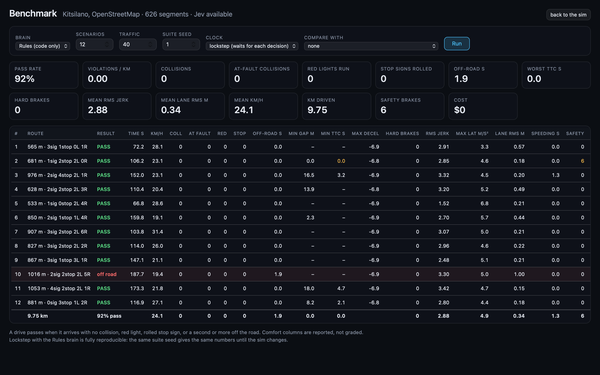

# Benchmarks and validation



Open [/bench](http://127.0.0.1:8322/bench), or use **Benchmark this city** in the explorer.
The benchmark runs seeded drives through the same simulation and autopilot without graphics.
**Lockstep** pauses while decisions are pending; **realtime** keeps the world moving so model
latency affects the drive. Runs save under `data/runs/`, support side-by-side comparison and
open as 3D replays on their recorded map.

A benchmark drive passes only if it arrives with no collision, red light, rolled stop or failed
yield, and less than one second off-road. A car arrives within 3.5 m of its destination, or
within 10 m, stopped on its route and in the route's lane, when every manoeuvre along that lane
that would get it closer hits a parked car or static scenery. It also reports comfort, lane keeping (measured from
the centre of the lane the car is in or moving into), lane changes, fault, safety
brakes, gaps, tokens, cost and latency. This pass criterion is separate from the live coach's
weighted score.

**Scores and held-out routes.** So that two drivers that both pass can still be ranked, the table, the
arena and the Node scripts also show each drive's progress, pace, comfort, margin kept and time lost
and a combined score, computed from the saved fields when shown (`bench/scores.js`). The **held-out
routes** box (`--heldout 1` in `bench_node.mjs` and `soak.mjs`) runs routes no fix was tuned against,
reported apart. Formulas and the held-out policy are in the [Rules baseline](../rules-baseline.md).

**Guarded and open tracks.** By default (the **guarded** track) the shared safety filter removes every
manoeuvre that fails a collision or road-rule check, so a driver only chooses among those left, and a
pass says more about the filter than the driver ([ROADMAP 4.1](../../ROADMAP.md#phase-4-a-benchmark-that-separates-drivers)).
On the **open** track (`track: "open"`; `--track open` in `bench_node.mjs` and `arena_node.mjs`, the
*track* box on `/bench` and in the arena) the filter advises instead: a manoeuvre that fails a road-rule
check stays on offer, flagged with the check, and the driver's own judgment decides the outcome, which
the audit judges as on any track (`brain/tracks.js`). A predicted collision is still removed, and the
emergency brake still brakes for one about to happen. Models are told so: the vector question's
instructions and the LLM system prompt say that only collisions were checked, and a flagged manoeuvre's
`outcome` reads `flagged: <the rule it breaks>`. Rules and the built-in agents keep to the unflagged
manoeuvres and brake where none is left, so they drive the open track exactly as the guarded one, and
remain the reference (`scripts/test_open_track.mjs`). An open-track result adds `track: "open"`,
`flagged_choices` (how often the car went on with a flagged manoeuvre) and `flagged_by_check`; a
guarded result and config are as before. A model recording keeps its track and replays on it.

**Who made the decisions.** A model can pass a drive that Rules mostly drove: many decisions need
no question and are answered locally, and a timeout or an unusable answer falls back to Rules.
So every driver but Rules also reports, per drive, where its decisions came from, counted by the
autopilot as it applies each one (`Autopilot.decidedBy`):

| Field | Meaning |
|---|---|
| `model_decisions` | The driver's own answer was used (for the cautious starter, the agent itself) |
| `partial_decisions` | Of those, answers that left a route or headlight question it was asked to the default (the first route option, the beam sensing allows) |
| `local_decisions` | Nothing needed asking, so the decision was made locally with no call; also the hard brake when no manoeuvre is eligible |
| `fallback_decisions` | Rules decided instead: a timeout, an error, an unusable answer, or a vector outside the eligible set replaced by the Rules choice |
| `model_share`, `local_share`, `fallback_share` | Each count over `decisions` (model + local + fallback), to 0.001; `null` with no decisions |

A Rules drive reports none of these, so its results stay field-for-field as before and earlier
records compare. `aggregate()` sums the counts over the drives that report them and gives the
suite's overall shares; the benchmark table shows the model and local shares per route and the
summary cards the three shares. The arena shows them in each result row, its details and each
driver's summary; the drive report and the Inspect drawer show them for an AI drive.

Recorded validation includes a 500 m Rules drive through Victoria in rain with no audited
collision, red-light, stop or yield violations and a score of 97. The
[2026-10-20 Rules baseline](../rules-baseline.md) is the current seeded record. In WebKit, the
12-route Kitsilano suite passed 12/12 dry, 11/12 fog, 12/12 rain and 12/12 snow, and every route
arrived; all eleven two-route city smoke suites passed. In V8 every Kitsilano route passed and
Edmonton's smoke suite failed one route.
Results vary between JavaScript engines, so compare runs from the same browser. These are
individual recorded checks, not guarantees for every city or seed. Live Jev behaviour with the revised prompt has
not been validated; offline fixtures establish request consistency, not model judgment.

Detailed results: [Rules benchmark baseline](../rules-baseline.md), [drive experience](../drive-experience.md),
[realism validation](../realism-validation.md) and [rendering validation](../render-performance.md). Release history is in [CHANGELOG.md](../../CHANGELOG.md).
The [world expansion validation](../world-validation.md) records the new maps, physical building
collisions, darkness, startup reliability and final seeded comparisons.

## Benchmark internals

The project notes on the benchmark code, moved here verbatim from `AGENTS.md`, which keeps a summary.

**Benchmark** (`static/js/bench/`): `scenarios.buildSuite` (seeded, routes via `/api/route`), `runner.runScenario` / `setupScenario` (also used by the app's `/?replay=1`), and `metrics.DriveMetrics`. Pass/fail rules live in `failures()` (collisions, red lights, stop signs, failures to yield, off road). Who made the decisions is counted in the autopilot (`Autopilot.decidedBy`, classified where `fire` applies each decision) and reported by `decidedBy` in `metrics.js` for every driver but Rules (`model_decisions`, `partial_decisions`, `local_decisions`, `fallback_decisions` and their shares); Rules results never get these fields, so earlier records compare. Bench runs take a `weather` option. They also take `features`: `bare` (the default: every opt-in feature off, so earlier records compare) or `city` (the free drive's features from `freeDriveOptions` in `sim/free-drive.js`, without parking at the destination, on the app's 15:30 Monday clock, with routes that keep to turn restrictions). `freeDriveOptions` is the one definition of a free drive: the app builds its world from it, so a new opt-in feature is added there, never inline in `main.js` (`scripts/test_free_drive.mjs` checks every `World` option is in it). `node --experimental-default-type=module scripts/bench_node.mjs --features city` runs the city suite. A drive's deadline is its route length at 2.5 m/s (divided by the weather's speed for city snow); when a road closure re-plans the route (`autopilot.closureRouting`), it becomes the distance driven plus the new route at the same pace, while other re-plans keep theirs. Both presets accept `--park 1` (the challenge parking verdict, except that an arrival with no space ever planned near the destination, where the car stops in its lane as a free drive does, records `no_space` and is no failure; a space given up still fails) and `--hour 23.5` (local Monday time, including darkness and time-dependent populations); defaults keep earlier records unchanged. City accepts `--without geese,ice` (World/fleet option names) and `--cover 0` through `12`, the seeded binary pairwise array in `bench/features.js`, including destination parking and respecting `stepOuts`/`hazards`. `scripts/soak.mjs --port 8381 --maps kitsilano,toronto,calgary,victoria --seeds 1,2,3 --count 2 --shard 0 --shards 8 --json soak.json` runs city map/seed samples plus all covering rows on the first map/seed; `--mode city` or `pairs` selects one part. Throws, deadlocks/timeouts and collisions fail it; other audits are reported separately while city triage is open. `.github/workflows/soak.yml` runs the eight shards and four parking/night suites weekly and manually, report-only, on Namespace; its `Soak summary` job (`scripts/soak_summary.py`) lists each leg's failed routes in the run summary and as warning annotations, since the run itself stays green. Runs are stored by `server.py` under `data/runs/`, which is gitignored, so a baseline has to be added with `git add -f`. Model recordings (`static/js/brain/recording.js`: `bench_node.mjs --record PATH` / `--replay PATH`, `window.__bench.run({ record | replay })`, the `tape` option of `runScenario` and `evaluateChallenge`, lockstep only) wrap a model brain's `transport` and are saved under `data/recordings/`, which is committed; with no tape every result is exactly as before.

## Inspect a saved benchmark

Run these commands from the repository root. The inspector reads saved benchmark JSON and prints JSON to standard output. It works offline with Python 3.10 or newer.

```sh
uv run python scripts/inspect_run.py --list
uv run python scripts/inspect_run.py data/runs/20261120-120000-rules.json suite-verdicts safety-collisions motion-following-gap
```

Omit the report IDs to run all 100 reports. The catalog describes each question. Use the suite reports for verdicts, route geometry and retained events, safety reports for measured traffic audits, motion reports for route rankings, and decision reports for model attribution and resource use. Missing or unmeasured feature counters carry different information from a measured zero. Event analyses use the first 50 retained events per route. Use the benchmark's separate summary for held-out suites.

Add `--compare` to run the selected reports side by side. This compares two Winnipeg runs and shows that `s1-1` stopped failing to yield.

```sh
uv run python scripts/inspect_run.py data/runs/20261112-190015-rules.json \
  --compare data/runs/20261120-120000-rules.json suite-verdicts safety-yields motion-duration
```

The first file is the baseline. Both files need the same map, pack version, seed, requested suite size and route restriction settings. The comparison uses the route ID and saved lengths and counts of lights, stops and turns as a proxy for route identity. It lists routes exclusive to either file and routes with changed or missing tags. Each report uses the matched routes in baseline order. The output shows the run settings and any changes in saved verdicts, arrivals or known failure reasons.
