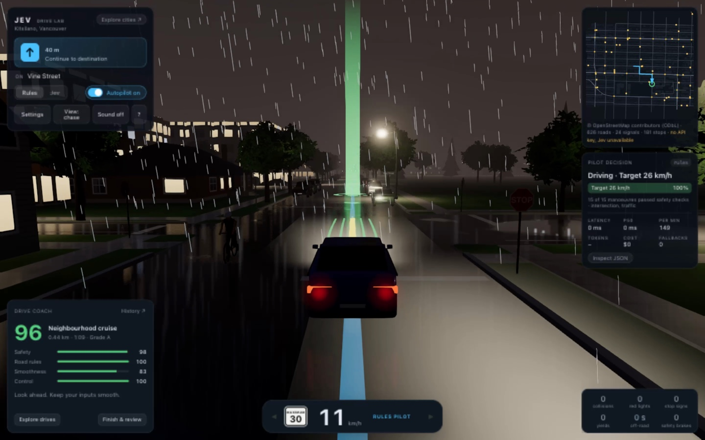

# Graphics and recent rendering fixes

The sky draws a drifting procedural cloud deck. Each cloud is lit from the sun's side, with a
silver rim near the sun. Coverage follows the weather: scattered fair-weather cumulus when dry and
a continuous low deck in rain or snow; fog hides it. At dusk the clouds take the sun's colour, and
at night they reflect the city's glow. Wet roads and car paint reflect the same clouds through the
environment map.

On High and Ultra, a grade pass after tone mapping sets contrast, saturation, a time-of-day tint
(warm at golden hour, cool at night) and a soft vignette. It also adds a ±½-step dither that removes
8-bit banding in smooth sky gradients.

The **cinematic** camera cuts automatically between five shots: a roadside camera the car sweeps
past, a low bumper chase, a slow helicopter orbit, a tracking shot from ahead and a wheel-height
side profile. **Photo mode** (`O`) pauses the world and hides the HUD. You can frame the car with
the free, cinematic, chase or hood camera. Sliders set exposure (±2 EV), contrast, saturation,
vignette and time of day. **Save photo** downloads the rendered frame as a PNG at the canvas
resolution; the controls are never included. Leaving photo mode restores the previous camera,
the default look and the previous pause state.

Parked cars and trees use distance-based detail to reduce distant geometry. Nearby scenery
retains detailed meshes and shadows, while hysteresis prevents repeated detail switches around
the distance threshold. Static scenery transforms are computed once.

Road layers share a stable ground depth. Wet reflections no longer sample their own render
target, and reflection and main passes share the same shadow maps and scenery detail within
each frame. These changes address road flicker, inconsistent shadows and wet-rendering errors.

Street-name and speed-limit signs use correctly proportioned printed rectangles, bolder street
lettering, padded atlas cells and up to 8× anisotropic filtering. Text reads correctly from
both sides. The signs keep their shared 2048² atlas and batched meshes. Driving instruments,
the drive coach, incident panel and windshield trim are opaque, and persistent HUD panels
avoid backdrop blur, so green scenery cannot bleed through the opaque surfaces.

HUD text and statistics refresh at most 10 times per second and skip unchanged DOM writes.
The decision card rebuilds only when a decision or autopilot state changes. These changes
reduce DOM work while physics and pilot decisions keep their existing cadence.

| Preset | Rendering |
|---|---|
| Low | Direct rendering at 1× pixel ratio, 2048 shadows, no post-processing or wet reflections |
| High | 1× pixel ratio, 2048 shadows, bloom, SMAA and quarter-size wet reflections |
| Ultra | Up to 2× pixel ratio, 4096 shadows, ambient occlusion and half-size wet reflections |

High is the default. URL options also work, for example
[Victoria in rain at night](http://127.0.0.1:8322/?map=victoria&weather=rain&time=night&quality=high).
Time accepts presets or a clock value such as `?time=17:45`.

Measured GPU work fell in the recorded rendering comparisons, but the high preset also uses
fewer pixels and effects than the earlier version. Those measurements do not establish a
frame-rate guarantee or an equal-quality speedup. See [rendering measurements, tradeoffs and
profiling instructions](../render-performance.md).
