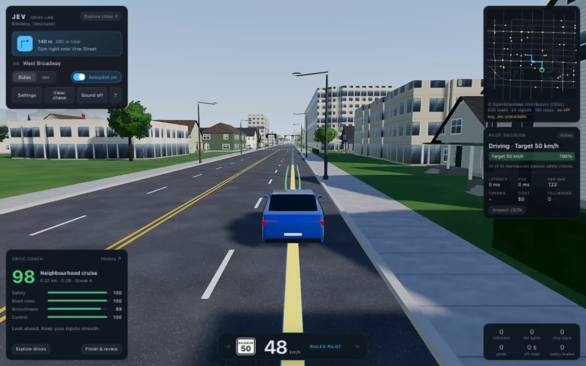

# Overview and quick start

**Drive real Canadian streets, watch an AI choose its next move, and improve your driving score.**

Jev FSD is a local driving simulator built from [OpenStreetMap](https://www.openstreetmap.org/)
roads and buildings. Explore twelve neighbourhoods across eleven Canadian cities by hand, with the free
Rules driver, or with [TypeSafe AI's Jev](https://typesafe.ai/). The decision panel shows the
situation, available manoeuvres, model probabilities, latency and API cost.

Choose a suggested route, take the wheel, and review your drive for safety, road rules,
smoothness and control. Traffic parks and pulls out, car doors open, pedestrians cross, and
weather changes both visibility and grip. The driving HUD keeps turn guidance, speed, live
coaching and the pilot's latest decision visible while you drive.



> This is a research and demo simulator, not a system for controlling a real vehicle. The project
> is independent and is not affiliated with or endorsed by TypeSafe AI.

## Quick start

Install [uv](https://docs.astral.sh/uv/) and use a modern browser with WebGL (keyboard, on-screen
touch controls and gamepads are supported). The app needs
Python 3.10 or newer; `uv` manages Python and the project dependency.

```sh
git clone https://github.com/BrendanH18/jev_fsd
cd jev_fsd
uv run server.py
```

Open [127.0.0.1:8322](http://127.0.0.1:8322). Without an API key, the app selects the free Rules
driver. There is no frontend build step; the simulation and renderer use JavaScript and Three.js,
and the local server uses Python. The pinned Three.js runtime and all twelve map packs are bundled,
so driving with Rules needs no external network after installing the Python dependencies.

Try **Explore cities → Victoria → Neighbourhood cruise**. A suggested drive starts the selected
autopilot; `W A S D`, touch controls or a gamepad takes over manually
([controls](drive-coach-and-hud.md#controls-and-driving-feel)). You can also click a destination on
the minimap or start a free drive directly. Cycle **View** to hood view and enable **Sound** for
driving ambience. Open **Settings** to change weather, time, traffic, garage vehicle and graphics,
or press `?` for keyboard help.

To enable Jev, get a key from the [TypeSafe console](https://console.typesafe.ai). Open
**Decision ▾ → Connect a decision model…**, choose **TypeSafe**, paste the key and keep the
preselected model. Click **Save and drive**. The local server saves the key and sends Jev's
decision requests to TypeSafe. To connect another driver, see [Connecting a model](../../README.md#connecting-a-model).

## Explore twelve Canadian neighbourhoods

The city picker includes neighbourhood-sized extracts of real roads, one-way streets, lane
and speed-limit tags, traffic controls and buildings. All twelve processed map packs are bundled.
Search by city or neighbourhood, and filter by region and road character. The explorer keeps
your search and keyboard focus while loading maps or finding routes, and offers retries on errors.

| City | Neighbourhood | Direct simulator URL |
|---|---|---|
| Vancouver | Kitsilano | [/?map=kitsilano](http://127.0.0.1:8322/?map=kitsilano) |
| Vancouver | Mount Pleasant | [/?map=mount_pleasant](http://127.0.0.1:8322/?map=mount_pleasant) |
| Victoria | Old Town | [/?map=victoria](http://127.0.0.1:8322/?map=victoria) |
| Toronto | The Annex | [/?map=toronto](http://127.0.0.1:8322/?map=toronto) |
| Montréal | Le Plateau | [/?map=montreal](http://127.0.0.1:8322/?map=montreal) |
| Calgary | Beltline | [/?map=calgary](http://127.0.0.1:8322/?map=calgary) |
| Ottawa | Centretown | [/?map=ottawa](http://127.0.0.1:8322/?map=ottawa) |
| Québec City | Saint-Roch | [/?map=quebec_city](http://127.0.0.1:8322/?map=quebec_city) |
| Halifax | Downtown | [/?map=halifax](http://127.0.0.1:8322/?map=halifax) |
| Winnipeg | Exchange District | [/?map=winnipeg](http://127.0.0.1:8322/?map=winnipeg) |
| Edmonton | Old Strathcona | [/?map=edmonton](http://127.0.0.1:8322/?map=edmonton) |
| Saskatoon | Downtown & Nutana | [/?map=saskatoon](http://127.0.0.1:8322/?map=saskatoon) |

**Explore cities** offers three reachable drives from your current position: **Neighbourhood
cruise**, **City precision** and **The long way home**. The world pauses while choosing a route
or reading a drive report. Changing cities keeps your weather, time and graphics settings.
Routing, rerouting, benchmarks and 3D benchmark replays use the selected city's map.

The sun uses each city's latitude, longitude and late-September daylight-time offset.
Vancouver's mountains, water and landmark backdrop appear only on Vancouver maps. These packs
have no elevation data; building heights come from tags or procedural estimates.
See [map coverage, attribution and refresh instructions](../maps.md).

**Settings** includes a six-car garage, six paint colours, traffic-car density, a repeatable world
seed and **Start new world**. Choose a city hatch, touring sedan, sport coupe, estate wagon,
trail SUV or utility pickup; start a new world to apply your selection. Each driven model has
its own dimensions, mass, wheel power, drive layout and centre of gravity. Collision checks,
stopping distances, candidate predictions and cameras use the selected vehicle. Vehicle names
and specifications describe generic simulated cars.
Changing density or seed restarts the world and saves a non-empty active drive. A quiet world
still has cyclists, pedestrians and curb activity. URL options include `?traffic=16&seed=42`.
The daylight clock can remain fixed, run in real time or advance one minute per simulated second
(`?clock=0`, `1` or `60`). Pausing also pauses daylight. The conditions strip shows local time,
weather and forward sight range, with a visible Pause/Resume button.

## Credits and license

- Map data © [OpenStreetMap contributors](https://www.openstreetmap.org/copyright), under the
  [Open Database License](https://opendatacommons.org/licenses/odbl/1-0/).
- Rendering by [Three.js](https://threejs.org/) (MIT).
- Jev and TypeSafe are products of TypeSafe AI; this project is independent.
- Inspired by [JevPilot](https://github.com/standardagents/jevpilot).

Released under the [MIT License](../../LICENSE).
